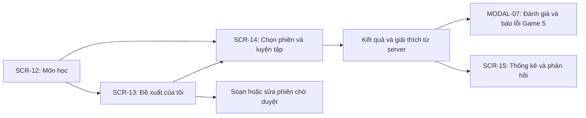

# Zone 3: Học tập và ngân hàng câu hỏi

Triển khai theo [tài liệu màn hình](../t_i_li_u_to_n_di_n_s_lu_ng_m_n_h_nh_mermaid_code.md) và UC17, UC19, UC21, UC22, UC26 trong [requirements.md](../requirements.md).

## Điều hướng

## Giao diện và dữ liệu

- Bố cục ba cột: điều hướng học tập, luồng thẻ nội dung, hướng dẫn ngữ cảnh. Trên điện thoại, điều hướng chuyển thành thanh ngang.
- Danh mục môn, môn đã ghi danh, đề xuất, câu hỏi và thống kê lấy qua service cùng TanStack Query. Không thay lỗi API bằng dữ liệu mẫu.
- Bộ lọc đề xuất, môn học, tìm kiếm và câu hỏi hiện tại nằm trong URL. Danh sách phiên hỗ trợ phân trang con trỏ.
- Hộp soạn thảo giữ nội dung khi gửi thất bại. Danh sách lớp lấy từ `/sessions/my-enrolled-course-classes`, chỉ cho phép chọn lớp có `can_propose=true` và gửi `course_class_id` theo OpenAPI hiện tại. Sửa/hủy chỉ mở khi xác định trạng thái PENDING; xóa yêu cầu xác nhận.
- Backend đang thiếu trường trạng thái trong generated DTO danh sách phiên. Giao diện chỉ dùng trạng thái từ phản hồi thực tế; không suy ra quyền sửa/hủy từ bộ lọc URL và không mặc định phiên là PENDING.
- API hiện có chỉ liệt kê phiên của người dùng. Trang luyện tập dùng danh sách đó và hỗ trợ đường dẫn phiên được chia sẻ; không tự tạo endpoint liệt kê toàn bộ ngân hàng theo môn.
- Trang phân tích lấy nội dung câu hỏi từ phiên khi URL có sessionId. Khi mở trực tiếp không có ngữ cảnh phiên, chỉ hiển thị mã câu hỏi và số liệu thật.
- Luồng giảng viên duyệt báo lỗi thuộc Zone 5; Zone 3 gửi báo lỗi qua API đánh giá câu hỏi.

## Mã nguồn

- [AcademicLayout.tsx](../src/components/academic/AcademicLayout.tsx)
- [SubjectsPage.tsx](../src/pages/subjects/SubjectsPage.tsx)
- [ProposalsPage.tsx](../src/pages/proposals/ProposalsPage.tsx)
- [PracticePage.tsx](../src/pages/practice/PracticePage.tsx)
- [QuestionAnalyticsPage.tsx](../src/pages/questions/QuestionAnalyticsPage.tsx)
- [useAcademicQuery.ts](../src/hooks/queries/useAcademicQuery.ts)
