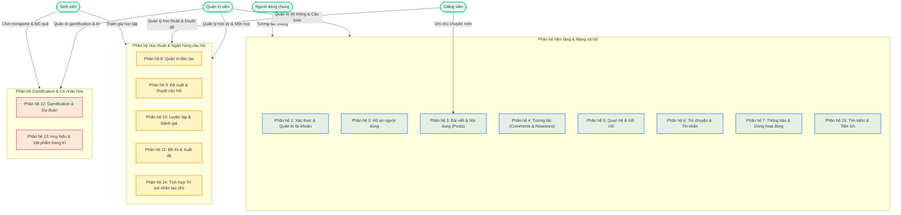

# TÀI LIỆU ĐẶC TẢ USE CASE HỆ THỐNG SQB (HUST)

> **Hệ thống Mạng xã hội Ngân hàng Câu hỏi do Sinh viên Khởi tạo (Social Network for Student-Generated Question Bank - SQB HUST)**  
> *Tài liệu đặc tả yêu cầu chức năng nghiệp vụ, kịch bản tương tác và ánh xạ API backend.*

---

## 1. THÔNG TIN HỆ THỐNG & TRUY CẬP NHANH

| Mục | Thông tin / Đường dẫn |
| :--- | :--- |
| **Link Swagger UI** | [https://snsqb.duckdns.org/api/v1/swagger-ui/index.html](https://snsqb.duckdns.org/api/v1/swagger-ui/index.html) |
| **Backend API Base URL** | `https://snsqb.duckdns.org/api/v1/` |
| **Môi trường triển khai** | Development & Staging Server |

### Tài khoản thử nghiệm được cấp:
```yaml
user:       an.lt235631@sis.hust.edu.vn
password:   20235631
```

---

## 2. SƠ ĐỒ PHÂN HỆ VÀ TÁC NHÂN HỆ THỐNG



---

## 3. BẢNG MA TRẬN PHÂN HỆ VÀ TÁC NHÂN (USE CASE MATRIX)

| Phân hệ | Danh sách Use Case | Sinh viên | Giảng viên | Quản trị viên | Người dùng chung |
| :--- | :--- | :---: | :---: | :---: | :---: |
| **Phân hệ 1** | UC01, UC02, UC03 | - | - | ✓ | ✓ |
| **Phân hệ 2** | UC04 | ✓ | ✓ | ✓ | ✓ |
| **Phân hệ 3** | UC05, UC06 | ✓ | ✓ | - | ✓ |
| **Phân hệ 4** | UC07, UC08 | ✓ | ✓ | - | ✓ |
| **Phân hệ 5** | UC09, UC10 | ✓ | ✓ | - | ✓ |
| **Phân hệ 6** | UC11, UC12, UC13 | ✓ | ✓ | ✓ | ✓ |
| **Phân hệ 7** | UC14, UC15 | ✓ | ✓ | ✓ | ✓ |
| **Phân hệ 8** | UC16, UC17, UC18 | ✓ | ✓ | ✓ | ✓ |
| **Phân hệ 9** | UC19, UC20 | ✓ | ✓ | ✓ | - |
| **Phân hệ 10** | UC21, UC22 | ✓ | - | - | ✓ |
| **Phân hệ 11** | UC23, UC24 | - | ✓ | - | - |
| **Phân hệ 12** | UC25, UC26 | ✓ | ✓ (Game 5) | ✓ | - |
| **Phân hệ 13** | UC27, UC28 | ✓ | ✓ | ✓ | ✓ |
| **Phân hệ 14** | UC29 | - | ✓ | ✓ | - |
| **Phân hệ 15** | UC30, UC31, UC32, UC33 | ✓ | ✓ | ✓ | ✓ |

---

## 4. MỤC LỤC ĐIỀU HƯỚNG

- [Phân hệ 1: Xác thực & Quản trị tài khoản](#phan-he-1-xac-thuc--quan-tri-tai-khoan)
  - [UC01: Đăng nhập hệ thống](#uc01-dang-nhap-he-thong)
  - [UC02: Quản trị viên tạo tài khoản & Kích hoạt qua OTP](#uc02-quan-tri-vien-tao-tai-khoan--kich-hoat-qua-otp)
  - [UC03: Nhập tài khoản hàng loạt (Bulk Import)](#uc03-nhap-tai-khoan-hang-loat-bulk-import)
- [Phân hệ 2: Hồ sơ người dùng](#phan-he-2-ho-so-nguoi-dung)
  - [UC04: Quản lý hồ sơ cá nhân](#uc04-quan-ly-ho-so-ca-nhan)
- [Phân hệ 3: Bài viết & Nội dung (Posts)](#phan-he-3-bai-viet--noi-dung-posts)
  - [UC05: Đăng bài viết mới](#uc05-dang-bai-viet-moi)
  - [UC06: Giảng viên cập nhật ghi chú chuyên môn](#uc06-giang-vien-cap-nhat-ghi-chu-chuyen-mon)
- [Phân hệ 4: Tương tác (Comments & Reactions)](#phan-he-4-tuong-tac-comments--reactions)
  - [UC07: Bình luận trên bài viết](#uc07-binh-luan-tren-bai-viet)
  - [UC08: Thả / Bỏ cảm xúc (Reactions)](#uc08-tha--bo-cam-xuc-reactions)
- [Phân hệ 5: Quan hệ & Kết nối (Friendships, Follows, Blocks)](#phan-he-5-quan-he--ket-noi-friendships-follows-blocks)
  - [UC09: Quản lý mối quan hệ Bạn bè (Friendships)](#uc09-quan-ly-moi-quan-he-ban-be-friendships)
  - [UC10: Chặn người dùng (Blocks)](#uc10-chan-nguoi-dung-blocks)
- [Phân hệ 6: Trò chuyện & Tin nhắn (Conversations & Messages)](#phan-he-6-tro-chuyen--tin-nhan-conversations--messages)
  - [UC11: Trò chuyện trực tiếp & Nhóm chat](#uc11-tro-chuyen-truc-tiep--nhom-chat)
  - [UC12: Quản trị nhóm chat](#uc12-quan-tri-nhom-chat)
  - [UC13: Quản lý kho hội thoại ẩn bằng mã PIN](#uc13-quan-ly-kho-hoi-thoai-an-bang-ma-pin)
- [Phân hệ 7: Thông báo & Dòng hoạt động (Notifications & Activity Feed)](#phan-he-7-thong-bao--dong-hoat-dong-notifications--activity-feed)
  - [UC14: Quản lý thông báo](#uc14-quan-ly-thong-bao)
  - [UC15: Xem dòng hoạt động (Activity Feed)](#uc15-xem-dong-hoat-dong-activity-feed)
- [Phân hệ 8: Quản trị đào tạo (Học kỳ, Môn học, Lớp học phần)](#phan-he-8-quan-tri-dao-tao-hoc-ky-mon-hoc-lop-hoc-phan)
  - [UC16: Quản lý học kỳ (Semesters)](#uc16-quan-ly-hoc-ky-semesters)
  - [UC17: Quản trị danh mục môn học (Subjects)](#uc17-quan-tri-danh-muc-mon-hoc-subjects)
  - [UC18: Quản lý lớp học phần (Course Classes)](#uc18-quan-ly-lop-hoc-phan-course-classes)
- [Phân hệ 9: Đề xuất và duyệt câu hỏi (Question Sessions & Review)](#phan-he-9-de-xuat-va-duyet-cau-hoi-question-sessions--review)
  - [UC19: Quản lý phiên đề xuất câu hỏi trắc nghiệm (Sessions)](#uc19-quan-ly-phien-de-xuat-cau-hoi-trac-nghiem-sessions)
  - [UC20: Thẩm định và duyệt câu hỏi (Question Review)](#uc20-tham-dinh-va-duyet-cau-hoi-question-review)
- [Phân hệ 10: Luyện tập & Đánh giá câu hỏi (Question Interaction)](#phan-he-10-luyen-tap--danh-gia-cau-hoi-question-interaction)
  - [UC21: Luyện tập và nộp câu trả lời](#uc21-luyen-tap-va-nop-cau-tra-loi)
  - [UC22: Đánh giá chất lượng câu hỏi](#uc22-danh-gia-chat-luong-cau-hoi)
- [Phân hệ 11: Đề thi & Xuất đề (Exams)](#phan-he-11-de-thi--xuat-de-exams)
  - [UC23: Quản lý và tạo đề thi tự động](#uc23-quan-ly-va-tao-de-thi-tu-dong)
  - [UC24: Xuất đề thi và ngân hàng câu hỏi](#uc24-xuat-de-thi-va-ngan-hang-cau-hoi)
- [Phân hệ 12: Gamification & Dự đoán học thuật (Minigames)](#phan-he-12-gamification--du-doan-hoc-thuat-minigames)
  - [UC25: Điểm danh chuyên cần và Bảng xếp hạng](#uc25-diem-danh-chuyen-can-va-bang-xep-hang)
  - [UC26: Tham gia Minigame dự đoán học thuật](#uc26-tham-gia-minigame-du-doan-hoc-thuat)
- [Phân hệ 13: Huy hiệu & Vật phẩm trang trí (Badges & Cosmetics)](#phan-he-13-huy-hieu--vat-pham-trang-tri-badges--cosmetics)
  - [UC27: Quản lý và Cấp phát huy hiệu danh hiệu](#uc27-quan-ly-va-cap-phat-huy-hieu-danh-hieu)
  - [UC28: Cửa hàng và Trang bị vật phẩm cá nhân hóa](#uc28-cua-hang-va-trang-bi-vat-pham-ca-nhan-hoa)
- [Phân hệ 14: Tích hợp trí tuệ nhân tạo (AI Integration)](#phan-he-14-tich-hop-tri-tue-nhan-tao-ai-integration)
  - [UC29: Trợ lý AI và Tinh chỉnh câu hỏi học thuật](#uc29-tro-ly-ai-va-tinh-chinh-cau-hoi-hoc-thuat)
- [Phân hệ 15: Tìm kiếm, Báo cáo & Tiện ích hệ thống](#phan-he-15-tim-kiem-bao-cao--tien-ich-he-thong)
  - [UC30: Tìm kiếm toàn văn (Full-Text Search)](#uc30-tim-kiem-toan-van-full-text-search)
  - [UC31: Gửi báo cáo vi phạm (Reports)](#uc31-gui-bao-cao-vi-pham-reports)
  - [UC32: Tải lên tệp và hình ảnh (Cloudflare R2 Media)](#uc32-tai-len-tep-va-hinh-anh-cloudflare-r2-media)
  - [UC33: Quản lý thiết bị đăng nhập và Phiên làm việc (Devices)](#uc33-quan-ly-thiet-bi-dang-nhap-va-phien-lam-viec-devices)

---

## PHÂN HỆ 1: XÁC THỰC & QUẢN TRỊ TÀI KHOẢN

### UC01: Đăng nhập hệ thống

| Thuộc tính | Chi tiết |
| :--- | :--- |
| **Mã Use Case** | `UC-AUTH-01` |
| **Tên Use Case** | Đăng nhập hệ thống |
| **Tác nhân (Actor)** | Người dùng |
| **Điều kiện tiên quyết (Pre-conditions)** | Người dùng đã có tài khoản và tài khoản đã được kích hoạt. |
| **Điều kiện sau (Post-conditions)** | Hệ thống trả về phiên đăng nhập hợp lệ (Access Token), người dùng truy cập được vào trang chủ tương ứng với vai trò của mình. |
| **API liên quan** | `POST /auth/login`, `POST /auth/refresh` |

**Mô tả:**  
Cho phép người dùng đăng nhập vào hệ thống bằng tài khoản được cấp để nhận token xác thực (Access Token & Refresh Token).

**Luồng sự kiện chính (Main Flow):**
1. Người dùng truy cập trang Đăng nhập và điền thông tin đăng nhập (Tên đăng nhập/Email, Mật khẩu).
2. Người dùng nhấn nút **"Đăng nhập"**.
3. Hệ thống gửi yêu cầu xác thực (`POST /auth/login`).
4. Hệ thống kiểm tra tính chính xác của thông tin đăng nhập:
   - Kiểm tra tài khoản tồn tại và khớp mật khẩu đã mã hóa.
   - Kiểm tra trạng thái tài khoản (đã kích hoạt, không bị khóa).
5. Hệ thống tạo cặp token (Access Token, Refresh Token), lưu phiên làm việc và phản hồi thành công.
6. Giao diện lưu token và chuyển hướng người dùng đến trang chính.

**Luồng thay thế / Ngoại lệ (Alternative / Exception Flows):**
- **E1 (Sai thông tin đăng nhập):** Tên đăng nhập hoặc mật khẩu không đúng. Hệ thống thông báo lỗi *"Thông tin tài khoản hoặc mật khẩu không chính xác"*, cho phép người dùng nhập lại.
- **E2 (Tài khoản chưa kích hoạt):** Hệ thống thông báo tài khoản chưa được kích hoạt và yêu cầu liên hệ Quản trị viên/xác thực mã OTP.
- **A1 (Gia hạn token ngầm):** Token hết hạn trong phiên sử dụng. Client ngầm gửi `POST /auth/refresh` kèm Refresh Token để gia hạn phiên làm việc mà không làm gián đoạn trải nghiệm của người dùng.

---

### UC02: Quản trị viên tạo tài khoản & Kích hoạt qua OTP

| Thuộc tính | Chi tiết |
| :--- | :--- |
| **Mã Use Case** | `UC-AUTH-02` |
| **Tên Use Case** | Tạo tài khoản và kích hoạt qua OTP |
| **Tác nhân (Actor)** | Quản trị viên (Admin) |
| **Điều kiện tiên quyết** | Admin đã đăng nhập hệ thống với quyền Quản trị viên. |
| **Điều kiện sau** | Tài khoản mới được tạo; sau khi xác thực OTP thành công thì tài khoản chuyển sang trạng thái kích hoạt (`ACTIVE`). |
| **API liên quan** | `POST /auth/admin/register`, `POST /auth/admin/verify`, `POST /auth/admin/resend-verify` |

**Mô tả:**  
Admin đăng ký tài khoản mới cho người dùng (sinh viên, giảng viên) trong hệ thống, hệ thống gửi mã OTP để kích hoạt tài khoản.

**Luồng sự kiện chính (Main Flow):**
1. Admin mở màn hình **"Thêm mới tài khoản"**, nhập thông tin cơ bản (họ tên, email, vai trò: sinh viên/giảng viên, mật khẩu khởi tạo).
2. Admin bấm **"Đăng ký"** (`POST /auth/admin/register`).
3. Hệ thống lưu tài khoản với trạng thái `PENDING_VERIFY`, đồng thời tạo mã OTP và gửi về email của người dùng.
4. Admin hoặc người dùng nhập mã OTP được gửi vào biểu mẫu xác thực (`POST /auth/admin/verify`).
5. Hệ thống đối chiếu mã OTP: nếu khớp và còn hiệu lực, cập nhật trạng thái tài khoản thành `ACTIVE`.

**Luồng thay thế / Ngoại lệ:**
- **E1 (Email đã tồn tại - 409 Conflict):** Hệ thống thông báo lỗi trùng lặp email.
- **E2 (Mã OTP sai hoặc hết hạn - 400 Bad Request):** Hệ thống báo lỗi. Admin/User có thể nhấn **"Gửi lại OTP"** (`POST /auth/admin/resend-verify`) để hệ thống tạo và gửi lại mã mới.

---

### UC03: Nhập tài khoản hàng loạt (Bulk Import)

| Thuộc tính | Chi tiết |
| :--- | :--- |
| **Mã Use Case** | `UC-AUTH-03` |
| **Tên Use Case** | Tạo tài khoản người dùng hàng loạt |
| **Tác nhân (Actor)** | Quản trị viên (Admin) |
| **Điều kiện tiên quyết** | Admin đã đăng nhập với vai trò Quản trị viên. |
| **Điều kiện sau** | Các tài khoản hợp lệ được lưu vào CSDL, hệ thống trả về báo cáo kết quả import (thành công/thất bại theo từng dòng). |
| **API liên quan** | `POST /admin/users/import` *(hoặc API upload file danh sách người dùng)* |

**Mô tả:**  
Cho phép Admin tải lên file danh sách để khởi tạo hàng loạt tài khoản người dùng cùng lúc.

**Luồng sự kiện chính (Main Flow):**
1. Admin truy cập màn hình **Nhập dữ liệu người dùng**.
2. Admin chọn file danh sách tài khoản theo mẫu quy định (Excel/CSV) và bấm **"Tải lên"**.
3. Hệ thống đọc file, validate cấu trúc và kiểm tra tính hợp lệ của từng bản ghi dữ liệu.
4. Hệ thống tiến hành tạo các bản ghi tài khoản hợp lệ vào cơ sở dữ liệu.
5. Hệ thống phản hồi số lượng bản ghi tạo thành công và danh sách lỗi chi tiết nếu có.

---

## PHÂN HỆ 2: HỒ SƠ NGƯỜI DÙNG

### UC04: Quản lý hồ sơ cá nhân

| Thuộc tính | Chi tiết |
| :--- | :--- |
| **Mã Use Case** | `UC-USER-01` |
| **Tên Use Case** | Quản lý hồ sơ cá nhân |
| **Tác nhân (Actor)** | Người dùng đã đăng nhập |
| **Điều kiện tiên quyết** | Người dùng đã đăng nhập vào hệ thống. |
| **Điều kiện sau** | Dữ liệu hồ sơ cá nhân được cập nhật hiển thị mới nhất trên hệ thống. |
| **API liên quan** | `GET /users/me`, `PUT /users/me`, `DELETE /users/me` |

**Mô tả:**  
Cho phép người dùng xem, cập nhật thông tin cá nhân hoặc yêu cầu xóa/hủy kích hoạt hồ sơ cá nhân của mình.

**Luồng sự kiện chính (Main Flow):**
1. Người dùng chọn mục **"Hồ sơ của tôi"**.
2. Giao diện gọi `GET /users/me` để lấy thông tin hồ sơ hiện tại và hiển thị (ảnh đại diện, họ tên, tiểu sử, thông tin liên hệ...).
3. Người dùng chỉnh sửa các trường thông tin mong muốn và chọn **"Lưu thay đổi"**.
4. Hệ thống kiểm tra tính hợp lệ của dữ liệu đầu vào và gửi yêu cầu `PUT /users/me`.
5. Hệ thống cập nhật dữ liệu vào CSDL và phản hồi thông báo thành công.

**Luồng thay thế / Ngoại lệ:**
- **A1 (Yêu cầu xóa tài khoản):** Người dùng chọn **"Xóa tài khoản"**, hệ thống hiển thị cảnh báo xác nhận. Nếu người dùng xác nhận, hệ thống gọi `DELETE /users/me`, vô hiệu hóa tài khoản và tự động đăng xuất người dùng khỏi hệ thống.

---

## PHÂN HỆ 3: BÀI VIẾT & NỘI DUNG (POSTS)

### UC05: Đăng bài viết mới

| Thuộc tính | Chi tiết |
| :--- | :--- |
| **Mã Use Case** | `UC-POST-01` |
| **Tên Use Case** | Đăng bài viết mới |
| **Tác nhân (Actor)** | Người dùng đã đăng nhập |
| **Điều kiện tiên quyết** | Người dùng đã đăng nhập vào hệ thống. |
| **Điều kiện sau** | Bài viết mới được lưu trữ và hiển thị trên dòng thời gian (Feed). |
| **API liên quan** | `POST /posts` |

**Mô tả:**  
Người dùng tạo và chia sẻ một bài viết mới (kèm văn bản, hình ảnh, hoặc đính kèm video bài giảng) lên nền tảng mạng xã hội.

**Luồng sự kiện chính (Main Flow):**
1. Người dùng chọn khung soạn thảo bài viết tại trang chủ hoặc trang cá nhân.
2. Người dùng nhập nội dung bài viết, đính kèm media/video nếu có.
3. Người dùng bấm nút **"Đăng bài"**.
4. Hệ thống kiểm tra tính hợp lệ của nội dung (không được để trống, kích thước media nằm trong giới hạn cho phép).
5. Hệ thống gửi yêu cầu `POST /posts` để lưu bài viết vào CSDL cùng thông tin tác giả.
6. Hệ thống hiển thị bài viết mới lên đầu trang bảng tin.

---

### UC06: Giảng viên cập nhật ghi chú chuyên môn

| Thuộc tính | Chi tiết |
| :--- | :--- |
| **Mã Use Case** | `UC-POST-02` |
| **Tên Use Case** | Thêm / cập nhật ghi chú chuyên môn cho bài viết |
| **Tác nhân (Actor)** | Giảng viên (Lecturer) |
| **Điều kiện tiên quyết** | Người dùng có vai trò là Giảng viên và bài viết mục tiêu đang tồn tại. |
| **Điều kiện sau** | Ghi chú chuyên môn được gắn vào bài viết và hiển thị công khai cho người xem. |
| **API liên quan** | `PUT /posts/{id}/lecturer-notes` |

**Mô tả:**  
Cho phép Giảng viên thêm nhận xét, đính chính chuyên môn hoặc phản hồi mang tính học thuật vào một bài viết cụ thể.

**Luồng sự kiện chính (Main Flow):**
1. Giảng viên mở chi tiết bài viết cần đánh giá.
2. Giảng viên chọn chức năng **"Thêm/Sửa ghi chú chuyên môn"**.
3. Giảng viên nhập nội dung nhận xét học thuật và nhấn **"Lưu ghi chú"**.
4. Hệ thống gửi yêu cầu `PUT /posts/{id}/lecturer-notes`.
5. Hệ thống kiểm tra quyền Giảng viên của người thực hiện:
   - Nếu hợp lệ: Cập nhật trường `lecturerNotes` của bài viết và thông báo thành công.

**Luồng thay thế / Ngoại lệ:**
- **E1 (Không đủ quyền hạn - 403 Forbidden):** Người dùng không có vai trò Giảng viên sẽ bị hệ thống từ chối thao tác.

---

## PHÂN HỆ 4: TƯƠNG TÁC (COMMENTS & REACTIONS)

### UC07: Bình luận trên bài viết

| Thuộc tính | Chi tiết |
| :--- | :--- |
| **Mã Use Case** | `UC-COMM-01` |
| **Tên Use Case** | Thêm và quản lý bình luận |
| **Tác nhân (Actor)** | Người dùng đã đăng nhập |
| **Điều kiện tiên quyết** | Bài viết không bị khóa/xóa, người dùng chưa bị tác giả chặn. |
| **Điều kiện sau** | Bình luận được thêm/sửa/xóa và cập nhật theo thời gian thực hoặc tải lại danh sách. |
| **API liên quan** | `GET /comments`, `POST /comments`, `PUT /comments/{commentId}`, `DELETE /comments/{commentId}` |

**Mô tả:**  
Cho phép người dùng xem danh sách bình luận, đăng bình luận mới, trả lời bình luận phân cấp (nested reply), sửa và xóa bình luận của chính mình.

**Luồng sự kiện chính (Thêm / Phản hồi bình luận):**
1. Người dùng mở phần bình luận dưới bài viết.
2. Hệ thống gọi `GET /comments` để hiển thị cây bình luận theo thứ bậc phân cấp.
3. Người dùng nhập nội dung tại ô bình luận gốc hoặc bấm **"Trả lời"** một bình luận cụ thể (gắn kèm `parentId`).
4. Người dùng bấm **"Gửi"** (`POST /comments`).
5. Hệ thống lưu nội dung bình luận và hiển thị ngay lập tức vào đúng nhánh bình luận.

**Luồng thay thế (Sửa / Xóa bình luận):**
- **Sửa bình luận:** Người dùng chọn sửa bình luận của chính mình $\rightarrow$ gửi `PUT /comments/{commentId}` với nội dung mới.
- **Xóa bình luận:** Người dùng chọn xóa $\rightarrow$ hệ thống gửi `DELETE /comments/{commentId}` để ẩn hoặc xóa bình luận.

---

### UC08: Thả / Bỏ cảm xúc (Reactions)

| Thuộc tính | Chi tiết |
| :--- | :--- |
| **Mã Use Case** | `UC-REACT-01` |
| **Tên Use Case** | Tương tác cảm xúc đa hình (Toggle Reaction) |
| **Tác nhân (Actor)** | Người dùng đã đăng nhập |
| **Điều kiện tiên quyết** | Người dùng đã đăng nhập; đối tượng mục tiêu (Bài viết, Bình luận, Câu hỏi) đang tồn tại và người dùng có quyền truy cập. |
| **Điều kiện sau** | Cảm xúc được tạo mới, cập nhật hoặc gỡ bỏ; số lượng tương tác hiển thị tương ứng được làm mới. |
| **API liên quan** | `POST /react` |

**Mô tả:**  
Cho phép người dùng thả hoặc hủy cảm xúc (`LIKE`, `LOVE`, `WOW`...) trên Bài viết, Bình luận hoặc Câu hỏi học thuật.

**Luồng sự kiện chính:**
1. Người dùng hover hoặc chọn biểu tượng cảm xúc mong muốn (ví dụ: `LIKE`, `LOVE`) trên bài viết/bình luận/câu hỏi.
2. Client gửi `POST /react` kèm thông tin target (loại đối tượng, ID đối tượng) và loại cảm xúc đã chọn.
3. Hệ thống kiểm tra:
   - **Chưa từng thả cảm xúc:** Tạo mới reaction.
   - **Bấm lại đúng cảm xúc đang có:** Hủy bỏ reaction (Toggle off).
   - **Chọn cảm xúc khác:** Cập nhật sang loại cảm xúc mới.
4. Hệ thống cập nhật tổng số lượng cảm xúc tương ứng trên giao diện.

---

## PHÂN HỆ 5: QUAN HỆ & KẾT NỐI (FRIENDSHIPS, FOLLOWS, BLOCKS)

### UC09: Quản lý mối quan hệ Bạn bè (Friendships)

| Thuộc tính | Chi tiết |
| :--- | :--- |
| **Mã Use Case** | `UC-REL-01` |
| **Tên Use Case** | Kết bạn và quản lý danh sách bạn bè |
| **Tác nhân (Actor)** | Người dùng cùng cấp (Sinh viên - Sinh viên hoặc Giảng viên - Giảng viên) |
| **Điều kiện tiên quyết** | Hai người dùng đã đăng nhập và thuộc cùng nhóm vai trò đồng cấp (Sinh viên với Sinh viên hoặc Giảng viên với Giảng viên). |
| **Điều kiện sau** | Quan hệ bạn bè được thiết lập hoặc giải trừ; danh sách bạn bè của cả hai được đồng bộ. |
| **API liên quan** | `POST /friendships/request`, `GET /friendships/requests/received`, `POST /friendships/accept`, `POST /friendships/decline`, `GET /friendships`, `DELETE /friendships/{friendId}` |

**Mô tả:**  
Cho phép gửi lời mời kết bạn, xem các lời mời gửi đi/nhận về, chấp nhận/từ chối lời mời hoặc hủy kết bạn.

**Luồng sự kiện chính (Gửi và chấp nhận lời mời kết bạn):**
1. Người dùng A truy cập trang cá nhân của người dùng B và bấm **"Kết bạn"**.
2. Hệ thống kiểm tra điều kiện đồng cấp (Sinh viên với Sinh viên hoặc Giảng viên với Giảng viên) và gửi `POST /friendships/request`.
3. Người dùng B vào mục **"Lời mời kết bạn đã nhận"** (`GET /friendships/requests/received`).
4. Người dùng B chọn **"Chấp nhận"** (`POST /friendships/accept`) hoặc **"Từ chối"** (`POST /friendships/decline`).
5. Nếu chấp nhận, hệ thống thiết lập trạng thái bạn bè giữa hai người dùng; danh sách bạn bè của cả hai được cập nhật (`GET /friendships`).

**Luồng thay thế (Hủy kết bạn):**
- Tại danh sách bạn bè hoặc trang cá nhân, người dùng chọn **"Hủy kết bạn"** $\rightarrow$ Gửi `DELETE /friendships/{friendId}` để kết thúc quan hệ bạn bè.

---

### UC10: Chặn người dùng (Blocks)

| Thuộc tính | Chi tiết |
| :--- | :--- |
| **Mã Use Case** | `UC-REL-02` |
| **Tên Use Case** | Chặn và Bỏ chặn người dùng |
| **Tác nhân (Actor)** | Người dùng đã đăng nhập |
| **Điều kiện tiên quyết** | Người dùng đã đăng nhập hệ thống và đối tượng cần chặn là một người dùng khác đang tồn tại. |
| **Điều kiện sau** | Quan hệ chặn được lưu; hai người dùng không thể thấy nội dung hoặc tương tác với nhau; hủy bỏ liên kết bạn bè nếu đang có. |
| **API liên quan** | `POST /blocks/{targetUserId}`, `GET /blocks`, `DELETE /blocks/{targetUserId}` |

**Mô tả:**  
Người dùng chủ động chặn người dùng khác để ngăn chặn tương tác hoặc xem nội dung, và có thể bỏ chặn khi cần.

**Luồng sự kiện chính (Chặn người dùng):**
1. Người dùng chọn tùy chọn **"Chặn người dùng này"** trên trang cá nhân của tài khoản mục tiêu.
2. Hệ thống hiển thị hộp thoại xác nhận hành động chặn.
3. Người dùng xác nhận $\rightarrow$ Hệ thống gửi `POST /blocks/{targetUserId}`.
4. Hệ thống ghi nhận quan hệ chặn, đồng thời tự động hủy liên kết Bạn bè (nếu có) và ngăn chặn mọi tương tác tiếp theo.

**Luồng thay thế (Bỏ chặn người dùng):**
- Người dùng vào trang **Cài đặt** $\rightarrow$ **Danh sách người dùng bị chặn** (`GET /blocks`) và bấm **"Bỏ chặn"** (`DELETE /blocks/{targetUserId}`).

---

## PHÂN HỆ 6: TRÒ CHUYỆN & TIN NHẮN (CONVERSATIONS & MESSAGES)

### UC11: Trò chuyện trực tiếp & Nhóm chat

| Thuộc tính | Chi tiết |
| :--- | :--- |
| **Mã Use Case** | `UC-CHAT-01` |
| **Tên Use Case** | Tạo và nhắn tin cuộc hội thoại (Direct & Group Chat) |
| **Tác nhân (Actor)** | Người dùng đã đăng nhập |
| **Điều kiện tiên quyết** | Người dùng đã xác thực vào hệ thống. |
| **Điều kiện sau** | Cuộc trò chuyện được khởi tạo hoặc tin nhắn được gửi/thu hồi thành công. |
| **API liên quan** | `GET /conversations`, `POST /conversations/direct`, `POST /conversations/group`, `GET /conversations/{id}/messages`, `DELETE /messages/{id}` |

**Mô tả:**  
Cho phép người dùng tạo đoạn chat 1-1 hoặc nhóm chat mới, xem danh sách cuộc hội thoại, đọc lịch sử tin nhắn và xóa/thu hồi tin nhắn.

**Luồng sự kiện chính (Main Flow):**
1. Người dùng truy cập tab Tin nhắn, hệ thống tải danh sách các cuộc trò chuyện (`GET /conversations`).
2. Người dùng chọn tạo chat 1-1 (`POST /conversations/direct`) hoặc tạo nhóm chat (`POST /conversations/group`).
3. Người dùng mở hộp thoại chat, hệ thống hiển thị lịch sử trao đổi và tự động cập nhật trạng thái đã xem (`GET /conversations/{id}/messages`).
4. Người dùng chọn một tin nhắn đã gửi để thu hồi (`DELETE /messages/{id}`) với tùy chọn: **Xóa phía tôi (ME)** hoặc **Thu hồi với mọi người (EVERYONE)**.

---

### UC12: Quản trị nhóm chat

| Thuộc tính | Chi tiết |
| :--- | :--- |
| **Mã Use Case** | `UC-CHAT-02` |
| **Tên Use Case** | Quản trị nhóm trò chuyện |
| **Tác nhân (Actor)** | Trưởng nhóm / Thành viên có quyền (Tù trưởng, Già làng, Dân làng) |
| **Điều kiện tiên quyết** | Người dùng là thành viên của nhóm trò chuyện và có quyền hạn quản trị phù hợp với từng tác vụ. |
| **Điều kiện sau** | Thông tin nhóm, danh sách thành viên hoặc quyền hạn của thành viên được cập nhật trong CSDL. |
| **API liên quan** | `PUT /conversations/{id}`, `GET /conversations/{id}/members`, `POST /conversations/{id}/members`, `DELETE /conversations/{id}/members/{userId}`, `PUT /conversations/{id}/members/{userId}/role`, `POST /conversations/{id}/leave` |

**Mô tả:**  
Đổi thông tin nhóm, phân quyền thành viên, mời thêm người, kích thành viên hoặc rời khỏi nhóm.

**Luồng sự kiện chính (Main Flow):**
1. Quản trị viên nhóm vào phần **Cài đặt nhóm**, cập nhật tên hoặc ảnh đại diện nhóm (`PUT /conversations/{id}`).
2. Mở danh sách thành viên nhóm (`GET /conversations/{id}/members`).
3. Thêm thành viên mới (`POST /conversations/{id}/members`) hoặc gỡ bỏ thành viên (`DELETE /conversations/{id}/members/{userId}`).
4. Thay đổi quyền hạn (phân vai trò: **Tù trưởng / Già làng / Dân làng**) cho từng thành viên (`PUT /conversations/{id}/members/{userId}/role`).
5. Thành viên bất kỳ có thể chọn **"Rời nhóm"** (`POST /conversations/{id}/leave`).

---

### UC13: Quản lý kho hội thoại ẩn bằng mã PIN

| Thuộc tính | Chi tiết |
| :--- | :--- |
| **Mã Use Case** | `UC-CHAT-03` |
| **Tên Use Case** | Quản lý kho trò chuyện ẩn |
| **Tác nhân (Actor)** | Người dùng đã đăng nhập |
| **Điều kiện tiên quyết** | Người dùng đã đăng nhập và có các cuộc hội thoại cần bảo mật riêng tư. |
| **Điều kiện sau** | Hội thoại được chuyển vào kho bí mật có mã PIN hoặc được bỏ ẩn về danh sách chung. |
| **API liên quan** | `POST /users/me/hidden-chat-pin`, `PATCH /conversations/{id}/hide`, `PATCH /conversations/{id}/unhide`, `POST /conversations/hidden/unlock`, `GET /conversations/hidden` |

**Mô tả:**  
Thiết lập/đổi mã PIN bí mật, ẩn cuộc hội thoại vào kho bảo mật, mở khóa xem kho và bỏ ẩn cuộc hội thoại.

**Luồng sự kiện chính (Main Flow):**
1. Người dùng thiết lập mã PIN bảo mật cá nhân (`POST /users/me/hidden-chat-pin`).
2. Người dùng chọn một cuộc hội thoại và bấm **"Ẩn"** (`PATCH /conversations/{id}/hide`), cuộc hội thoại biến mất khỏi danh sách chung.
3. Khi cần xem lại, người dùng nhập mã PIN để mở khóa kho ẩn (`POST /conversations/hidden/unlock`).
4. Hệ thống xác thực PIN thành công và tải danh sách các đoạn chat ẩn (`GET /conversations/hidden`).
5. Người dùng có thể chọn bỏ ẩn để đưa về danh sách chính (`PATCH /conversations/{id}/unhide`).

---

## PHÂN HỆ 7: THÔNG BÁO & DÒNG HOẠT ĐỘNG (NOTIFICATIONS & ACTIVITY FEED)

### UC14: Quản lý thông báo

| Thuộc tính | Chi tiết |
| :--- | :--- |
| **Mã Use Case** | `UC-NOTI-01` |
| **Tên Use Case** | Nhận và đọc thông báo |
| **Tác nhân (Actor)** | Người dùng đã đăng nhập |
| **Điều kiện tiên quyết** | Người dùng đã đăng nhập vào hệ thống. |
| **Điều kiện sau** | Trạng thái thông báo chuyển sang đã đọc; các cấu hình nhận thông báo được lưu lại. |
| **API liên quan** | `GET /notifications`, `POST /notifications/{id}/read`, `POST /notifications/read-all`, `GET /settings/push`, `PUT /settings/push` |

**Mô tả:**  
Cho phép xem danh sách thông báo, đánh dấu đã đọc (từng cái hoặc tất cả), cấu hình thông báo đẩy (Quiet Hours).

**Luồng sự kiện chính (Main Flow):**
1. Người dùng mở trung tâm thông báo, hệ thống hiển thị danh sách (`GET /notifications`).
2. Người dùng bấm vào 1 thông báo để đọc (`POST /notifications/{id}/read`) hoặc chọn **"Đánh dấu tất cả đã đọc"** (`POST /notifications/read-all`).
3. Người dùng vào **Cài đặt** để tùy biến nhận thông báo đẩy và khung giờ im lặng (`GET /settings/push`, `PUT /settings/push`).

---

### UC15: Xem dòng hoạt động (Activity Feed)

| Thuộc tính | Chi tiết |
| :--- | :--- |
| **Mã Use Case** | `UC-FEED-01` |
| **Tên Use Case** | Theo dõi dòng hoạt động mạng lưới |
| **Tác nhân (Actor)** | Người dùng đã đăng nhập |
| **Điều kiện tiên quyết** | Người dùng đã đăng nhập vào hệ thống. |
| **Điều kiện sau** | Bảng tin hoạt động cá nhân hóa được tải và hiển thị danh sách mới nhất. |
| **API liên quan** | `GET /activity-feeds`, `GET /activity-feeds/new-count` |

**Mô tả:**  
Xem dòng bảng tin sự kiện cá nhân hóa và các hoạt động từ mạng lưới bạn bè (đăng bài, video bài giảng, chia sẻ câu hỏi, huy hiệu...).

**Luồng sự kiện chính (Main Flow):**
1. Hệ thống định kỳ kiểm tra số lượng sự kiện hoạt động mới chưa đọc (`GET /activity-feeds/new-count`).
2. Người dùng truy cập trang Hoạt động, hệ thống nạp danh sách feed theo dòng thời gian (`GET /activity-feeds`).

---

## PHÂN HỆ 8: QUẢN TRỊ ĐÀO TẠO (HỌC KỲ, MÔN HỌC, LỚP HỌC PHẦN)

### UC16: Quản lý học kỳ (Semesters)

| Thuộc tính | Chi tiết |
| :--- | :--- |
| **Mã Use Case** | `UC-ACA-01` |
| **Tên Use Case** | Quản lý vòng đời học kỳ |
| **Tác nhân (Actor)** | Quản trị viên (Admin) |
| **Điều kiện tiên quyết** | Admin đã đăng nhập hệ thống với quyền Quản trị viên. |
| **Điều kiện sau** | Học kỳ mới được tạo, kích hoạt hoặc đóng/xóa thành công trong hệ thống. |
| **API liên quan** | `GET /admin/semesters`, `POST /admin/semesters`, `DELETE /admin/semesters/{semesterId}`, `PUT /admin/semesters/{semesterId}/activate`, `PUT /admin/semesters/deactive-all` |

**Mô tả:**  
Tạo học kỳ mới, kích hoạt học kỳ đang dạy, đóng toàn bộ học kỳ hoặc xóa học kỳ.

**Luồng sự kiện chính (Main Flow):**
1. Admin xem danh sách tất cả các học kỳ trong hệ thống (`GET /admin/semesters`).
2. Admin thêm học kỳ mới (`POST /admin/semesters`).
3. Admin chọn một học kỳ để kích hoạt áp dụng cho toàn trường (`PUT /admin/semesters/{semesterId}/activate`) hoặc tạm đóng các học kỳ đang mở (`PUT /admin/semesters/deactive-all`).
4. Admin có thể xóa học kỳ nếu chưa phát sinh dữ liệu ràng buộc (`DELETE /admin/semesters/{semesterId}`).

---

### UC17: Quản trị danh mục môn học (Subjects)

| Thuộc tính | Chi tiết |
| :--- | :--- |
| **Mã Use Case** | `UC-ACA-02` |
| **Tên Use Case** | Quản lý môn học và Tra cứu danh mục môn học |
| **Tác nhân (Actor)** | Quản trị viên (Admin), Người dùng chung (Sinh viên, Giảng viên) |
| **Điều kiện tiên quyết** | Người dùng đã đăng nhập (Admin có quyền tạo/sửa môn; Sinh viên và Giảng viên có quyền tra cứu). |
| **Điều kiện sau** | Môn học mới được ghi nhận vào CSDL hoặc danh mục môn học được trả về hiển thị. |
| **API liên quan** | `POST /admin/subjects`, `GET /subjects` |

**Mô tả:**  
Admin tạo môn học mới vào hệ thống; Người dùng tra cứu danh sách môn học phục vụ học tập/giảng dạy.

**Luồng sự kiện chính (Main Flow):**
1. Admin nhập thông tin mã môn, tên môn, số tín chỉ và bấm lưu (`POST /admin/subjects`).
2. Sinh viên/Giảng viên vào danh mục môn học để tra cứu thông tin môn (`GET /subjects`).

---

### UC18: Quản lý lớp học phần (Course Classes)

| Thuộc tính | Chi tiết |
| :--- | :--- |
| **Mã Use Case** | `UC-ACA-03` |
| **Tên Use Case** | Phân công và quản lý lớp học phần |
| **Tác nhân (Actor)** | Giảng viên (Lecturer), Quản trị viên (Admin) |
| **Điều kiện tiên quyết** | Giảng viên hoặc Admin đã đăng nhập với vai trò tương ứng. |
| **Điều kiện sau** | Lớp học phần được khởi tạo, danh sách sinh viên được gán hoặc dữ liệu lớp được import thành công. |
| **API liên quan** | `GET /lecturer/course-classes`, `POST /lecturer/course-classes`, `GET /lecturer/course-classes/{courseClassId}`, `GET /lecturer/course-classes/{courseClassId}/students`, `POST /lecturer/course-classes/{courseClassId}/students`, `GET /lecturer/course-classes/lecturers`, `GET /lecturer/course-classes/my-classes`, `POST /admin/course-classes/import-excel` |

**Mô tả:**  
Giảng viên/Admin tạo lớp học phần, tra cứu thông tin lớp, xem danh sách giảng viên, quản lý sinh viên trong lớp hoặc import dữ liệu lớp từ Excel.

**Luồng sự kiện chính (Main Flow):**
1. Giảng viên tra cứu các lớp học phần trong kỳ hiện tại (`GET /lecturer/course-classes`) hoặc lớp do mình phụ trách (`GET /lecturer/course-classes/my-classes`).
2. Giảng viên/Admin khởi tạo một lớp học phần mới (`POST /lecturer/course-classes`).
3. Mở chi tiết lớp học (`GET /lecturer/course-classes/{courseClassId}`).
4. Xem danh sách sinh viên (`GET .../students`) và thêm/gán sinh viên vào lớp (`POST .../students`).
5. Admin có thể nhập hàng loạt lớp và danh sách sinh viên qua file Excel (`POST /admin/course-classes/import-excel`).

---

## PHÂN HỆ 9: ĐỀ XUẤT VÀ DUYỆT CÂU HỎI (QUESTION SESSIONS & REVIEW)

### UC19: Quản lý phiên đề xuất câu hỏi trắc nghiệm (Sessions)

| Thuộc tính | Chi tiết |
| :--- | :--- |
| **Mã Use Case** | `UC-QS-01` |
| **Tên Use Case** | Đề xuất câu hỏi trắc nghiệm |
| **Tác nhân (Actor)** | Sinh viên / Người dùng tham gia môn học |
| **Điều kiện tiên quyết** | Sinh viên đã đăng ký/tham gia vào môn học tương ứng. |
| **Điều kiện sau** | Phiên đề xuất được gửi đi và chuyển sang trạng thái chờ duyệt (`PENDING`). |
| **API liên quan** | `GET /sessions/my-enrolled-subjects`, `GET /sessions/my-submissions`, `GET /sessions/my-submissions/{sessionId}`, `POST /sessions/propose`, `PUT /sessions/my-submissions/{sessionId}`, `DELETE /sessions/my-submissions/{sessionId}` |

**Mô tả:**  
Sinh viên chọn môn học mình tham gia để soạn và gửi các phiên đề xuất câu hỏi trắc nghiệm, theo dõi trạng thái, cập nhật hoặc xóa phiên gửi của mình.

**Luồng sự kiện chính (Main Flow):**
1. Sinh viên vào mục **Đề xuất câu hỏi**, hệ thống nạp danh sách các môn học sinh viên đang tham gia (`GET /sessions/my-enrolled-subjects`).
2. Sinh viên chọn môn học, soạn nội dung bộ câu hỏi trắc nghiệm kèm đáp án và bấm gửi đề xuất (`POST /sessions/propose`).
3. Sinh viên xem lại các phiên đã nộp của mình (`GET /sessions/my-submissions`) và xem chi tiết (`GET /sessions/my-submissions/{sessionId}`).
4. Nếu phiên chưa bị khóa xét duyệt, sinh viên có thể chỉnh sửa (`PUT .../{sessionId}`) hoặc hủy/xóa phiên (`DELETE .../{sessionId}`).

---

### UC20: Thẩm định và duyệt câu hỏi (Question Review)

| Thuộc tính | Chi tiết |
| :--- | :--- |
| **Mã Use Case** | `UC-QS-02` |
| **Tên Use Case** | Thẩm định và phê duyệt đề xuất câu hỏi |
| **Tác nhân (Actor)** | Giảng viên / Quản trị viên thẩm định |
| **Điều kiện tiên quyết** | Người dùng có quyền Giảng viên/Admin phụ trách môn học. |
| **Điều kiện sau** | Các câu hỏi được duyệt chuyển vào kho ngân hàng câu hỏi chính thức; phiên đề xuất được cập nhật trạng thái đóng. |
| **API liên quan** | `GET /sessions/pending`, `GET /sessions/{sessionId}`, `PUT /questions/{questionId}`, `POST /sessions/approve`, `POST /sessions/reject`, `POST /sessions/{sessionId}/complete-review` |

**Mô tả:**  
Giảng viên kiểm tra các phiên câu hỏi do sinh viên gửi lên, chỉnh sửa nội dung nếu cần, phê duyệt hoặc từ chối từng câu hỏi và chốt hoàn tất phiên duyệt.

**Luồng sự kiện chính (Main Flow):**
1. Giảng viên mở danh sách các phiên đang chờ duyệt (`GET /sessions/pending`).
2. Giảng viên chọn một phiên để xem chi tiết danh sách câu hỏi (`GET /sessions/{sessionId}`).
3. Với từng câu hỏi, Giảng viên có thể chỉnh sửa lại câu từ/đáp án cho chuẩn xác (`PUT /questions/{questionId}`).
4. Giảng viên chọn danh sách các câu đạt yêu cầu để duyệt (`POST /sessions/approve`) hoặc từ chối các câu không đạt kèm lý do (`POST /sessions/reject`).
5. Sau khi xử lý xong toàn bộ câu hỏi trong phiên, Giảng viên bấm **"Hoàn tất duyệt"** (`POST /sessions/{sessionId}/complete-review`) để chốt kết quả và thông báo cho sinh viên.

---

## PHÂN HỆ 10: LUYỆN TẬP & ĐÁNH GIÁ CÂU HỎI (QUESTION INTERACTION)

### UC21: Luyện tập và nộp câu trả lời

| Thuộc tính | Chi tiết |
| :--- | :--- |
| **Mã Use Case** | `UC-PRAC-01` |
| **Tên Use Case** | Luyện tập trắc nghiệm và nộp bài |
| **Tác nhân (Actor)** | Sinh viên / Người dùng |
| **Điều kiện tiên quyết** | Người dùng đã đăng nhập hệ thống. |
| **Điều kiện sau** | Câu trả lời được ghi nhận, điểm/kết quả được lưu vào thống kê cá nhân và dữ liệu thống kê câu hỏi. |
| **API liên quan** | `GET /sessions/{sessionId}/questions`, `POST /questions/{questionId}/answer`, `GET /questions/{questionId}/statistics`, `GET /users/{userId}/sessions` |

**Mô tả:**  
Cho phép người dùng lấy danh sách câu hỏi trong một phiên học tập để làm bài, nộp câu trả lời, xem thống kê tương tác và tra cứu các phiên đề xuất của người dùng khác.

**Luồng sự kiện chính (Main Flow):**
1. Người dùng chọn một phiên học tập để bắt đầu luyện tập (`GET /sessions/{sessionId}/questions`).
2. Giao diện hiển thị danh sách câu hỏi trắc nghiệm.
3. Người dùng chọn phương án và bấm **"Nộp bài / Trả lời"** (`POST /questions/{questionId}/answer`).
4. Hệ thống chấm điểm, phản hồi kết quả đúng/sai kèm giải thích chi tiết (nếu có).
5. Người dùng có thể xem lại thống kê tỷ lệ đúng/sai và số lượt làm của câu hỏi đó (`GET /questions/{questionId}/statistics`).

---

### UC22: Đánh giá chất lượng câu hỏi

| Thuộc tính | Chi tiết |
| :--- | :--- |
| **Mã Use Case** | `UC-PRAC-02` |
| **Tên Use Case** | Đánh giá và xem phản hồi về câu hỏi |
| **Tác nhân (Actor)** | Sinh viên / Người dùng |
| **Điều kiện tiên quyết** | Người dùng đã tương tác hoặc hoàn thành làm câu hỏi trắc nghiệm đó. |
| **Điều kiện sau** | Đánh giá được ghi nhận vào hệ thống; điểm chất lượng trung bình của câu hỏi được cập nhật lại. |
| **API liên quan** | `POST /questions/{questionId}/rate`, `GET /questions/{questionId}/ratings` |

**Mô tả:**  
Người dùng gửi đánh giá (chấm sao, nhận xét độ khó, độ chính xác) cho câu hỏi và xem các đánh giá từ cộng đồng sinh viên.

**Luồng sự kiện chính (Main Flow):**
1. Sau khi hoàn thành câu hỏi, người dùng mở mục **Đánh giá câu hỏi**.
2. Hệ thống tải danh sách đánh giá của cộng đồng trước đó (`GET /questions/{questionId}/ratings`).
3. Người dùng chọn mức đánh giá chất lượng và nhập nội dung phản hồi (`POST /questions/{questionId}/rate`).
4. Hệ thống ghi nhận điểm đánh giá và tính lại điểm chất lượng trung bình của câu hỏi.

---

## PHÂN HỆ 11: ĐỀ THI & XUẤT ĐỀ (EXAMS)

### UC23: Quản lý và tạo đề thi tự động

| Thuộc tính | Chi tiết |
| :--- | :--- |
| **Mã Use Case** | `UC-EXAM-01` |
| **Tên Use Case** | Sinh đề thi tự động từ ngân hàng câu hỏi |
| **Tác nhân (Actor)** | Giảng viên (Lecturer) |
| **Điều kiện tiên quyết** | Người dùng có quyền Giảng viên và ngân hàng câu hỏi môn học có đủ số lượng theo yêu cầu. |
| **Điều kiện sau** | Đề thi mới được khởi tạo và lưu vào hệ thống cùng danh sách câu hỏi được chọn lọc. |
| **API liên quan** | `POST /exams/generate`, `GET /exams/my-exams`, `GET /exams/{examId}` |

**Mô tả:**  
Giảng viên cấu hình tiêu chí (số lượng, ma trận độ khó, môn học) để hệ thống tự sinh đề thi, sau đó xem chi tiết hoặc xem danh sách đề do mình tạo.

**Luồng sự kiện chính (Main Flow):**
1. Giảng viên vào chức năng **"Tạo đề thi mới"**, cấu hình số lượng câu, môn học và phân bố độ khó.
2. Giảng viên bấm **"Tạo đề"** (`POST /exams/generate`).
3. Hệ thống quét ngân hàng câu hỏi đã duyệt, ngẫu nhiên hóa ma trận đề và tạo bản ghi đề thi mới.
4. Giảng viên mở xem chi tiết câu hỏi trong đề vừa tạo (`GET /exams/{examId}`) hoặc xem lại danh sách đề thi của mình (`GET /exams/my-exams`).

---

### UC24: Xuất đề thi và ngân hàng câu hỏi

| Thuộc tính | Chi tiết |
| :--- | :--- |
| **Mã Use Case** | `UC-EXAM-02` |
| **Tên Use Case** | Xuất file đề thi và dữ liệu câu hỏi |
| **Tác nhân (Actor)** | Giảng viên (Lecturer) |
| **Điều kiện tiên quyết** | Giảng viên đã đăng nhập và có quyền truy cập đề thi hoặc môn học mục tiêu. |
| **Điều kiện sau** | File tài liệu (PDF/Excel) chứa đề thi kèm đáp án hoặc toàn bộ câu hỏi được tải về máy thành công. |
| **API liên quan** | `GET /exams/{examId}/export`, `GET /lecturer/questions/export` |

**Mô tả:**  
Hỗ trợ xuất đề thi ra file định dạng PDF/Excel hoặc xuất toàn bộ dữ liệu ngân hàng câu hỏi theo môn học để lưu trữ hoặc in ấn.

**Luồng sự kiện chính (Main Flow):**
1. Giảng viên chọn một đề thi cụ thể và nhấn **"Xuất file"** định dạng mong muốn (PDF/Excel) (`GET /exams/{examId}/export`).
2. Hệ thống biên soạn cấu trúc đề kèm đáp án và tải file về máy.
3. *(Tùy chọn)* Giảng viên chọn **"Xuất toàn bộ câu hỏi môn học"** (`GET /lecturer/questions/export`) để lưu trữ offline.

---

## PHÂN HỆ 12: GAMIFICATION & DỰ ĐOÁN HỌC THUẬT (MINIGAMES)

### UC25: Điểm danh chuyên cần và Bảng xếp hạng

| Thuộc tính | Chi tiết |
| :--- | :--- |
| **Mã Use Case** | `UC-GAME-01` |
| **Tên Use Case** | Điểm danh hàng ngày và theo dõi Bảng xếp hạng |
| **Tác nhân (Actor)** | Sinh viên, Quản trị viên (Admin) |
| **Điều kiện tiên quyết** | Sinh viên hoặc Admin đã đăng nhập vào hệ thống. |
| **Điều kiện sau** | Chuỗi chuyên cần và điểm thưởng được ghi nhận cho sinh viên; bảng xếp hạng được đồng bộ. |
| **API liên quan** | `GET /games/check-in`, `POST /games/check-in`, `GET /games/leaderboard`, `POST /admin/leaderboards/rebuild`, `POST /admin/semesters/finalize-semester` |

**Mô tả:**  
Sinh viên điểm danh mỗi ngày để nhận điểm/thưởng, xem bảng xếp hạng vinh danh; Admin quản lý chốt kỳ và rebuild cache bảng xếp hạng.

**Luồng sự kiện chính (Main Flow):**
1. Sinh viên vào trang Điểm danh, hệ thống kiểm tra trạng thái (`GET /games/check-in`).
2. Nếu chưa điểm danh trong ngày, sinh viên bấm **"Điểm danh"** (`POST /games/check-in`) để nhận chuỗi chuyên cần và xu/điểm thưởng.
3. Sinh viên xem vị trí của mình trên bảng vinh danh toàn trường (`GET /games/leaderboard`).
4. Admin có thể kích hoạt tính toán lại bảng xếp hạng trên Redis (`POST /admin/leaderboards/rebuild`) hoặc chốt tổng kết học kỳ (`POST /admin/semesters/finalize-semester`).

---

### UC26: Tham gia Minigame dự đoán học thuật

| Thuộc tính | Chi tiết |
| :--- | :--- |
| **Mã Use Case** | `UC-GAME-02` |
| **Tên Use Case** | Tham gia các minigame dự đoán (Game 1, 2, 4, 5, 6) |
| **Tác nhân (Actor)** | Sinh viên, Giảng viên (cho Game 5) |
| **Điều kiện tiên quyết** | Người dùng đã đăng nhập và các minigame đang trong phiên dự đoán hợp lệ. |
| **Điều kiện sau** | Lựa chọn dự đoán được ghi nhận và hiển thị trong lịch sử dự đoán cá nhân. |
| **API liên quan** | `GET /games/prediction/game-1/classes`, `POST /games/prediction/participants`, `POST /games/prediction/approved-questions`, `POST /games/prediction/bank-size`, `POST /questions/{questionId}/ratings/{ratingUserId}/review-error`, `GET /games/prediction/active-session`, `POST /games/prediction/submit`, `GET /games/my-predictions` |

**Mô tả:**  
Người dùng tham gia các trò chơi dự đoán học thuật: số sinh viên nộp bài ngày mai (Game 1), số câu hỏi LLM vs Con người được duyệt (Game 2), quy mô ngân hàng câu hỏi cuối kỳ (Game 4), thẩm định báo lỗi câu hỏi (Game 5), phân đoán câu hỏi do AI tạo (Game 6 Thứ 7 hàng tuần).

**Luồng sự kiện chính (Main Flow):**
1. Người dùng mở khu vực Minigame và xem lịch sử các lượt dự đoán của mình (`GET /games/my-predictions`).
2. Người dùng chọn minigame muốn tham gia:
   - **Game 1:** Xem danh sách lớp (`GET .../classes`) $\rightarrow$ Đặt cược số SV nộp bài (`POST .../participants`).
   - **Game 2:** Đặt dự đoán tỷ lệ duyệt câu hỏi AI vs Người (`POST .../approved-questions`).
   - **Game 4:** Đặt dự đoán quy mô ngân hàng câu hỏi (`POST .../bank-size`).
   - **Game 6:** Lấy phiên mở vào thứ 7 (`GET .../active-session`) $\rightarrow$ Gửi phán đoán câu nào do AI tạo (`POST .../submit`).
3. *(Đối với Giảng viên - Game 5):* Thẩm định xem báo lỗi câu hỏi của sinh viên là đúng hay sai (`POST /questions/{questionId}/ratings/{ratingUserId}/review-error`).

---

## PHÂN HỆ 13: HUY HIỆU & VẬT PHẨM TRANG TRÍ (BADGES & COSMETICS)

### UC27: Quản lý và Cấp phát huy hiệu danh hiệu

| Thuộc tính | Chi tiết |
| :--- | :--- |
| **Mã Use Case** | `UC-BADGE-01` |
| **Tên Use Case** | Cấu hình và xem danh hiệu / huy hiệu |
| **Tác nhân (Actor)** | Quản trị viên (Admin), Người dùng |
| **Điều kiện tiên quyết** | Người dùng đã đăng nhập (Admin có quyền quản trị; Người dùng có quyền tra cứu hồ sơ). |
| **Điều kiện sau** | Huy hiệu được tạo, cập nhật hoặc cấp phát thành công cho người dùng. |
| **API liên quan** | `GET /admin/badges`, `POST /admin/badges`, `PUT /admin/badges/{badgeId}`, `DELETE /admin/badges/{badgeId}`, `POST /admin/badges/{badgeId}/grant`, `GET /badges`, `GET /badges/{badgeId}`, `GET /badges/me`, `GET /badges/users/{userId}` |

**Mô tả:**  
Admin tạo/sửa/xóa mềm và trao tặng huy hiệu thủ công; Người dùng xem huy hiệu cá nhân hoặc huy hiệu của người khác.

**Luồng sự kiện chính (Main Flow):**
1. Admin cấu hình danh mục huy hiệu (tên, icon, tiêu chí mở khóa) (`POST /admin/badges`, `PUT /admin/badges/{badgeId}`).
2. Admin có thể trao tặng danh hiệu trực tiếp cho người dùng cụ thể (`POST /admin/badges/{badgeId}/grant`).
3. Người dùng vào hồ sơ để xem bộ sưu tập huy hiệu đã đạt được (`GET /badges/me`) hoặc xem của người khác (`GET /badges/users/{userId}`).

---

### UC28: Cửa hàng và Trang bị vật phẩm cá nhân hóa

| Thuộc tính | Chi tiết |
| :--- | :--- |
| **Mã Use Case** | `UC-COSM-01` |
| **Tên Use Case** | Mua sắm và quản lý túi đồ trang trí |
| **Tác nhân (Actor)** | Người dùng đã đăng nhập |
| **Điều kiện tiên quyết** | Người dùng đã đăng nhập và có đủ số dư SQB Coins khi mua vật phẩm. |
| **Điều kiện sau** | Vật phẩm được thêm vào kho đồ cá nhân, số dư xu được cập nhật và hiệu ứng trang bị được hiển thị. |
| **API liên quan** | `GET /cosmetics/shop`, `POST /cosmetics/{id}/buy`, `GET /cosmetics/my-inventory`, `PUT /cosmetics/equip`, `PUT /cosmetics/unequip` |

**Mô tả:**  
Người dùng dùng tiền ảo tích lũy (SQB Coins) mua vật phẩm trang trí (khung avatar, hiệu ứng...), trang bị hoặc tháo gỡ vật phẩm từ túi đồ cá nhân.

**Luồng sự kiện chính (Main Flow):**
1. Người dùng vào Cửa hàng xem các vật phẩm đang mở bán (`GET /cosmetics/shop`).
2. Người dùng bấm mua vật phẩm bằng SQB Coins (`POST /cosmetics/{id}/buy`).
3. Hệ thống trừ xu, thêm vật phẩm vào kho đồ cá nhân (`GET /cosmetics/my-inventory`).
4. Người dùng chọn vật phẩm trong túi để kích hoạt hiển thị (`PUT /cosmetics/equip`) hoặc tháo gỡ (`PUT /cosmetics/unequip`).

---

## PHÂN HỆ 14: TÍCH HỢP TRÍ TUỆ NHÂN TẠO (AI INTEGRATION)

### UC29: Trợ lý AI và Tinh chỉnh câu hỏi học thuật

| Thuộc tính | Chi tiết |
| :--- | :--- |
| **Mã Use Case** | `UC-AI-01` |
| **Tên Use Case** | Tương tác trợ lý AI và Tinh chỉnh câu hỏi tự động |
| **Tác nhân (Actor)** | Quản trị viên / Giảng viên |
| **Điều kiện tiên quyết** | Người dùng có quyền Quản trị viên hoặc Giảng viên và câu hỏi trắc nghiệm cần tinh chỉnh đang tồn tại. |
| **Điều kiện sau** | Nội dung tinh chỉnh câu hỏi được lưu trữ hoặc áp dụng trực tiếp vào ngân hàng câu hỏi. |
| **API liên quan** | `POST /admin/ai/chat`, `GET /admin/ai/chat/history`, `GET /admin/ai/chat/sessions`, `POST /questions/{questionId}/ai-refine`, `POST /questions/{questionId}/ai-apply` |

**Mô tả:**  
Quản trị viên/Giảng viên trò chuyện với trợ lý AI, tra cứu lịch sử hội thoại; dùng AI để tinh chỉnh lại nội dung câu hỏi trắc nghiệm, phát hiện ảo giác (hallucination/btprop) và áp dụng/hủy kết quả do AI đề xuất.

**Luồng sự kiện chính (Main Flow):**
1. Người dùng mở mục Trợ lý AI để trao đổi, sinh tài liệu hoặc tra cứu lại lịch sử các phiên chat trước (`POST /admin/ai/chat`, `GET /admin/ai/chat/sessions`, `GET .../history`).
2. Khi kiểm duyệt câu hỏi, người dùng bấm **"AI tinh chỉnh"** (`POST /questions/{questionId}/ai-refine`).
3. Hệ thống AI phân tích, tối ưu câu hỏi, kiểm tra tính đúng đắn và đưa ra đề xuất cải tiến.
4. Người dùng đối chiếu đề xuất và chọn **Phê duyệt áp dụng** hoặc **Bác bỏ** kết quả tinh chỉnh (`POST /questions/{questionId}/ai-apply`).

---

## PHÂN HỆ 15: TÌM KIẾM, BÁO CÁO & TIỆN ÍCH HỆ THỐNG

### UC30: Tìm kiếm toàn văn (Full-Text Search)

| Thuộc tính | Chi tiết |
| :--- | :--- |
| **Mã Use Case** | `UC-SYS-01` |
| **Tên Use Case** | Tìm kiếm toàn cục đa thực thể |
| **Tác nhân (Actor)** | Người dùng hệ thống |
| **Điều kiện tiên quyết** | Người dùng truy cập hệ thống. |
| **Điều kiện sau** | Danh sách kết quả phù hợp theo từng loại thực thể được hiển thị; lịch sử tìm kiếm được ghi nhận. |
| **API liên quan** | `GET /search`, `GET /search/saved`, `DELETE /search/saved/{id}` |

**Mô tả:**  
Tìm kiếm dữ liệu đa thực thể (bài viết, môn học, câu hỏi, người dùng) qua Elasticsearch, gợi ý từ khóa thịnh hành và lưu/xóa lịch sử tìm kiếm.

**Luồng sự kiện chính (Main Flow):**
1. Người dùng bấm vào thanh tìm kiếm, hệ thống hiển thị lịch sử tìm kiếm gần đây và từ khóa thịnh hành (`GET /search/saved`).
2. Người dùng nhập từ khóa và nhấn Enter (`GET /search`).
3. Hệ thống trả về kết quả phân loại theo các đối tượng tương ứng (Bài viết, Môn học, Câu hỏi, Người dùng).
4. Người dùng có thể xóa từng mục trong lịch sử tìm kiếm của mình (`DELETE /search/saved/{id}`).

---

### UC31: Gửi báo cáo vi phạm (Reports)

| Thuộc tính | Chi tiết |
| :--- | :--- |
| **Mã Use Case** | `UC-SYS-02` |
| **Tên Use Case** | Báo cáo vi phạm nội dung / người dùng |
| **Tác nhân (Actor)** | Người dùng đã đăng nhập |
| **Điều kiện tiên quyết** | Người dùng đã đăng nhập và phát hiện nội dung hoặc hành vi vi phạm tiêu chuẩn. |
| **Điều kiện sau** | Ticket báo cáo vi phạm được tạo và lưu vào hệ thống để ban quản trị tiếp nhận xử lý. |
| **API liên quan** | `POST /report` |

**Mô tả:**  
Cho phép người dùng gắn cờ báo cáo các nội dung vi phạm tiêu chuẩn (bài viết, bình luận) hoặc hành vi sai trái của người dùng khác gửi đến ban quản trị.

**Luồng sự kiện chính (Main Flow):**
1. Tại bài viết/bình luận/trang cá nhân của đối tượng vi phạm, người dùng chọn menu **"Báo cáo"**.
2. Người dùng chọn lý do (spam, nội dung phản cảm, sai lệch học thuật...) và nhập mô tả chi tiết.
3. Người dùng bấm **"Gửi báo cáo"** (`POST /report`).
4. Hệ thống ghi nhận ticket vi phạm để Admin xử lý.

---

### UC32: Tải lên tệp và hình ảnh (Cloudflare R2 Media)

| Thuộc tính | Chi tiết |
| :--- | :--- |
| **Mã Use Case** | `UC-SYS-03` |
| **Tên Use Case** | Tải lên tệp phương tiện đa phương tiện |
| **Tác nhân (Actor)** | Người dùng đã đăng nhập (hệ thống client xử lý ngầm) |
| **Điều kiện tiên quyết** | Người dùng đã đăng nhập và tệp tải lên đáp ứng quy chuẩn kích thước/định dạng cho phép. |
| **Điều kiện sau** | Tệp phương tiện được lưu trữ an toàn trên Cloudflare R2 và backend kích hoạt đường dẫn hợp lệ. |
| **API liên quan** | `POST /medias/presign`, `POST /medias/upload`, `POST /medias/verify` |

**Mô tả:**  
Hỗ trợ người dùng tải tài liệu/ảnh trực tiếp qua backend hoặc nhận Presigned URL để upload thẳng lên Cloudflare R2 rồi xác minh tệp.

**Luồng sự kiện chính (Upload qua Presigned URL):**
1. Client gửi thông tin loại tệp và kích thước để xin cấp URL tải lên (`POST /medias/presign`).
2. Hệ thống tạo link ký trước (Presigned URL) trả về cho client.
3. Client tải trực tiếp dữ liệu tệp lên bộ lưu trữ Cloudflare R2.
4. Client gọi `POST /medias/verify` để thông báo cho backend kiểm tra tệp đã lên lưu trữ thành công và kích hoạt đường dẫn hợp lệ.

---

### UC33: Quản lý thiết bị đăng nhập và Phiên làm việc (Devices)

| Thuộc tính | Chi tiết |
| :--- | :--- |
| **Mã Use Case** | `UC-SYS-04` |
| **Tên Use Case** | Quản lý phiên thiết bị và Cấu hình thông báo đẩy (FCM) |
| **Tác nhân (Actor)** | Người dùng đã đăng nhập |
| **Điều kiện tiên quyết** | Người dùng đã đăng nhập tài khoản trên ít nhất một thiết bị. |
| **Điều kiện sau** | Phiên thiết bị được đồng bộ, đăng xuất từ xa hoặc hủy đăng ký thông báo đẩy thành công. |
| **API liên quan** | `GET /devices`, `DELETE /devices/{deviceId}`, `POST /devices/{deviceId}/logout`, `POST /devices/fid`, `POST /devices/fid/unregister` |

**Mô tả:**  
Xem danh sách thiết bị đang đăng nhập tài khoản, đăng xuất phiên từ xa; đồng bộ hoặc hủy mã định danh Firebase Installation ID (FID) phục vụ Push Notification.

**Luồng sự kiện chính (Main Flow):**
1. Khi người dùng mở app/web, client đồng bộ token FID lên hệ thống (`POST /devices/fid`).
2. Người dùng truy cập Cài đặt bảo mật, xem các phiên/thiết bị đang hoạt động (`GET /devices`).
3. Người dùng chọn một thiết bị lạ và bấm **"Đăng xuất thiết bị"** (`POST /devices/{deviceId}/logout`).
4. Người dùng có thể xóa thông tin thiết bị khỏi danh sách ghi nhớ (`DELETE /devices/{deviceId}`).
5. Khi đăng xuất tài khoản hoàn toàn, client hủy đăng ký token thông báo (`POST /devices/fid/unregister`).
