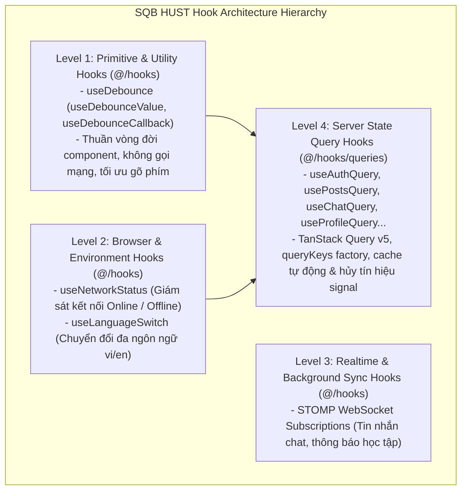
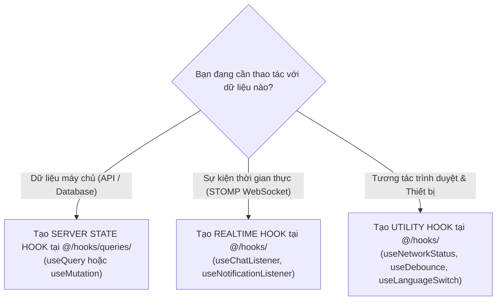

# SQB HUST Custom Hooks & Reactive State Architecture (README)

> **Cẩm Nang Kiến Trúc & Quản Lý Trạng Thái Phản Ứng SQB HUST Frontend (`src/hooks/`)**  
> *Phiên bản:* 2.0.0 (Strict Enterprise Standard)  
> *Cập nhật lần cuối:* 2026-10-25  
> *Phạm vi áp dụng:* Toàn bộ lập trình viên frontend khi tạo mới, sử dụng, hoặc tái cấu trúc các Custom Hooks tiện ích và Server State Query Hooks trong hệ thống Mạng xã hội Ngân hàng Đề thi SQB HUST.  
> *Tài liệu liên quan:* [Cổng Quy Chuẩn Master Frontend](../../FRONTEND_CONVENTIONS.md) | [Chuyên Đề 01: Kiến Trúc & Cấu Trúc Thư Mục](../../docs/01-architecture-and-structure.md) | [Chuyên Đề 02: Quản Lý Trạng Thái](../../docs/02-state-management.md) | [Tầng Dịch Vụ Mạng (`src/services/README.md`)](../services/README.md) | [Zustand Stores (`src/stores/README.md`)](../stores/README.md)

---

## MỤC LỤC TỔNG QUAN

1. [Chương 1: Kiến Trúc State & Tháp Phân Tầng Hook (State & Hook Hierarchy)](#chương-1-kiến-trúc-state-tháp-phân-tầng-hook-state-hook-hierarchy)
2. [Chương 2: Chuẩn Thiết Kế Hook Theo Vercel Composition & Performance Patterns](#chương-2-chuẩn-thiết-kế-hook-theo-vercel-composition-performance-patterns)
3. [Chương 3: Chiến Lược Caching & TanStack Query v5 Best Practices](#chương-3-chiến-lược-caching-tanstack-query-v5-best-practices)
4. [Chương 4: Quick-Start Code Recipe: Viết Một Query Hook Mới Chuẩn SQB HUST (3 Bước)](#chương-4-quick-start-code-recipe-viết-một-query-hook-mới-chuẩn-sqb-hust-3-bước)
5. [Chương 5: Cẩm Nang Tái Cấu Trúc & 5 Anti-patterns Điển Hình (Refactoring Playbook)](#chương-5-cẩm-nang-tái-cấu-trúc-5-anti-patterns-điển-hình-refactoring-playbook)
6. [Chương 6: Cây Quyết Định Thiết Kế & Lựa Chọn Hook (3 Decision Trees)](#chương-6-cây-quyết-định-thiết-kế-lựa-chọn-hook-3-decision-trees)
7. [Chương 7: Catalog Toàn Diện 100% Hooks (`hooks/` & `hooks/queries/`)](#chương-7-catalog-toàn-diện-100-hooks-hooks-hooksqueries)
8. [Chương 8: Chuẩn Mực Kiểm Thử Hook (Testing Standards With Vitest & RTL)](#chương-8-chuẩn-mực-kiểm-thử-hook-testing-standards-with-vitest-rtl)
9. [Chương 9: Quy Chuẩn Nghiêm Cấm & Cảnh Báo Lạm Dụng (Anti-Abuse Directives)](#chương-9-quy-chuẩn-nghiêm-cấm-cảnh-báo-lạm-dụng-anti-abuse-directives)
10. [Chương 10: Bảng Tra Cứu Nhanh 5 Giây (Quick Reference Cheat Sheet)](#chương-10-bảng-tra-cứu-nhanh-5-giây-quick-reference-cheat-sheet)

---

<a id="chương-1-kiến-trúc-state-tháp-phân-tầng-hook-state-hook-hierarchy"></a>
## CHƯƠNG 1: KIẾN TRÚC STATE & THÁP PHÂN TẦNG HOOK (STATE & HOOK HIERARCHY)

Hệ thống quản lý trạng thái của SQB HUST được thiết kế theo nguyên tắc phân định trách nhiệm rõ ràng (Separation of Concerns). Thư mục `src/hooks/` đóng vai trò là **tầng cầu nối phản ứng (Reactive Bridge)** kết nối giao diện React với Tầng Dịch Vụ Mạng (`src/services/`) và Tầng Store (`src/stores/`).

Mọi hooks trong hệ thống được phân định thành 4 tầng tháp độc lập:



### 1.1 Ranh Giới Nghiêm Ngặt Bất Khả Xâm Phạm (Hard Boundaries)

1. **Tuyệt Đối Cấm Fetch API Bằng `useEffect` + `useState` Trên UI (Rule `NO_EFFECT_FETCH`):**
   - Mọi thao tác tải dữ liệu từ máy chủ (Server State) **BẮT BUỘC** phải đi qua TanStack Query v5 hoặc các custom query hooks tại [`queries/`](queries/).
   - Cấm viết `useEffect(() => { service.getData().then(...) }, [])` trực tiếp trên trang hay component. Cách làm này gây ra:
     - Thất thoát bộ nhớ (Memory leaks) khi component unmount.
     - Race conditions khi tham số tìm kiếm/lọc thay đổi nhanh.
     - Triệt tiêu hoàn toàn khả năng chia sẻ cache giữa các màn hình.
2. **Quy Tắc Định Dạng Trả Về `state-actions-meta`:**
   - Các hooks phức tạp quản lý form hoặc mutation phải cấu trúc giá trị trả về theo nhóm: dữ liệu (`data`, `error`), hành động (`submit`, `reset`), và cờ trạng thái (`isPending`, `isValid`).

---

## CHƯƠNG 2: CHUẨN THIẾT KẾ HOOK THEO VERCEL COMPOSITION & PERFORMANCE PATTERNS

### 2.1 Ổn Định Con Trỏ Hàm Với `useCallback` & Co-location

Khi thiết kế custom hook, lập trình viên cần tuân thủ quy tắc Vercel:
- **Tránh tạo hàm inline mới mỗi lần re-render:** Nếu hook trả về các hàm handler được truyền xuống component con hoặc context, bắt buộc bọc chúng trong `useCallback`.
- **Nguyên Tắc Co-location Cho Hooks Nghiệp Vụ Đặc Thù:** Nếu một hook chỉ phục vụ riêng cho một trang cụ thể (ví dụ: `useExamFormState` chỉ dùng cho trang tạo đề thi), hook đó phải được đặt ngay cạnh thư mục của trang đó, không đưa vào thư mục chung `src/hooks/`.
- **Tránh đồng bộ hóa cưỡng bức (No Duplicated State in useEffect):** Không dùng `useEffect` chỉ để sao chép dữ liệu từ props hoặc query result sang một state cục bộ. Hãy tính toán trực tiếp trong render (Derived State).

---

<a id="chương-3-chiến-lược-caching-tanstack-query-v5-best-practices"></a>
## CHƯƠNG 3: CHIẾN LƯỢC CACHING & TANSTACK QUERY V5 BEST PRACTICES

<a id="31-nguồn-dữ-liệu-chuẩn-duy-nhất-single-source-of-truth-cho-query-keys-querykeys"></a>
### 3.1 Nguồn Dữ Liệu Chuẩn Duy Nhất Cho Query Keys (`queryKeys`)

Mọi truy vấn dữ liệu máy chủ bắt buộc phải khai báo khóa cache thông qua Factory tập trung tại [`@/lib/query-keys`](../lib/query-keys.ts):

```typescript
// Sử dụng chuẩn mực
import { useQuery } from '@tanstack/react-query'
import { queryKeys } from '@/lib/query-keys'
import { postService } from '@/services/post.service'

export function useFeedQuery(filter?: string) {
  return useQuery({
    queryKey: queryKeys.posts.feed(filter),
    queryFn: ({ signal }) => postService.getFeed({ filter }, { signal }),
    staleTime: 60_000, // Fresh trong 1 phút
    gcTime: 5 * 60_000, // Giữ trong bộ nhớ rác 5 phút
  })
}
```

<a id="32-quy-chuẩn-thời-gian-sống-cache-staletime-vs-gctime"></a>
### 3.2 Quy Chuẩn Thời Gian Sống Cache (`staleTime` vs `gcTime`)

| Nhóm Dữ Liệu | `staleTime` (Thời gian fresh) | `gcTime` (Thời gian dọn rác) | Ví Dụ Điển Hình |
| :--- | :---: | :---: | :--- |
| **Dữ liệu thời gian thực / Nhạy cảm** | `0` (luôn refetch) | `5 phút` | Tin nhắn chat, thông báo mới, hồ sơ cá nhân `/users/me`. |
| **Dòng tin hoạt động & Thảo luận** | `1 phút` | `10 phút` | Bảng tin sinh viên (`useFeedQuery`), danh sách bình luận. |
| **Ngân hàng Đề thi & Câu hỏi** | `3 phút` | `15 phút` | Danh sách đề thi (`/exams`), chi tiết câu hỏi (`/questions/{id}`). |
| **Danh mục Môn học & Thiết lập** | `10 phút` | `30 phút` | Danh mục môn học (`/subjects`), bảng xếp hạng huy hiệu. |

### 3.3 Tự Động Truyền `AbortSignal` Cho Mọi Service Call

TanStack Query v5 cung cấp sẵn thuộc tính `signal` trong `QueryFunctionContext`. Mọi query hook **BẮT BUỘC** phải truyền `signal` xuống tầng service để tự động hủy HTTP request khi sinh viên điều hướng sang trang khác trước khi request hoàn tất:

```typescript
queryFn: ({ signal }) => reviewService.getPendingReviews({ signal }),
```

---

## CHƯƠNG 4: QUICK-START CODE RECIPE: VIẾT MỘT QUERY HOOK MỚI CHUẨN SQB HUST (3 BƯỚC)

Khi tích hợp một API endpoint mới từ Backend Spring Boot vào Frontend, lập trình viên tuân thủ đúng 3 bước:

### Bước 1: Khai Báo Query Key Trong `@/lib/query-keys`
```typescript
// src/lib/query-keys.ts
export const queryKeys = {
  // ...
  exams: {
    all: ['exams'] as const,
    list: (filters: Record<string, unknown>) => ['exams', 'list', filters] as const,
    detail: (id: string) => ['exams', 'detail', id] as const,
  },
}
```

### Bước 2: Tạo Custom Hook Với `useQuery` / `useMutation`
```typescript
// src/hooks/queries/useExamQuery.ts
import { useQuery, useMutation, useQueryClient } from '@tanstack/react-query'
import { queryKeys } from '@/lib/query-keys'
import { examService } from '@/services/exam.service'

export function useExamDetailQuery(examId: string) {
  return useQuery({
    queryKey: queryKeys.exams.detail(examId),
    queryFn: ({ signal }) => examService.getExamById(examId, { signal }),
    enabled: Boolean(examId),
    staleTime: 3 * 60_000,
  })
}

export function useGenerateExamMutation() {
  const queryClient = useQueryClient()
  return useMutation({
    mutationFn: (payload: GenerateExamDto) => examService.generateExam(payload),
    onSuccess: () => {
      queryClient.invalidateQueries({ queryKey: queryKeys.exams.all })
    },
  })
}
```

### Bước 3: Viết Unit Test Với `createQueryWrapper` Trong Vitest
```typescript
// src/hooks/queries/useExamQuery.test.tsx
import { renderHook, waitFor } from '@testing-library/react'
import { describe, it, expect, vi } from 'vitest'
import { createQueryWrapper } from '@/tests/query-wrapper'
import { useExamDetailQuery } from './useExamQuery'

describe('useExamDetailQuery', () => {
  it('truy vấn thành công dữ liệu đề thi', async () => {
    const { result } = renderHook(() => useExamDetailQuery('EX-101'), {
      wrapper: createQueryWrapper(),
    })

    await waitFor(() => expect(result.current.isSuccess).toBe(true))
    expect(result.current.data?.title).toBeDefined()
  })
})
```

---

<a id="chương-4-cẩm-nang-tái-cấu-trúc-5-anti-patterns-điển-hình-refactoring-playbook"></a>
## CHƯƠNG 5: CẨM NANG TÁI CẤU TRÚC & 5 ANTI-PATTERNS ĐIỂN HÌNH (REFACTORING PLAYBOOK)

| Anti-pattern | Vị Trí / Bối Cảnh | Phân Tích Rủi Ro Kỹ Thuật | Phương Án Chuẩn SQB HUST |
| :--- | :--- | :--- | :--- |
| **Fetch Trong `useEffect`** | Trang danh sách câu hỏi hoặc bài nộp | Dễ gây memory leaks, race conditions khi gõ tìm kiếm, không có cache chia sẻ. | Chuyển toàn bộ sang `useQuery` với query key tương ứng. |
| **Bỏ Quên `signal` Hủy Request** | Query hooks tùy tiện | Khi người dùng chuyển trang nhanh, các request cũ vẫn chạy ngầm và tải tài nguyên lãng phí. | Luôn truyền `{ signal }` từ query context vào tham số service. |
| **Hardcode String Query Key** | `useQuery({ queryKey: ['posts'] })` | Khiến việc invalidate cache bị sót hoặc sai lệch giữa các màn hình khác nhau. | Luôn dùng factory `queryKeys.posts.all`. |
| **Bỏ Rơi Error Boundary** | Trang AttendancePage / QuestionReviewPage | Khi API trả về lỗi 500, cả màn hình bị văng lỗi trắng trang. | Dùng `useQuery` kết hợp UI Component `<EmptyState>` hoặc `<ErrorBoundary>`. |
| **Mutation Không Invalidate Cache** | Sau khi tạo câu hỏi mới | Danh sách câu hỏi không tự làm mới, người dùng phải F5 lại trang mới thấy dữ liệu mới. | Gọi `queryClient.invalidateQueries` bên trong callback `onSuccess` của mutation. |

---

## CHƯƠNG 6: CÂY QUYẾT ĐỊNH THIẾT KẾ & LỰA CHỌN HOOK (3 DECISION TREES)



---

<a id="chương-6-catalog-toàn-diện-100-hooks-hooks-hooksqueries"></a>
<a id="6-useactivepackagesquery"></a>
<a id="9-usetrainersessionsquery"></a>
<a id="11-useattendancelogsquery"></a>
## CHƯƠNG 7: CATALOG TOÀN DIỆN 100% HOOKS (`hooks/` & `hooks/queries/`)

Thư mục `src/hooks/` cung cấp **9 custom hooks cốt lõi** phục vụ toàn bộ các luồng nghiệp vụ của SQB HUST:

| STT | Tên Hook / Tệp | Thuộc Cấp | Vai Trò Nghiệp Vụ SQB HUST | Hooks & Mutations Xuất Bản | Tệp Kiểm Thử Tương Ứng |
| :---: | :--- | :---: | :--- | :--- | :--- |
| 1 | [`useDebounce.ts`](useDebounce.ts) | Level 1 | Trì hoãn cập nhật giá trị hoặc hành vi callback để chống bão API khi người dùng gõ từ khóa tìm kiếm đề thi, câu hỏi. | `useDebounceValue`, `useDebounceCallback` | [`useDebounce.test.ts`](useDebounce.test.ts) |
| 2 | [`useLanguageSwitch.ts`](useLanguageSwitch.ts) | Level 2 | Quản lý chuyển đổi ngôn ngữ hiển thị (Việt - Anh) và đồng bộ trạng thái với `i18next`. | `useLanguageSwitch` (`currentLanguage`, `switchLanguage`, `isVietnamese`) | [`useLanguageSwitch.test.ts`](useLanguageSwitch.test.ts) |
| 3 | [`useNetworkStatus.ts`](useNetworkStatus.ts) | Level 2 | Lắng nghe sự kiện phần cứng mạng của trình duyệt, cảnh báo khi thiết bị ngoại tuyến (offline). | `useNetworkStatus` (`isOnline`, `isOffline`) | [`useNetworkStatus.test.ts`](useNetworkStatus.test.ts) |
| 4 | [`useAuthQuery.ts`](queries/useAuthQuery.ts) | Level 4 | Truy vấn hồ sơ tài khoản `/users/me`, thực hiện mutation đăng nhập, làm mới token và đăng xuất an toàn. | `useMeQuery`, `useLoginMutation`, `useLogoutMutation` | Kiểm thử tích hợp Vitest |
| 5 | [`usePostsQuery.ts`](queries/usePostsQuery.ts) | Level 4 | Quản lý bảng tin học tập: danh sách bài viết, xem chi tiết câu hỏi thảo luận, đăng bài mới, bình luận và thả biểu cảm. | `useFeedQuery`, `usePostDetailQuery`, `useCreatePostMutation`, `useCommentsQuery` | Kiểm thử tích hợp Vitest |
| 6 | [`useChatQuery.ts`](queries/useChatQuery.ts) | Level 4 | Quản lý danh sách hội thoại học tập 1-1, nhóm học phần, tải lịch sử tin nhắn và gửi tin nhắn mới. | `useConversationsQuery`, `useMessagesQuery`, `useSendMessageMutation` | Kiểm thử tích hợp Vitest |
| 7 | [`useProfileQuery.ts`](queries/useProfileQuery.ts) | Level 4 | Truy vấn thông tin sinh viên/giảng viên, lịch sử đóng góp ngân hàng câu hỏi, cập nhật hồ sơ cá nhân. | `useProfileQuery`, `useUpdateProfileMutation`, `useAchievementsQuery` | Kiểm thử tích hợp Vitest |
| 8 | [`useReviewQuery.ts`](queries/useReviewQuery.ts) | Level 4 | Dành cho Giảng viên: duyệt danh sách câu hỏi sinh viên đóng góp, phê duyệt, từ chối hoặc yêu cầu chỉnh sửa. | `usePendingReviewsQuery`, `useApproveReviewMutation`, `useRejectReviewMutation` | Kiểm thử tích hợp Vitest |
| 9 | [`useSessionsQuery.ts`](queries/useSessionsQuery.ts) | Level 4 | Dành cho Sinh viên: theo dõi phiên tạo câu hỏi, nộp đề xuất câu hỏi trắc nghiệm vào ngân hàng đề thi. | `useMySessionsQuery`, `useSubmitQuestionMutation` | Kiểm thử tích hợp Vitest |

---

## CHƯƠNG 8: CHUẨN MỰC KIỂM THỬ HOOK (TESTING STANDARDS WITH VITEST & RTL)

Mọi custom hook phải được kiểm thử với `@testing-library/react` (`renderHook`):
1. **Kiểm thử Utility Hooks:** Kiểm thử với timers giả lập (`vi.useFakeTimers()`) cho các hooks debounce.
2. **Kiểm thử Query Hooks:** Bắt buộc bọc hook trong `createQueryWrapper()` để cung cấp `QueryClient` độc lập, tránh rò rỉ cache giữa các bài test.

```typescript
// useDebounce.test.ts
import { renderHook, act } from '@testing-library/react'
import { describe, it, expect, vi, beforeEach, afterEach } from 'vitest'
import { useDebounceValue } from './useDebounce'

describe('useDebounceValue', () => {
  beforeEach(() => {
    vi.useFakeTimers()
  })

  afterEach(() => {
    vi.useRealTimers()
  })

  it('trì hoãn cập nhật giá trị sau khoảng delay đã cấu hình', () => {
    const { result, rerender } = renderHook(
      ({ val, delay }) => useDebounceValue(val, delay),
      { initialProps: { val: 'toán', delay: 300 } }
    )

    expect(result.current).toBe('toán')

    rerender({ val: 'giải tích', delay: 300 })
    expect(result.current).toBe('toán')

    act(() => {
      vi.advanceTimersByTime(300)
    })

    expect(result.current).toBe('giải tích')
  })
})
```

---

## CHƯƠNG 9: QUY CHUẨN NGHIÊM CẤM & CẢNH BÁO LẠM DỤNG (ANTI-ABUSE DIRECTIVES)

| Mã Rule ID | Hành Vi Bị Nghiêm Cấm | Mức Độ | Hậu Quả Hệ Thống |
| :--- | :--- | :---: | :--- |
| `RULE_NO_DIRECT_EFFECT_FETCH` | Fetch API trực tiếp bằng `useEffect` thay vì dùng TanStack Query. | **CRITICAL** | Gây memory leaks, race conditions và triệt tiêu khả năng cache dữ liệu dùng chung. |
| `RULE_NO_MISSING_SIGNAL` | Không truyền `signal` từ query context xuống hàm service. | **SEVERE** | Lãng phí tài nguyên mạng, tiếp tục xử lý các cuộc gọi API không còn cần thiết khi sinh viên đã chuyển trang. |
| `RULE_NO_MUTATION_WITHOUT_INVALIDATE` | Gọi API mutation thay đổi dữ liệu mà không invalidate query key tương ứng. | **SEVERE** | Dữ liệu trên màn hình không đồng bộ với cơ sở dữ liệu máy chủ, gây bug hiển thị dữ liệu ma. |
| `RULE_NO_ANONYMOUS_QUERY_KEYS` | Định nghĩa query key bằng chuỗi tự do thay vì dùng factory `@/lib/query-keys`. | **CRITICAL** | Phân mảnh cache, xung đột khóa truy vấn và làm tê liệt cơ chế làm mới dữ liệu tự động. |

---

## CHƯƠNG 10: BẢNG TRA CỨU NHANH 5 GIÂY (QUICK REFERENCE CHEAT SHEET)

```typescript
// 1. Tối ưu ô tìm kiếm với useDebounceValue
import { useDebounceValue } from '@/hooks/useDebounce'
const [debouncedKeyword] = useDebounceValue(searchQuery, 300)

// 2. Kiểm tra trạng thái mạng Online / Offline
import { useNetworkStatus } from '@/hooks/useNetworkStatus'
const { isOnline } = useNetworkStatus()

// 3. Truy vấn bảng tin học tập với TanStack Query
import { useFeedQuery } from '@/hooks/queries/usePostsQuery'
const { data: posts, isPending, error } = useFeedQuery()

// 4. Mutation duyệt câu hỏi của giảng viên
import { useReviewQuery } from '@/hooks/queries/useReviewQuery'
const { approveReview, isPending: isApproving } = useReviewQuery()
```
