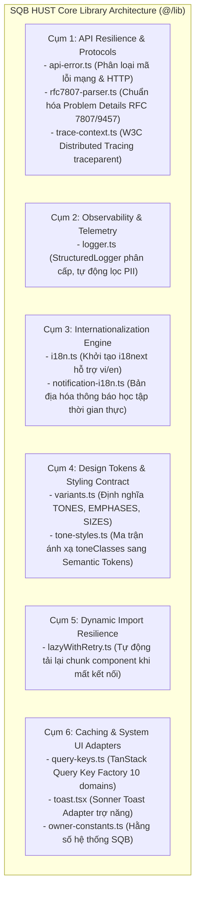

# SQB HUST Core Libraries & Infrastructure Architecture (README)

> **Cẩm Nang Kiến Trúc & Tiện Ích Nền Tảng SQB HUST Frontend (`src/lib/`)**  
> *Phiên bản:* 2.0.0 (Strict Enterprise Standard)  
> *Cập nhật lần cuối:* 2026-10-25  
> *Phạm vi áp dụng:* Toàn bộ lập trình viên frontend khi tạo mới, sử dụng, hoặc mở rộng các module tiện ích giao thức, chuẩn hóa lỗi API, nhật ký có cấu trúc, quốc tế hóa và thư viện hạ tầng lõi trong hệ sinh thái Mạng xã hội Ngân hàng Đề thi SQB HUST.  
> *Tài liệu liên quan:* [Cổng Quy Chuẩn Master Frontend](../../FRONTEND_CONVENTIONS.md) | [Chuyên Đề 01: Kiến Trúc & Cấu Trúc Thư Mục](../../docs/01-architecture-and-structure.md) | [Chuyên Đề 13: Giao Thức Mạng & Khả Năng Phục Hồi Lỗi](../../docs/13-api-contracts-and-resilience.md) | [Tầng Dịch Vụ Mạng (`src/services/README.md`)](../services/README.md) | [Tiện Ích Thuần Túy (`src/utils/README.md`)](../utils/README.md)

---

## MỤC LỤC TỔNG QUAN

1. [Chương 1: Kiến Trúc Hạ Tầng Thư Viện Lõi & Phân Tầng Trách Nhiệm (Core Architecture)](#chương-1-kiến-trúc-hạ-tầng-thư-viện-lõi-phân-tầng-trách-nhiệm-core-architecture)
2. [Chương 2: Tối Ưu Bundle Size & Quy Chuẩn Direct Imports (Vercel Bundle Rules)](#chương-2-tối-ưu-bundle-size-quy-chuẩn-direct-imports-vercel-bundle-rules)
3. [Chương 3: Giao Thức Khả Năng Phục Hồi & Xử Lý Lỗi (API Resilience & RFC Standards)](#chương-3-giao-thức-khả-năng-phục-hồi-xử-lý-lỗi-api-resilience-rfc-standards)
4. [Chương 4: Bảo Mật PII, Vệ Sinh Dữ Liệu & Logging Có Cấu Trúc (Security & Observability)](#chương-4-bảo-mật-pii-vệ-sinh-dữ-liệu-logging-có-cấu-trúc-security-observability)
5. [Chương 5: Đa Ngôn Ngữ & Thông Báo Hệ Thống (Internationalization & Notifications)](#chương-5-đa-ngôn-ngữ-thông-báo-hệ-thống-internationalization-notifications)
6. [Chương 6: Quick-Start Code Recipe: Tạo Mới Module Hạ Tầng Chuẩn SQB HUST (3 Bước)](#chương-6-quick-start-code-recipe-tạo-mới-module-hạ-tầng-chuẩn-sqb-hust-3-bước)
7. [Chương 7: Cẩm Nang Nâng Cấp, Tái Cấu Trúc & Mở Rộng Thư Viện (Library Refactoring Playbook)](#chương-7-cẩm-nang-nâng-cấp-tái-cấu-trúc-mở-rộng-thư-viện-library-refactoring-playbook)
8. [Chương 8: Catalog Toàn Diện 12 Infrastructure Modules Cốt Lõi](#chương-8-catalog-toàn-diện-12-infrastructure-modules-cốt-lõi)
9. [Chương 9: Quy Chuẩn Nghiêm Cấm & Cảnh Báo Lạm Dụng (Anti-Abuse Directives)](#chương-9-quy-chuẩn-nghiêm-cấm-cảnh-báo-lạm-dụng-anti-abuse-directives)
10. [Chương 10: Bảng Tra Cứu Nhanh 5 Giây (Quick Reference Cheat Sheet)](#chương-10-bảng-tra-cứu-nhanh-5-giây-quick-reference-cheat-sheet)

---

<a id="chương-1-kiến-trúc-hạ-tầng-thư-viện-lõi-phân-tầng-trách-nhiệm-core-architecture"></a>
## CHƯƠNG 1: KIẾN TRÚC HẠ TẦNG THƯ VIỆN LÕI & PHÂN TẦNG TRÁCH NHIỆM (CORE ARCHITECTURE)

Thư mục `src/lib/` là tầng hạ tầng nền tảng (Foundation Infrastructure) của SQB HUST Frontend. Phân hệ bao gồm **12 modules độc lập** đóng vai trò là khung xương kỹ thuật phi giao diện, cầu nối với các giao thức IETF, W3C và hệ thống Design Tokens:



> [!NOTE]
> **Phân định ranh giới kiến trúc:** Các hàm tiện ích tính toán thuần túy (`formatDate`, `formatVnd`, `cn.ts`) và các bộ lọc thông tin cá nhân (`pii-masker.ts`, `backoff-retry.ts`) thuộc về tầng tiện ích tại `src/utils/`. Xem chi tiết tại [**src/utils/README.md**](../utils/README.md).

### 1.1 Bốn Trụ Cột Thiết Kế Cốt Lõi (The 4 Architectural Pillars)

1. **Tuân Thủ Tuyệt Đối Chuẩn W3C & IETF RFC:**
   - Lỗi API tuân thủ **IETF RFC 7807 / RFC 9457 (Problem Details for HTTP APIs)**.
   - Truy vết phân tán tuân thủ **W3C Distributed Trace Context Recommendation (`traceparent`)**.
   - Thời gian tuân thủ **ISO 8601** và khóa cứng múi giờ Việt Nam **`Asia/Ho_Chi_Minh` (UTC+7)**.
2. **Quy Tắc 100% Design Tokens & Không Hardcode:**
   - Toàn bộ màu sắc và tone trạng thái (như `tone-styles.ts`, `variants.ts`) tuyệt đối không dùng mã HEX thô, mà ánh xạ trực tiếp sang **Semantic Token CSS Variables** (`--color-...`, `--rogym-...`) hoặc `toneClasses`.
3. **Ghi Log Qua Structured Logger:**
   - 100% thông tin theo dõi và cảnh báo trong ứng dụng phải đi qua [`logger.ts`](logger.ts) để tự động lọc thông tin cá nhân (PII thông qua `pii-masker`) và tự động tắt chế độ debug trên Production.
4. **Resilience & Fault Tolerance:**
   - Bảo vệ ứng dụng khỏi rớt mạng tạm thời với `lazyWithRetry` khi tải dynamic chunks, và hỗ trợ `backoff-retry` khi tái kết nối STOMP / WebSocket.

---

<a id="chương-2-tối-ưu-bundle-size-quy-chuẩn-direct-imports-vercel-bundle-rules"></a>
## CHƯƠNG 2: TỐI ƯU BUNDLE SIZE & QUY CHUẨN DIRECT IMPORTS (VERCEL BUNDLE RULES)

### 2.1 Nguyên Tắc Vercel `bundle-barrel-imports`: Nghiêm Cấm Monolithic Barrel

> [!CAUTION]
> **QUY TẮC CỐT LÕI:** Tuyệt đối **KHÔNG ĐƯỢC TẠO** tệp `src/lib/index.ts` tập trung để re-export toàn bộ các modules hạ tầng (`bundle-barrel-imports`).

#### Phân Tích Chi Phí Bundle (Bundle Cost Analysis):
Nếu tạo tệp barrel `lib/index.ts`:
- Khi một component đơn giản chỉ cần hàm `getApiError`, cơ chế import từ barrel `import { getApiError } from '@/lib'` sẽ kéo theo toàn bộ:
  - `@stomp/stompjs` WebSocket runtime dependencies (~80KB)
  - `sonner` toast animations (~20KB)
  - `i18next` bundle locales (~40KB)
- Điều này phá vỡ cơ chế Tree-shaking của bundler, làm phình to gói bundle tải trang ban đầu và suy giảm nghiêm trọng chỉ số LCP.

### 2.2 Quy Chuẩn Import Trực Tiếp (Granular Direct Imports)

```tsx
// ❌ SAI: Kéo theo toàn bộ dependencies của cả thư mục
import { getApiError, queryKeys, showToast } from '@/lib'

// ✅ CHUẨN MỰC: Import trực tiếp đích danh từ từng module
import { getApiError } from '@/lib/api-error'
import { queryKeys } from '@/lib/query-keys'
import { showToast } from '@/lib/toast'
```

---

## CHƯƠNG 3: GIAO THỨC KHẢ NĂNG PHỤC HỒI & XỬ LÝ LỖI (API RESILIENCE & RFC STANDARDS)

### 3.1 Chuẩn Hóa Lỗi API Theo IETF RFC 7807 / RFC 9457

Phản hồi lỗi từ máy chủ Spring Boot được bóc tách và chuẩn hóa qua [`rfc7807-parser.ts`](rfc7807-parser.ts):

```typescript
export interface ProblemDetails {
  type?: string
  title: string
  status: number
  detail?: string
  instance?: string
  code?: string
  invalidParams?: Array<{ name: string; reason: string }>
}
```

Hàm `getApiError` trong [`api-error.ts`](api-error.ts) tự động phân loại lỗi mạng (`isNetworkError`), lỗi xung đột phiên làm việc (`isApiConflict`), lỗi hết hạn phiên (`isUnauthorizedError`), và chuyển đổi thành thông báo thân thiện cho sinh viên/giảng viên.

### 3.2 Phân Tán Truy Vết W3C Distributed Trace Context

Mỗi yêu cầu mạng được gắn mã định danh phân tán qua [`trace-context.ts`](trace-context.ts):

```
traceparent: 00-4bf92f3577b34da6a3ce929d0e0e4736-00f067aa0ba902b7-01
              ^^ -------------------------------- ---------------- ^^
           Version            Trace ID                 Span ID     Flags
```

---

## CHƯƠNG 4: BẢO MẬT PII, VỆ SINH DỮ LIỆU & LOGGING CÓ CẤU TRÚC (SECURITY & OBSERVABILITY)

### 4.1 Structured Logging Với Tự Động Lọc PII

Toàn bộ hệ thống SQB HUST sử dụng [`logger.ts`](logger.ts) thay vì `console.log`:
- Tự động che giấu thông tin cá nhân (MSSV, SĐT, Email, Token) thông qua cơ chế lọc PII (`pii-masker`).
- Tự động gắn kèm metadata: `timestamp`, `traceId`, `environment`.
- Tự động tắt log cấp độ `DEBUG` khi chạy trên môi trường Production để bảo mật.

```typescript
// Sử dụng chuẩn mực
import { logger } from '@/lib/logger'

logger.info('Sinh viên nộp câu hỏi đề xuất mới', {
  studentId: '20201234', // Tự động che thành 2020****
  subjectId: 'IT4409',
})
```

---

## CHƯƠNG 5: ĐA NGÔN NGỮ & THÔNG BÁO HỆ THỐNG (INTERNATIONALIZATION & NOTIFICATIONS)

### 5.1 Khởi Tạo Đa Ngôn Ngữ Với `i18n.ts`

Module [`i18n.ts`](i18n.ts) cấu hình `i18next` hỗ trợ hai ngôn ngữ chính: Tiếng Việt (`vi` - mặc định) và Tiếng Anh (`en`), tự động phát hiện ngôn ngữ qua trình duyệt hoặc lưu trữ trong `localStorage`.

### 5.2 Bản Địa Hóa Thông Báo Thời Gian Thực Với `notification-i18n.ts`

Module [`notification-i18n.ts`](notification-i18n.ts) chịu trách nhiệm ánh xạ các sự kiện thông báo đẩy (Realtime Notifications) từ WebSocket/STOMP sang văn bản trực quan:
- Sự kiện bình luận câu hỏi mới (`question.commented`).
- Giảng viên phê duyệt đề xuất câu hỏi (`session.approved`).
- Bạn học tương tác thả reaction bài viết (`post.reacted`).
- Lời mời kết bạn học tập mới (`friendship.requested`).

---

## CHƯƠNG 6: QUICK-START CODE RECIPE: TẠO MỚI MODULE HẠ TẦNG CHUẨN SQB HUST (3 BƯỚC)

### Bước 1: Thiết Kế Module Độc Lập Không Phụ Thuộc Vòng Đời React
```typescript
// src/lib/sound-effects.ts
class SoundManager {
  private sounds = new Map<string, HTMLAudioElement>()

  play(soundName: 'notification' | 'success' | 'alert') {
    if (typeof window === 'undefined') return
    // Logic phát âm thanh không phụ thuộc component
  }
}

export const soundManager = new SoundManager()
```

### Bước 2: Bọc Xử Lý Lỗi Tự Động & Ghi Nhật Ký Qua `logger`
```typescript
import { logger } from '@/lib/logger'

try {
  // Thao tác hạ tầng mạng / audio / storage
} catch (error) {
  logger.error('Thao tác hạ tầng thất bại', { error })
}
```

### Bước 3: Viết Unit Test Với Vitest Giả Lập Môi Trường
```typescript
// src/lib/sound-effects.test.ts
import { describe, it, expect } from 'vitest'
import { soundManager } from './sound-effects'

describe('SoundManager', () => {
  it('khởi tạo thành công mà không gây lỗi môi trường', () => {
    expect(soundManager).toBeDefined()
  })
})
```

---

## CHƯƠNG 7: CẨM NANG NÂNG CẤP, TÁI CẤU TRÚC & MỞ RỘNG THƯ VIỆN (LIBRARY REFACTORING PLAYBOOK)

Khi nâng cấp hoặc mở rộng tầng thư viện, lập trình viên cần tuân thủ các quy tắc sau:
1. **Khẳng định tính độc lập:** Module hạ tầng không gọi chéo các hooks UI của React, không gọi `navigate` hoặc `useLocation`.
2. **Khóa kiểu dữ liệu chặt chẽ (Zero `any`):** Bắt buộc sử dụng TypeScript Generics kết hợp Type Guards.
3. **Bao phủ 100% trường hợp biên (Edge Cases):** Unit test phải kiểm thử các giá trị dị biệt: `null`, `undefined`, chuỗi rỗng `""`, lỗi kết nối mạng.
4. **Không phụ thuộc chéo vòng tròn (Circular Dependency Protection):** Kiểm tra đồ thị phụ thuộc trước khi import module khác trong `@/lib`.

---

<a id="chương-7-catalog-toàn-diện-12-infrastructure-modules-cốt-lõi"></a>
## CHƯƠNG 8: CATALOG TOÀN DIỆN 12 INFRASTRUCTURE MODULES CỐT LÕI

| STT | Module | File Nguồn | File Test | Vai Trò Hạ Tầng SQB HUST | Các Hàm / Đối Tượng Xuất Bản |
| :---: | :--- | :--- | :--- | :--- | :--- |
| 1 | `api-error.ts` | [`api-error.ts`](api-error.ts) | [`api-error.test.ts`](api-error.test.ts) | Bóc tách mã lỗi Axios, phân loại lỗi mất mạng, xung đột dữ liệu và thông báo lỗi thân thiện cho người dùng. | `getApiError`, `isNetworkError`, `isApiConflict`, `isUnauthorizedError`, `isForbiddenError`, `isNotFoundError` |
| 2 | `rfc7807-parser.ts` | [`rfc7807-parser.ts`](rfc7807-parser.ts) | [`rfc7807-parser.test.ts`](rfc7807-parser.test.ts) | Trích xuất Problem Details theo chuẩn IETF RFC 7807 / RFC 9457 từ phản hồi máy chủ Spring Boot. | `parseRfc7807Error`, interface `ProblemDetails` |
| 3 | `trace-context.ts` | [`trace-context.ts`](trace-context.ts) | [`trace-context.test.ts`](trace-context.test.ts) | Sinh tiêu đề `traceparent` (trace-id 16 bytes, span-id 8 bytes) theo chuẩn W3C Distributed Tracing. | `generateTraceparent`, `parseTraceparent`, `createTraceContext` |
| 4 | `logger.ts` | [`logger.ts`](logger.ts) | [`logger.test.ts`](logger.test.ts) | Structured Logger có cấu trúc phân cấp, tự động gỡ PII qua `pii-masker` và tắt debug ở production. | `logger`, `StructuredLogger`, `LogLevel` |
| 5 | `i18n.ts` | [`i18n.ts`](i18n.ts) | N/A | Cấu hình và khởi tạo `i18next`, thiết lập ngôn ngữ mặc định `vi`, nạp từ điển `locales/`. | `default as i18n`, `supportedLngs`, `changeLanguage` |
| 6 | `notification-i18n.ts` | [`notification-i18n.ts`](notification-i18n.ts) | N/A | Bản địa hóa nội dung thông báo đẩy thời gian thực từ WebSocket/STOMP sang văn bản trực quan. | `translateNotification`, interface `NotificationText` |
| 7 | `variants.ts` | [`variants.ts`](variants.ts) | N/A | Single Source of Truth cho hằng số Design System: `TONES`, `EMPHASES`, `SIZES` và các Type Guards. | `TONES`, `EMPHASES`, `SIZES`, `isValidTone`, `isValidSize` |
| 8 | `tone-styles.ts` | [`tone-styles.ts`](tone-styles.ts) | N/A | Ma trận ánh xạ 6 Tones $\times$ 3 Emphases sang Semantic Tokens Tailwind tự động tương thích Dual-Theme (`toneClasses`). | `getToneStyles`, `TONE_STYLE_MAP` |
| 9 | `lazyWithRetry.ts` | [`lazyWithRetry.ts`](lazyWithRetry.ts) | [`lazyWithRetry.test.tsx`](lazyWithRetry.test.tsx) | Bọc `React.lazy` với cơ chế tự động thử tải lại module khi gặp sự cố mạng hoặc bản build mới. | `lazyWithRetry` |
| 10 | `query-keys.ts` | [`query-keys.ts`](query-keys.ts) | [`query-keys.test.ts`](query-keys.test.ts) | TanStack Query Key Factory quản lý tập trung toàn bộ khóa cache cho 10 domain nghiệp vụ SQB HUST. | `queryKeys` (auth, posts, chat, questions, exams, reviews, sessions...) |
| 11 | `toast.tsx` | [`toast.tsx`](toast.tsx) | [`toast.test.tsx`](toast.test.tsx) | Adapter thông báo Sonner chuẩn Tone ngữ nghĩa, icon trợ năng và thời lượng hiển thị tối ưu. | `showToast`, `toastSuccess`, `toastError`, `toastWarning`, `toastInfo` |
| 12 | `owner-constants.ts` | [`owner-constants.ts`](owner-constants.ts) | N/A | Hằng số cấu hình quản trị hệ thống, quyền hạn người dùng và giới hạn kích thước phân trang. | `SYSTEM_ROLES`, `PAGE_SIZES`, `DEFAULT_TIMEOUT_MS` |

---

## CHƯƠNG 9: QUY CHUẨN NGHIÊM CẤM & CẢNH BÁO LẠM DỤNG (ANTI-ABUSE DIRECTIVES)

| Mã Rule ID | Hành Vi Bị Nghiêm Cấm | Mức Độ | Hậu Quả Hệ Thống |
| :--- | :--- | :---: | :--- |
| `RULE_NO_BARREL_IMPORT_LIB` | Tạo tệp barrel `src/lib/index.ts` re-export toàn bộ module hạ tầng. | **CRITICAL** | Phá vỡ Tree-shaking; kéo theo thư viện nặng `@stomp/stompjs`, `socket.io-client`, làm tăng initial bundle size. |
| `RULE_NO_RAW_CONSOLE_LOG` | Dùng `console.log` / `console.error` trực tiếp trong code production. | **CRITICAL** | Rò rỉ thông tin cá nhân (PII) trên DevTools của trình duyệt; vi phạm tiêu chuẩn bảo mật. |
| `RULE_NO_HARDCODED_QUERY_KEYS` | Viết chuỗi query key tùy tiện trong `useQuery`: `queryKey: ['my-posts']`. | **SEVERE** | Phân mảnh cache; triệt tiêu khả năng invalidate cache tự động của TanStack Query; phát sinh bug dữ liệu cũ. |
| `RULE_NO_HARDCODED_COLORS_IN_LIB` | Trả về mã màu HEX thô trong các hàm styling helper. | **CRITICAL** | Phá vỡ cơ chế Dual-Theme sáng/tối; vi phạm quy chuẩn Semantic Design Tokens. |

---

## CHƯƠNG 10: BẢNG TRA CỨU NHANH 5 GIÂY (QUICK REFERENCE CHEAT SHEET)

```typescript
// 1. Chuẩn hóa lỗi API
import { getApiError, isNetworkError } from '@/lib/api-error'
const message = getApiError(error)

// 2. Sử dụng Query Key Factory
import { queryKeys } from '@/lib/query-keys'
const key = queryKeys.posts.feed()

// 3. Hiển thị thông báo Sonner Toast chuẩn Tone
import { toastSuccess, toastError } from '@/lib/toast'
toastSuccess('Đề xuất câu hỏi thành công!')

// 4. Ghi log có cấu trúc tự động gỡ PII
import { logger } from '@/lib/logger'
logger.info('Truy vấn đề thi', { examId: 'EX-2026' })

// 5. Tải chậm Component chống rớt mạng
import { lazyWithRetry } from '@/lib/lazyWithRetry'
const ExamEditor = lazyWithRetry(() => import('@/pages/exam-editor/ExamEditor'))
```
