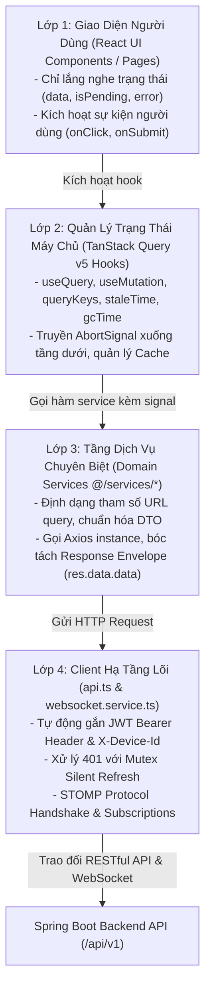

# SQB HUST RESTful Services & Realtime API Architecture (README)

> **Cẩm Nang Kiến Trúc Tầng Dịch Vụ Mạng & API Client SQB HUST Frontend (`src/services/`)**  
> *Phiên bản:* 2.0.0 (React Enterprise Standard)  
> *Phạm vi áp dụng:* Toàn bộ lập trình viên frontend khi định nghĩa, sử dụng hoặc tái cấu trúc các cuộc gọi REST API, cấu hình Axios instance, bộ lọc interceptors, giao thức WebSocket STOMP và tích hợp với TanStack Query v5 trong SQB HUST Management System.  
> *Tài liệu liên quan:* [Cổng Quy Chuẩn Master Frontend](../../FRONTEND_CONVENTIONS.md) | [Chuyên Đề 01: Kiến Trúc & Cấu Trúc Thư Mục](../../docs/01-architecture-and-structure.md) | [Chuyên Đề 02: Quản Lý Trạng Thái](../../docs/02-state-management.md)

---

## MỤC LỤC TỔNG QUAN

1. [Chương 1: Kiến Trúc Tầng Dịch Vụ Mạng & Luồng Dữ Liệu 4 Lớp](#chương-1-kiến-trúc-tầng-dịch-vụ-mạng-luồng-dữ-liệu-4-lớp)
2. [Chương 2: Cấu Hình Axios Client, Interceptors & Cơ Chế Silent Token Refresh](#chương-2-cấu-hình-axios-client-interceptors-cơ-chế-silent-token-refresh)
3. [Chương 3: Giao Thức AbortSignal Bắt Buộc 100% Cho Mọi Service Calls](#chương-3-giao-thức-abortsignal-bắt-buộc-100-cho-mọi-service-calls)
4. [Chương 4: Đặc Tả Giao Thức Realtime WebSocket STOMP (Chat & Presence)](#chương-4-đặc-tả-giao-thức-realtime-websocket-stomp-chat-presence)
5. [Chương 5: Chuẩn Hóa Kiểu Dữ Liệu DTO & Cơ Chế Bóc Tách GlobalResponse](#chương-5-chuẩn-hóa-kiểu-dữ-liệu-dto-cơ-chế-bóc-tách-globalresponse)
6. [Chương 6: Catalog Toàn Diện 100% Services Tại `services/` (18 Modules Dịch Vụ)](#chương-6-catalog-toàn-diện-100-services-tại-services-18-modules-dịch-vụ)
7. [Chương 7: Tiêu Chuẩn Kiểm Thử Tầng Dịch Vụ Với Vitest & Mocking](#chương-7-tiêu-chuẩn-kiểm-thử-tầng-dịch-vụ-với-vitest-mocking)
8. [Chương 8: Quy Chuẩn Nghiêm Cấm & Cảnh Báo Lạm Dụng](#chương-8-quy-chuẩn-nghiêm-cấm-cảnh-báo-lạm-dụng)

---

<a id="chương-1-kiến-trúc-tầng-dịch-vụ-mạng-luồng-dữ-liệu-4-lớp-network-service-layer-architecture"></a>
## CHƯƠNG 1: KIẾN TRÚC TẦNG DỊCH VỤ MẠNG & LUỒNG DỮ LIỆU 4 LỚP

Trong SQB HUST Frontend, tầng Dịch vụ mạng (`src/services/`) đóng vai trò là **lớp ranh giới độc lập (Isolation Boundary)** giữa giao thức mạng HTTP/WebSocket bên ngoài và luồng dữ liệu nội bộ của ứng dụng React.

Mọi hoạt động tương tác với Backend bắt buộc tuân thủ **Luồng Dữ Liệu 4 Lớp (4-tier Data Flow)**:



### 1.1 Nguyên Tắc Trách Nhiệm Duy Nhất (Single Responsibility Principle)
1. **Dumb Data Transport (Vận chuyển dữ liệu thuần túy):** Tầng service không chứa UI logic, không lưu trữ component state, không gọi thông báo `toast` và không thực hiện chuyển trang `navigate`.
2. **DTO Normalization (Chuẩn hóa dữ liệu):** Nhận TypeScript Request Payload từ Query Hook, chuyển đổi định dạng query params nếu cần, và trả về dữ liệu thuần (`data`) đã được unwrap từ Envelope chuẩn của backend:
   ```typescript
   export interface GlobalResponse<T> {
     code: string
     message: string
     data: T
   }
   ```
3. **Decoupled Lifecycle (Không phụ thuộc vòng đời Component):** Mọi hàm service là các hàm bất đồng bộ độc lập (standalone async functions) trong plain object/class, có thể dễ dàng test độc lập trong môi trường Node.js.

---

## CHƯƠNG 2: CẤU HÌNH AXIOS CLIENT, INTERCEPTORS & CƠ CHẾ SILENT TOKEN REFRESH

Hạ tầng kết nối mạng trung tâm được định nghĩa tại [`api.ts`](api.ts). Đây là phiên bản cấu hình duy nhất của Axios Client được phép sử dụng trong toàn bộ dự án.

### 2.1 Cấu Hình Khởi Tạo Axios Instance
```typescript
const api = axios.create({
  baseURL: import.meta.env.VITE_API_URL || '/api/v1',
  headers: { 'Content-Type': 'application/json' },
  timeout: 60000,
  withCredentials: true,
})
```

### 2.2 Request Interceptor: Tự Động Gắn JWT Bearer Token & Device ID
Mỗi request trước khi rời khỏi trình duyệt sẽ được kiểm tra qua `useAuthStore` để bổ sung Header xác thực và `x-device-id`:
```typescript
api.interceptors.request.use((config) => {
  const token = useAuthStore.getState().token
  const headers = AxiosHeaders.from(config.headers)
  if (token && !headers.has('Authorization')) {
    headers.set('Authorization', `Bearer ${token}`)
  }
  if (!headers.has('X-Device-Id')) {
    headers.set('X-Device-Id', getDeviceId())
  }
  config.headers = headers
  return config
})
```

### 2.3 Response Interceptor: Xử Lý 401 & Hàng Đợi Mutex Silent Refresh
Khi gặp lỗi `HTTP 401 Unauthorized`:
- Cờ `config._retry = true` được gán vào request để bảo đảm một request chỉ được phép thử refresh token tối đa 1 lần duy nhất.
- Hàng đợi Mutex (`refreshPromise`) bảo đảm khi nhiều request đồng thời nhận 401, chỉ có đúng **1 request** được gửi lên máy chủ (`/auth/refresh`), các request còn lại sẽ đăng ký chờ kết quả và replay đồng loạt khi có token mới.

---

<a id="chương-3-giao-thức-abortsignal-bắt-buộc-100-cho-mọi-service-calls-prevent-race-conditions-memory-leaks"></a>
## CHƯƠNG 3: GIAO THỨC `AbortSignal` BẮT BUỘC 100% CHO MỌI SERVICE CALLS

Mọi hàm fetch hoặc tìm kiếm trong service bắt buộc phải hỗ trợ nhận tham số `signal?: AbortSignal`:

```typescript
export const postService = {
  getPostById: async (
    id: number,
    options?: { signal?: AbortSignal }
  ): Promise<PostResponseDto> => {
    return requestData<PostResponseDto>(
      api.get<GlobalResponse<PostResponseDto>>(`/posts/${id}`, {
        signal: options?.signal,
      })
    )
  },
}
```

---

## CHƯƠNG 4: ĐẶC TẢ GIAO THỨC REALTIME WEBSOCKET STOMP (CHAT & PRESENCE)

Tính năng Nhắn tin và Sự kiện đang soạn thảo (Typing Indicator) sử dụng kết nối bền vững qua WebSocket STOMP tại [`websocket.service.ts`](websocket.service.ts):

- **Endpoint kết nối Handshake:** `wss://snsqb.duckdns.org/api/v1/ws`
- **Header xác thực khi CONNECT:** `Authorization: Bearer <jwt_access_token>`
- **Tiền tố Application (Client -> Server):** `/app`
- **Tiền tố Broker (Server -> Client):** `/user` (kênh riêng tư) và `/topic` (kênh nhóm/cộng đồng)

### Các Kênh STOMP Chính:
| Kênh / Destination | Chiều | Mô Tả Nghiệp Vụ | DTO Payload |
| :--- | :---: | :--- | :--- |
| `/app/chat.send` | Client -> Server | Gửi tin nhắn mới | `SendWsMessageRequestDto` |
| `/app/chat.read` | Client -> Server | Báo đã đọc tin nhắn | `ReadWsMessageRequestDto` |
| `/app/chat.typing` | Client -> Server | Bật/tắt trạng thái gõ phím | `TypingWsRequestDto` |
| `/user/queue/messages` | Server -> Client | Nhận tin nhắn cá nhân & biên nhận | `WsMessageBroadcastDto` |
| `/topic/conv.{id}.typing` | Server -> Client | Lắng nghe thành viên đang gõ | `WsTypingBroadcastDto` |

---

## CHƯƠNG 5: CHUẨN HÓA KIỂU DỮ LIỆU DTO & CƠ CHẾ BÓC TÁCH GLOBALRESPONSE

Mọi kiểu dữ liệu DTO được sinh tự động từ OpenAPI 3.1 Spec và lưu trữ tại `src/types/`. Helper `requestData<T>` tự động bóc tách vỏ bọc máy chủ:

```typescript
export async function requestData<T>(
  promise: Promise<{ data: GlobalResponse<T> }>
): Promise<T> {
  const response = await promise
  return response.data.data
}
```

---

<a id="chương-6-catalog-toàn-diện-100-services-tại-services-22-modules-dịch-vụ"></a>
## CHƯƠNG 6: CATALOG TOÀN DIỆN 100% SERVICES TẠI `services/` (18 MODULES DỊCH VỤ)

| STT | File Service | Mô Tả Trách Nhiệm Nghiệp Vụ | Endpoints Tương Tác Chính |
| :---: | :--- | :--- | :--- |
| 1 | [`api.ts`](api.ts) | Cấu hình lõi Axios Client, Interceptors, Mutex Refresh. | Toàn bộ các endpoints |
| 2 | [`auth.service.ts`](auth.service.ts) | Đăng nhập credentials, đăng xuất, cấp mới token, đổi mật khẩu. | `/auth/login`, `/auth/logout`, `/auth/refresh`, `/auth/change-password` |
| 3 | [`device.service.ts`](device.service.ts) | Quản lý thiết bị đăng nhập, thu hồi phiên làm việc, đồng bộ FID Firebase. | `/devices`, `/devices/{id}/logout`, `/devices/fid` |
| 4 | [`user.service.ts`](user.service.ts) | Hồ sơ cá nhân của tôi, xem trang cá nhân khác, mã PIN ẩn, cấu hình push. | `/users/me`, `/users/{id}`, `/settings/push` |
| 5 | [`relationship.service.ts`](relationship.service.ts) | Mạng lưới bạn bè, gửi/nhận lời mời kết bạn, theo dõi (Follow), chặn (Block). | `/friendships/*`, `/follows/*`, `/blocks/*` |
| 6 | [`post.service.ts`](post.service.ts) | Đăng bài viết, xem chi tiết, sửa/xóa bài, video bài giảng, ghi chú giảng viên. | `/posts`, `/posts/{id}`, `/video-posts`, `/posts/{id}/lecturer-notes` |
| 7 | [`comment.service.ts`](comment.service.ts) | Bình luận bài viết, phản hồi bình luận đa cấp, chỉnh sửa/xóa bình luận. | `/comments`, `/comments/{id}` |
| 8 | [`reaction.service.ts`](reaction.service.ts) | Thả hoặc gỡ tương tác cảm xúc đa hình LIKE, LOVE, WOW. | `/react` |
| 9 | [`feed.service.ts`](feed.service.ts) | Dòng hoạt động học tập cá nhân hóa và mạng lưới bạn bè, đếm sự kiện mới. | `/activity-feeds`, `/activity-feeds/new-count` |
| 10 | [`chat.service.ts`](chat.service.ts) | Hội thoại 1-1, nhóm chat, quản trị vai trò thành viên, thu hồi tin nhắn, kho ẩn. | `/conversations/*`, `/messages/*` |
| 11 | [`course.service.ts`](course.service.ts) | Danh mục môn học, quản lý lớp học phần, gán sinh viên vào lớp. | `/subjects`, `/lecturer/course-classes/*` |
| 12 | [`session.service.ts`](session.service.ts) | Sinh viên tạo phiên đề xuất câu hỏi, quản lý bài nộp, môn học đã ghi danh. | `/sessions/propose`, `/sessions/my-submissions/*` |
| 13 | [`review.service.ts`](review.service.ts) | Giảng viên thẩm định, phê duyệt/từ chối câu hỏi, sửa câu hỏi và chốt phiên. | `/sessions/pending`, `/sessions/approve`, `/sessions/reject`, `/questions/{id}` |
| 14 | [`practice.service.ts`](practice.service.ts) | Luyện tập trắc nghiệm, nộp câu trả lời, đánh giá chất lượng câu hỏi 0-4 sao. | `/questions/{id}/answer`, `/questions/{id}/rate`, `/questions/{id}/statistics` |
| 15 | [`exam.service.ts`](exam.service.ts) | Tự động sinh đề thi theo ma trận độ khó, xuất file đề thi DOCX/PDF. | `/exams/generate`, `/exams/my-exams`, `/exams/{id}/export` |
| 16 | [`gamification.service.ts`](gamification.service.ts) | Điểm danh hàng ngày, bảng xếp hạng vinh danh, Minigames 1-6, huy hiệu. | `/games/*`, `/badges/*` |
| 17 | [`cosmetic.service.ts`](cosmetic.service.ts) | Cửa hàng vật phẩm, túi đồ cá nhân, mua sắm và trang bị khung avatar. | `/cosmetics/*` |
| 18 | [`utility.service.ts`](utility.service.ts) | Tìm kiếm toàn văn Elasticsearch, báo cáo vi phạm, upload Cloudflare R2, AI. | `/search`, `/report`, `/medias/*`, `/questions/{id}/ai-refine` |
| 19 | [`notification.service.ts`](notification.service.ts) | Danh sách thông báo đẩy, đánh dấu đã đọc một mục hoặc tất cả. | `/notifications`, `/notifications/{id}/read` |
| 20 | [`websocket.service.ts`](websocket.service.ts) | Realtime STOMP Client: gửi/nhận tin nhắn chat, báo đọc, sự kiện typing. | `/app/chat.*`, `/user/queue/messages`, `/topic/conv.*` |

---

## CHƯƠNG 7: TIÊU CHUẨN KIỂM THỬ TẦNG DỊCH VỤ VỚI VITEST & MOCKING

```typescript
import { describe, it, expect, vi, beforeEach } from 'vitest'
import { postService } from './post.service'
import api from './api'

vi.mock('./api', () => ({
  default: {
    get: vi.fn(),
    post: vi.fn(),
    put: vi.fn(),
    delete: vi.fn(),
  },
  requestData: vi.fn((p) => p.then((res: { data: { data: unknown } }) => res.data.data)),
}))

describe('postService', () => {
  beforeEach(() => {
    vi.clearAllMocks()
  })

  it('lấy chi tiết bài viết và truyền đúng AbortSignal', async () => {
    const mockPost = { id: 101, content: 'Nội dung bài viết' }
    vi.mocked(api.get).mockResolvedValueOnce({
      data: { code: '1000', message: 'SUCCESS', data: mockPost },
    })

    const controller = new AbortController()
    const result = await postService.getPostById(101, { signal: controller.signal })

    expect(api.get).toHaveBeenCalledWith('/posts/101', expect.objectContaining({
      signal: controller.signal,
    }))
    expect(result).toEqual(mockPost)
  })
})
```

---

## CHƯƠNG 8: QUY CHUẨN NGHIÊM CẤM & CẢNH BÁO LẠM DỤNG

| Mã Rule ID | Hành Vi Nghiêm Cấm | Hậu Quả & Mức Độ |
| :--- | :--- | :---: |
| `RULE_NO_BYPASS_ABORT_SIGNAL` | Không nhận hoặc không truyền `signal?: AbortSignal` khi fetch dữ liệu/search. | `CRITICAL` (Gây Race Condition nguy hiểm) |
| `RULE_NO_UI_IN_SERVICE` | Gọi trực tiếp `toast`, `navigate` bên trong hàm service. | `CRITICAL` (Vi phạm SRP, tê liệt Unit Test) |
| `RULE_NO_DIRECT_AXIOS_IN_UI` | Tự import `axios` trong component hoặc `useEffect`. | `CRITICAL` (Bypass token & Mutex refresh) |
| `RULE_NO_RAW_AXIOS_RESPONSE` | Trả về nguyên đối tượng `AxiosResponse` thay vì unwrap sạch `res.data.data`. | `SEVERE` (Phá vỡ tính bao đóng DTO) |
