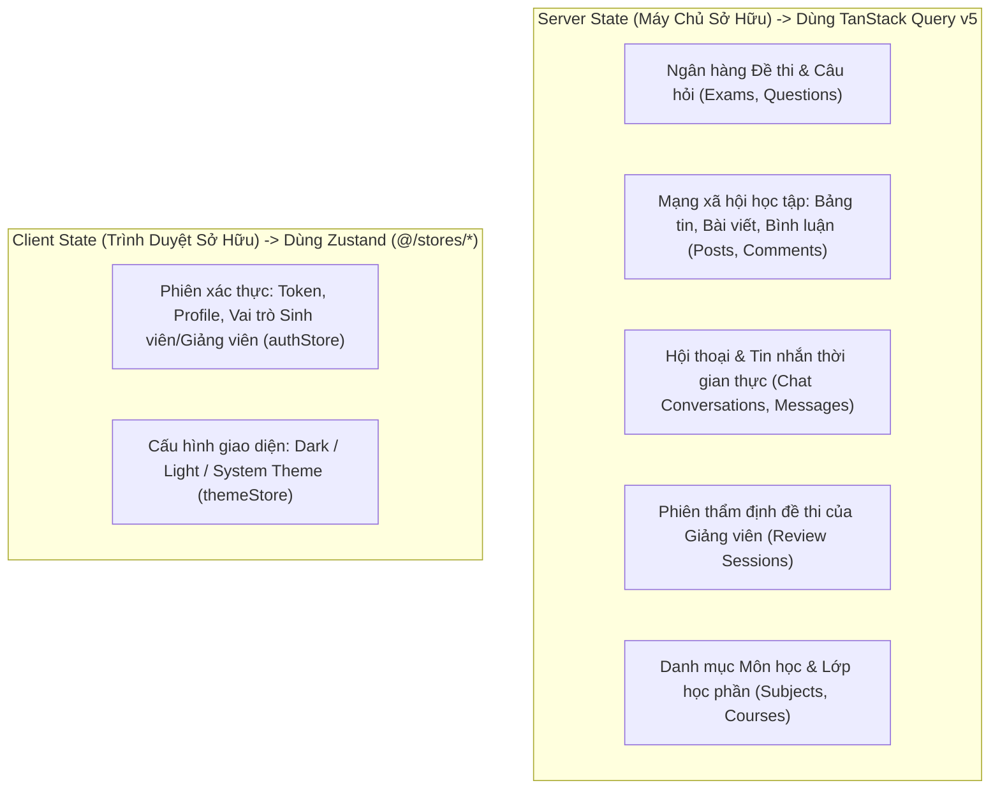
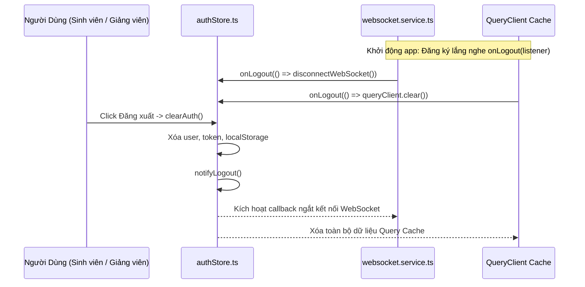
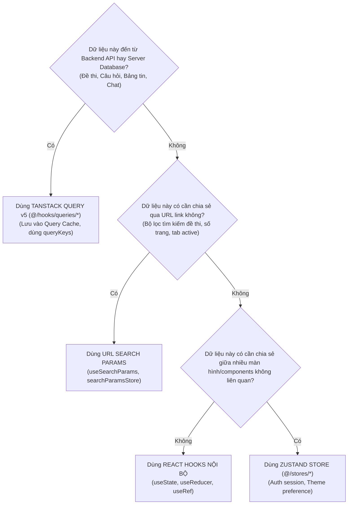

# SQB HUST Zustand Stores & Client State Architecture (README)

> **Cẩm Nang Kiến Trúc Quản Lý Trạng Thái Client SQB HUST Frontend (`src/stores/`)**  
> *Phiên bản:* 2.0.0 (React Enterprise Standard)  
> *Cập nhật lần cuối:* 2026-10-25  
> *Phạm vi áp dụng:* Toàn bộ lập trình viên frontend khi tạo mới, sử dụng, hoặc tái cấu trúc các kho trạng thái toàn cục (Global Client State), phiên xác thực đăng nhập người dùng, cấu hình giao diện hiển thị, và quản lý vòng đời bộ nhớ trong hệ thống Mạng xã hội Ngân hàng Đề thi SQB HUST.  
> *Tài liệu liên quan:* [Cổng Quy Chuẩn Master Frontend](../../FRONTEND_CONVENTIONS.md) | [Chuyên Đề 01: Kiến Trúc & Cấu Trúc Thư Mục](../../docs/01-architecture-and-structure.md) | [Chuyên Đề 02: Quản Lý Trạng Thái](../../docs/02-state-management.md) | [Chuyên Đề 10: Bảo Mật & Xác Thực](../../docs/10-frontend-security-and-auth.md) | [Hạ Tầng Thư Viện Lõi (`src/lib/README.md`)](../lib/README.md) | [Tầng Dịch Vụ Mạng (`src/services/README.md`)](../services/README.md)

---

## MỤC LỤC TỔNG QUAN

1. [Chương 1: Kiến Trúc Quản Lý Trạng Thái & Ranh Giới: Zustand = Client State ONLY](#chương-1-kiến-trúc-quản-lý-trạng-thái-ranh-giới-zustand-client-state-only)
2. [Chương 2: Atomic Selectors & Đồng Bộ Đa Tab Qua BroadcastChannel / Storage](#chương-2-atomic-selectors-đồng-bộ-đa-tab-qua-broadcastchannel-storage)
3. [Chương 3: Cơ Chế Dọn Dẹp Tài Nguyên Tập Trung Với `onLogout` Listener Pattern](#chương-3-cơ-chế-dọn-dẹp-tài-nguyên-tập-trung-với-onlogout-listener-pattern)
4. [Chương 4: Nhận Diện Anti-patterns & Cẩm Nang Tái Cấu Trúc (Refactoring Playbook)](#chương-4-nhận-diện-anti-patterns-cẩm-nang-tái-cấu-trúc-refactoring-playbook)
5. [Chương 5: Quick-Start Code Recipe: Tạo Mới Một Zustand Client Store Chuẩn SQB HUST (3 Bước)](#chương-5-quick-start-code-recipe-tạo-mới-một-zustand-client-store-chuẩn-sqb-hust-3-bước)
6. [Chương 6: Cây Quyết Định Chọn Nơi Lưu Trữ Trạng Thái Trong 15 Giây (Decision Tree)](#chương-6-cây-quyết-định-chọn-nơi-lưu-trữ-trạng-thái-trong-15-giây-decision-tree)
7. [Chương 7: Catalog Toàn Diện 100% Stores Thực Tế Tại `stores/` (2 Modules Stores)](#chương-7-catalog-toàn-diện-100-stores-thực-tế-tại-stores-2-modules-stores)
8. [Chương 8: Tiêu Chuẩn Kiểm Thử Zustand Stores Với Vitest (Unit Testing Standards)](#chương-8-tiêu-chuẩn-kiểm-thử-zustand-stores-với-vitest-unit-testing-standards)
9. [Chương 9: Quy Chuẩn Nghiêm Cấm & Cảnh Báo Lạm Dụng (Anti-Abuse Directives)](#chương-9-quy-chuẩn-nghiêm-cấm-cảnh-báo-lạm-dụng-anti-abuse-directives)
10. [Chương 10: Bảng Tra Cứu Nhanh 5 Giây (Quick Reference Cheat Sheet)](#chương-10-bảng-tra-cứu-nhanh-5-giây-quick-reference-cheat-sheet)

---

<a id="chương-1-kiến-trúc-quản-lý-trạng-thái-toàn-cục-ranh-giới-zustand-client-state-only-no-server-cache"></a>
## CHƯƠNG 1: KIẾN TRÚC QUẢN LÝ TRẠNG THÁI & RANH GIỚI: ZUSTAND = CLIENT STATE ONLY

Trong ứng dụng SQB HUST Frontend, việc phân định rõ ràng giữa **Client State** và **Server State** là nguyên tắc quan trọng hàng đầu để ngăn chặn lỗi phân kỳ dữ liệu (Stale State Divergence) và các chu kỳ re-render lãng phí trên toàn bộ cây giao diện.

### 1.1 Vai Trò & Sứ Mệnh Kiến Trúc Của `src/stores/`

Thư mục `src/stores/` đóng vai trò là **vùng biên Client-Side duy nhất (Client Boundary)** của ứng dụng. Sứ mệnh của nó bao gồm:
1. **Lưu trữ dữ liệu phiên duyệt web tạm thời:** Chỉ giữ các thông tin thuộc quyền sở hữu của trình duyệt hiện tại (như JWT token, user profile, theme preference).
2. **Quản trị vòng đời Client an toàn:** Cung cấp cơ chế dọn dẹp tập trung (`onLogout`) để giải phóng toàn bộ tài nguyên khi phiên làm việc kết thúc.
3. **Tuyệt đối không lưu Server State:** Toàn bộ dữ liệu ngân hàng câu hỏi, đề thi, bài viết thảo luận, bình luận và tin nhắn chat thuộc quyền sở hữu của máy chủ và được TanStack Query v5 quản lý độc quyền tại `src/hooks/queries/`.



### 1.2 Bảng Phân Định Trách Nhiệm Giữa 2 Công Cụ

| Đặc Tính | Zustand (`src/stores/`) | TanStack Query v5 (`src/hooks/queries/`) |
| :--- | :--- | :--- |
| **Loại trạng thái** | **Client State thuần túy:** Token xác thực, theme, quyền người dùng. | **Server State:** Dữ liệu lưu trong PostgreSQL / Spring Boot Backend API. |
| **Bản quyền dữ liệu** | Thuộc về phiên duyệt web hiện tại của Client. | Thuộc về Database trên máy chủ (Client chỉ giữ bản cache tạm). |
| **Cơ chế Cache** | Không tự động hết hạn (lưu trong memory hoặc `localStorage`). | Tự động làm mới (Auto-refetch), xóa rác (`gcTime`), quản lý độ trễ (`staleTime`). |
| **Xử lý bất đồng bộ** | Thao tác synchronous đơn giản, không tự viết retry/dedup. | Xử lý triệt để loading, error, deduplication và hủy request (`signal`). |
| **Hành vi khi unmount** | Dữ liệu vẫn được giữ trong store trừ khi chủ động `reset/clear`. | Tự hủy subscription lắng nghe, tự động thu hồi bộ nhớ theo `gcTime`. |

> [!IMPORTANT]
> **NGUYÊN TẮC BẤT DI BẤT DỊCH:** Tuyệt đối không sao chép danh sách dữ liệu từ máy chủ (như `exams`, `questions`, `posts`, `comments`) vào một mảng lưu trong Zustand Store. Hãy để TanStack Query v5 làm nhiệm vụ đó.

---

## CHƯƠNG 2: ATOMIC SELECTORS & ĐỒNG BỘ ĐA TAB QUA BROADCASTCHANNEL / STORAGE

### 2.1 Atomic Selectors: Chống Re-render Toàn Bộ Cây Giao Diện

Một lỗi phổ biến khi sử dụng Zustand là destructure toàn bộ state object trong React Component:

```tsx
// ❌ SAI LẦM: Gây re-render component mỗi khi BẤT KỲ state nào trong store thay đổi
const { user, token, setAuth, clearAuth } = useAuthStore()

// ✅ CHUẨN MỰC: Sử dụng Atomic Selector cho từng giá trị cần thiết
const user = useAuthStore((s) => s.user)
const isAuthenticated = useAuthStore((s) => s.isAuthenticated)
const clearAuth = useAuthStore((s) => s.clearAuth)
```

Khi sử dụng Atomic Selector, React Component chỉ re-render khi và chỉ khi giá trị mà selector trả về thực sự thay đổi (so sánh bằng `Object.is`).

### 2.2 Đồng Bộ Đa Tab (Multi-Tab Synchronization)

Khi sinh viên hoặc giảng viên mở ứng dụng trên nhiều tab trình duyệt:
1. Nếu người dùng **Đăng xuất (Logout)** ở Tab A, Tab B phải lập tức xóa session và chuyển hướng về trang đăng nhập để bảo mật.
2. Nếu người dùng **Đổi Theme** ở Tab A, Tab B phải lập tức cập nhật giao diện mà không cần reload trang.

`authStore` và `themeStore` sử dụng middleware `persist` ghi dữ liệu vào `localStorage`. Để đồng bộ tức thì giữa các tab, một listener theo dõi sự kiện `storage` được kích hoạt:

```typescript
// Lắng nghe sự kiện đồng bộ từ các Tab khác
if (typeof window !== 'undefined') {
  window.addEventListener('storage', (event) => {
    if (event.key === 'sqb-auth-storage' && !event.newValue) {
      // Khi Tab khác xóa token, Tab hiện tại lập tức reset auth
      useAuthStore.getState().clearAuth()
    }
  })
}
```

---

## CHƯƠNG 3: CƠ CHẾ DỌN DẸP TÀI NGUYÊN TẬP TRUNG VỚI `onLogout` LISTENER PATTERN

### 3.1 Giải Quyết Vấn Đề Circular Dependency

Khi người dùng đăng xuất, nhiều phân hệ độc lập cần giải phóng tài nguyên:
- `websocket.service.ts`: Ngắt kết nối STOMP client, hủy toàn bộ kênh lắng nghe chat.
- `TanStack Query`: Xóa sạch toàn bộ query cache (`queryClient.clear()`).
- Tầng UI: Chuyển hướng người dùng về trang đăng nhập `/login`.

Nếu `authStore.ts` trực tiếp import từng module trên để gọi hàm reset, dự án sẽ ngay lập tức rơi vào bẫy **Circular Dependency (Phụ thuộc vòng tròn)**.

### 3.2 Cơ Chế Publish / Subscribe Thông Qua `onLogout`

Tại [`authStore.ts`](authStore.ts), một cơ chế Pub/Sub siêu nhẹ được thiết lập:



#### Mã Nguồn Chuẩn Triển Khai:

```typescript
// authStore.ts
export type LogoutListener = () => void
const logoutListeners = new Set<LogoutListener>()

export function onLogout(listener: LogoutListener): () => void {
  logoutListeners.add(listener)
  return () => {
    logoutListeners.delete(listener)
  }
}

export function notifyLogout(): void {
  logoutListeners.forEach((listener) => {
    try {
      listener()
    } catch (err) {
      // Ghi log bảo vệ, không để lỗi của một listener làm gián đoạn luồng logout
      logger.error('Error during logout listener cleanup', { error: err })
    }
  })
}
```

---

<a id="chương-4-nhận-diện-anti-patterns-cẩm-nang-tái-cấu-trúc-refactoring-playbook"></a>
## CHƯƠNG 4: NHẬN DIỆN ANTI-PATTERNS & CẨM NANG TÁI CẤU TRÚC (REFACTORING PLAYBOOK)

| Anti-pattern | Mô Tả & Phân Tích Rủi Ro Kỹ Thuật | Phương Án Tái Cấu Trúc Chuẩn SQB HUST |
| :--- | :--- | :--- |
| **Server Cache Trong Zustand** | Tự quản lý danh sách đề thi, bài nộp, mảng retry trong Zustand Store. Gây duplicate tính năng và xung đột dữ liệu với TanStack Query. | Xóa bỏ store trung gian. Chuyển sang custom hook query tại `src/hooks/queries/` sử dụng `useQuery`. |
| **Lưu Records & Toast Trong Store** | Lưu mảng bài viết của server, tự gọi `toast.success` trong action của Zustand thay vì để UI quản lý. | Chuyển việc gọi `toast` sang `onSuccess` của TanStack Mutation hoặc sự kiện xử lý tại UI Component. |
| **Ghi Log Thô `console.error`** | Dùng trực tiếp hàm `console.error` trong listener callback thay vì hệ thống logger chuẩn. | Thay bằng `logger.error` từ `@/lib/logger` để tự động lọc PII và vô hiệu hóa ở Production. |

---

## CHƯƠNG 5: QUICK-START CODE RECIPE: TẠO MỚI MỘT ZUSTAND CLIENT STORE CHUẨN SQB HUST (3 BƯỚC)

Khi có nhu cầu tạo mới một kho trạng thái Client-Side, lập trình viên cần tuân thủ đúng quy trình 3 bước sau:

### Bước 1: Khai Báo TypeScript Interface Định Rõ State & Actions
```typescript
// src/stores/myFeatureStore.ts
export interface MyFeatureState {
  isPanelOpen: boolean
  activeTab: 'questions' | 'exams'
  setPanelOpen: (isOpen: boolean) => void
  setActiveTab: (tab: 'questions' | 'exams') => void
  resetState: () => void
}
```

### Bước 2: Tạo Store Với Middleware `persist` & `devtools`
```typescript
import { create } from 'zustand'
import { persist } from 'zustand/middleware'

const INITIAL_STATE = {
  isPanelOpen: false,
  activeTab: 'questions' as const,
}

export const useMyFeatureStore = create<MyFeatureState>()(
  persist(
    (set) => ({
      ...INITIAL_STATE,
      setPanelOpen: (isPanelOpen) => set({ isPanelOpen }),
      setActiveTab: (activeTab) => set({ activeTab }),
      resetState: () => set(INITIAL_STATE),
    }),
    {
      name: 'sqb-my-feature-preference',
      partialize: (state) => ({ activeTab: state.activeTab }),
    }
  )
)
```

### Bước 3: Đăng Ký Dọn Dẹp Khi Logout & Viết Unit Test Với Vitest
```typescript
import { onLogout } from '@/stores/authStore'

// Tự động reset store khi người dùng đăng xuất
onLogout(() => {
  useMyFeatureStore.getState().resetState()
})
```

---

## CHƯƠNG 6: CÂY QUYẾT ĐỊNH CHỌN NƠI LƯU TRỮ TRẠNG THÁI TRONG 15 GIÂY (DECISION TREE)

Khi bắt đầu làm một tính năng mới trong SQB HUST, hãy trả lời các câu hỏi sau để chọn đúng nơi lưu trữ trạng thái:



---

<a id="chương-6-catalog-toàn-diện-100-stores-tại-stores-7-modules-stores"></a>
## CHƯƠNG 7: CATALOG TOÀN DIỆN 100% STORES THỰC TẾ TẠI `stores/` (2 MODULES STORES)

Thư mục `src/stores/` duy trì tối giản và nghiêm ngặt đúng **2 modules Client State** phục vụ toàn bộ ứng dụng SQB HUST:

| STT | File Store | Vai Trò Nghiệp Vụ SQB HUST | Trạng Thái Lưu Trữ Chính | Hàm / Hooks Xuất Bản | Tệp Kiểm Thử Tương Ứng |
| :---: | :--- | :--- | :--- | :--- | :--- |
| 1 | [`authStore.ts`](authStore.ts) | Quản lý phiên đăng nhập, JWT token, thông tin sinh viên/giảng viên, quyền hạn và đồng bộ dọn dẹp khi logout. | `token`, `refreshToken`, `user` (`userId`, `email`, `role`, `roles`, `studentId`, `department`), `isAuthenticated`, `hasHydrated`. Persist `localStorage` (`sqb-auth-storage`). | `useAuthStore`, `onLogout`, `notifyLogout`, `Role`, `AuthUser` | Kiểm thử tích hợp qua `useAuthQuery` & Auth tests |
| 2 | [`themeStore.ts`](themeStore.ts) | Quản lý chế độ giao diện Sáng / Tối / Theo hệ điều hành, tính toán theme thực tế và đồng bộ class `dataset.theme` trên `<html>`. | `theme` ('dark' \| 'light' \| 'system'), `resolvedTheme` ('dark' \| 'light'). Persist `localStorage` (`rogym-theme`). | `useThemeStore`, `useTheme`, `resolveTheme`, `applyTheme`, `Theme`, `ResolvedTheme` | [`themeStore.test.ts`](themeStore.test.ts) |

---

## CHƯƠNG 8: TIÊU CHUẨN KIỂM THỬ ZUSTAND STORES VỚI VITEST (UNIT TESTING STANDARDS)

Zustand stores chạy thuần túy bằng JavaScript nên việc viết unit tests rất nhanh chóng và không yêu cầu render component.

### 8.1 Mẫu Test Case Chuẩn Cho Zustand Store (`themeStore.test.ts`)

```typescript
import { describe, it, expect, beforeEach } from 'vitest'
import { useThemeStore, resolveTheme } from './themeStore'

describe('useThemeStore', () => {
  beforeEach(() => {
    // Reset store về trạng thái mặc định trước mỗi bài test
    useThemeStore.setState({ theme: 'dark', resolvedTheme: 'dark' })
  })

  it('khởi tạo với các giá trị mặc định chính xác', () => {
    const theme = useThemeStore.getState().theme
    const resolvedTheme = useThemeStore.getState().resolvedTheme

    expect(theme).toBe('dark')
    expect(resolvedTheme).toBe('dark')
  })

  it('cập nhật giá trị theme khi gọi setTheme', () => {
    useThemeStore.getState().setTheme('light')

    expect(useThemeStore.getState().theme).toBe('light')
    expect(useThemeStore.getState().resolvedTheme).toBe('light')
  })

  it('hàm resolveTheme tính toán chính xác giá trị trực tiếp', () => {
    expect(resolveTheme('dark')).toBe('dark')
    expect(resolveTheme('light')).toBe('light')
  })
})
```

---

<a id="chương-9-quy-chuẩn-nghiêm-cấm--cảnh-báo-lạm-dụng-anti-abuse-directives"></a>
## CHƯƠNG 9: QUY CHUẨN NGHIÊM CẤM & CẢNH BÁO LẠM DỤNG (ANTI-ABUSE DIRECTIVES)

Tài liệu này là **hợp đồng kỹ thuật tối thượng** quy định ranh giới vận hành của Zustand Stores trong SQB HUST. Việc lạm dụng lưu trữ Server Cache hoặc quản lý Local State sai chỗ sẽ làm phá vỡ toàn bộ tính dự đoán được của ứng dụng, gây rò rỉ dữ liệu cá nhân (PII) và suy giảm hiệu năng nghiêm trọng.

### 9.1 Bảng Ma Trận Quy Tắc Cấm Trong Stores

| Mã Rule ID | Hành Vi Lạm Dụng Bị Nghiêm Cấm | Mức Độ | Hậu Quả Nặng Nề & Blast Radius |
| :--- | :--- | :---: | :--- |
| `RULE_NO_SERVER_STATE_IN_ZUSTAND` | Sao chép mảng dữ liệu máy chủ (`exams`, `questions`, `posts`, `comments`) vào Zustand Store và tự viết hàm retry/fetch thủ công. | `CRITICAL` | Gây phân kỳ dữ liệu (Stale State Divergence) giữa các màn hình; triệt tiêu cơ chế tự động refetch và xóa rác của TanStack Query; phát sinh bug "dữ liệu ma" khi dữ liệu máy chủ đã thay đổi nhưng store client vẫn giữ giá trị cũ. |
| `RULE_NO_GLOBAL_LOCAL_STATE` | Đưa trạng thái đóng/mở modal, popover, tab active hoặc giá trị ô tìm kiếm của 1 component cụ thể vào Zustand Store toàn cục. | `SEVERE` | Kích hoạt chu kỳ re-render diện rộng (Global Re-render Cascades) trên toàn bộ cây giao diện; làm phức tạp hóa vòng đời component; khiến unit test bị phụ thuộc chéo vào global state. |
| `RULE_NO_UNREGISTERED_LOGOUT_CLEANUP` | Khởi tạo store chứa dữ liệu định danh người dùng hoặc kết nối WebSocket mà không đăng ký dọn dẹp qua `onLogout`. | `CRITICAL` | Rò rỉ dữ liệu phiên (Session & PII Data Leakage); sinh viên sau đăng nhập vào máy tính phòng máy có thể nhìn thấy dữ liệu của sinh viên trước đó. |
| `RULE_NO_BULK_STORE_DESTRUCTURING` | Gọi store theo cú pháp destructure toàn bộ: `const { a, b, c } = useStore()`. | `SEVERE` | Thành phần React sẽ bị ép re-render mỗi khi **bất kỳ** giá trị nào trong store thay đổi, dù component hoàn toàn không sử dụng giá trị đó. |
| `RULE_NO_UNVALIDATED_LOCALSTORAGE` | Đọc `JSON.parse` từ `localStorage` trong custom store mà không có `try/catch` hoặc Zod Schema an toàn. | `CRITICAL` | Khi cấu trúc state trong phiên bản mới thay đổi, chuỗi dữ liệu cũ trong localStorage làm văng lỗi runtime, khiến ứng dụng bị **Crash trắng màn hình vĩnh viễn** cho đến khi người dùng tự xóa cache trình duyệt. |

---

## CHƯƠNG 10: BẢNG TRA CỨU NHANH 5 GIÂY (QUICK REFERENCE CHEAT SHEET)

### 10.1 Năm Quy Định Bắt Buộc Dành Cho Lập Trình Viên

1. **Tuyệt Đối Không Lưu Server Data Trong Zustand:** Server State phải được xử lý bởi TanStack Query v5. Zustand chỉ quản lý Client State thuần túy.
2. **Luôn Sử Dụng Atomic Selector:** Không bao giờ gọi `const { a, b } = useStore()`. Hãy viết `const a = useStore(s => s.a)` để tránh re-render thừa.
3. **Đăng Ký Dọn Dẹp Với `onLogout`:** Nếu một store có giữ dữ liệu cá nhân hoặc kết nối WebSocket, bắt buộc phải đăng ký giải phóng thông qua `onLogout`.
4. **Không Gọi Thông Báo `toast` Trong Store Actions:** Store actions chỉ thay đổi state. Việc hiển thị thông báo giao diện phải do tầng UI hoặc mutation hook đảm nhiệm.
5. **Dùng Logger Chuẩn Khi Bắt Lỗi:** Sử dụng `logger.error` từ `@/lib/logger` khi xử lý lỗi trong middleware hoặc listeners, không dùng `console.log`.

### 10.2 Mẫu Code 5 Giây (5-Second Cheat Sheet)

```typescript
// 1. Sử dụng Auth Store với Atomic Selector
const user = useAuthStore((s) => s.user)
const isAuthenticated = useAuthStore((s) => s.isAuthenticated)
const clearAuth = useAuthStore((s) => s.clearAuth)

// 2. Sử dụng Theme Store qua Hook tiện ích
const { theme, resolvedTheme, setTheme, toggleTheme, isDark } = useTheme()

// 3. Đăng ký giải phóng tài nguyên khi đăng xuất
useEffect(() => {
  const unsubscribe = onLogout(() => {
    // Dọn dẹp tài nguyên hoặc đóng socket
  })
  return unsubscribe
}, [])
```
