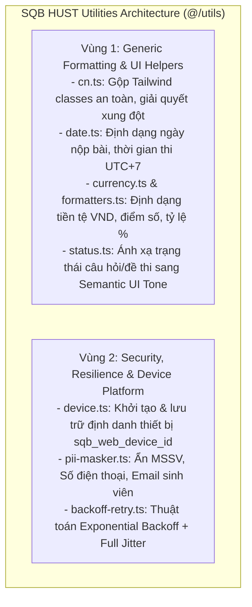
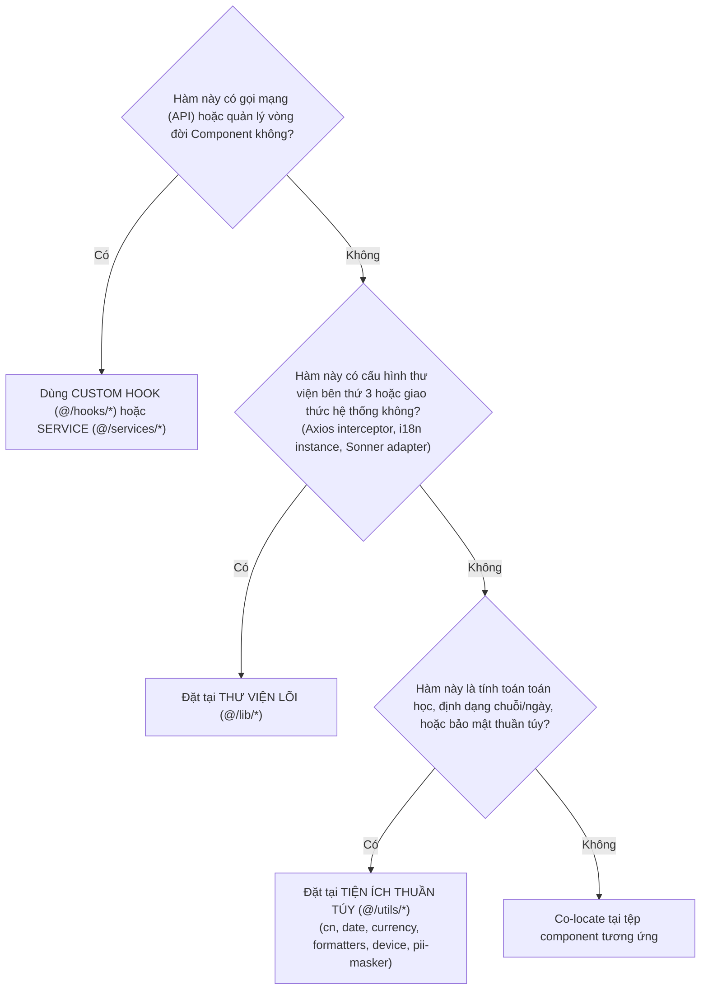

# SQB HUST Pure Utilities & Helper Architecture (README)

> **Cẩm Nang Kiến Trúc & Tiện Ích Thuần Túy SQB HUST Frontend (`src/utils/`)**  
> *Phiên bản:* 2.0.0 (React Enterprise Standard)  
> *Cập nhật lần cuối:* 2026-10-25  
> *Phạm vi áp dụng:* Toàn bộ lập trình viên frontend khi tạo mới, sử dụng, hoặc tái cấu trúc các hàm tiện ích, formatters định dạng văn bản/số học, bộ lọc PII, định danh thiết bị và thuật toán tính toán trong hệ thống Mạng xã hội Ngân hàng Đề thi SQB HUST.  
> *Tài liệu liên quan:* [Cổng Quy Chuẩn Master Frontend](../../FRONTEND_CONVENTIONS.md) | [Kiến Trúc Hạ Tầng Thư Viện Lõi (`src/lib/README.md`)](../lib/README.md) | [Chuyên Đề 01: Kiến Trúc & Cấu Trúc Thư Mục](../../docs/01-architecture-and-structure.md) | [Chuyên Đề 03: 19 Tiêu Chuẩn Coding](../../docs/03-coding-standards.md) | [Tầng Dịch Vụ Mạng (`src/services/README.md`)](../services/README.md)

---

## MỤC LỤC TỔNG QUAN

1. [Chương 1: Kiến Trúc Phân Hệ Tiện Ích & 2 Vùng Trách Nhiệm (Core Architecture)](#chương-1-kiến-trúc-phân-hệ-tiện-ích-2-vùng-trách-nhiệm-core-architecture)
2. [Chương 2: Tối Ưu Bundle Size Theo Chuẩn Vercel: Cấm Monolithic Barrel & Dùng Direct Imports](#chương-2-tối-ưu-bundle-size-theo-chuẩn-vercel-cấm-monolithic-barrel-dùng-direct-imports)
3. [Chương 3: Tính Thuần Túy Của Hàm & An Toàn Múi Giờ UTC+7 (`Asia/Ho_Chi_Minh`)](#chương-3-tính-thuần-túy-của-hàm-an-toàn-múi-giờ-utc7-asiaho_chi_minh)
4. [Chương 4: Quick-Start Code Recipe: Tạo Mới Một Tiện Ích Thuần Túy Chuẩn SQB HUST (3 Bước)](#chương-4-quick-start-code-recipe-tạo-mới-một-tiện-ích-thuần-túy-chuẩn-sqb-hust-3-bước)
5. [Chương 5: Nhận Diện Anti-patterns & Cẩm Nang Tái Cấu Trúc (Refactoring Playbook)](#chương-5-nhận-diện-anti-patterns-cẩm-nang-tái-cấu-trúc-refactoring-playbook)
6. [Chương 6: Cây Quyết Định Định Vị Tiện Ích Trong 15 Giây (Decision Tree)](#chương-6-cây-quyết-định-định-vị-tiện-ích-trong-15-giây-decision-tree)
7. [Chương 7: Catalog Toàn Diện 100% Modules Thực Tế Của SQB HUST (8 Modules)](#chương-7-catalog-toàn-diện-100-modules-thực-tế-của-sqb-hust-8-modules)
8. [Chương 8: Tiêu Chuẩn Kiểm Thử Tiện Ích Với Vitest (Unit Testing Standards)](#chương-8-tiêu-chuẩn-kiểm-thử-tiện-ích-với-vitest-unit-testing-standards)
9. [Chương 9: Quy Chuẩn Nghiêm Cấm & Cảnh Báo Lạm Dụng (Anti-Abuse Directives)](#chương-9-quy-chuẩn-nghiêm-cấm-cảnh-báo-lạm-dụng-anti-abuse-directives)
10. [Chương 10: Bảng Tra Cứu Nhanh 5 Giây (Quick Reference Cheat Sheet)](#chương-10-bảng-tra-cứu-nhanh-5-giây-quick-reference-cheat-sheet)

---

<a id="chương-1-kiến-trúc-phân-hệ-tiện-ích-3-vùng-trách-nhiệm-core-architecture"></a>
## CHƯƠNG 1: KIẾN TRÚC PHÂN HỆ TIỆN ÍCH & 2 VÙNG TRÁCH NHIỆM (CORE ARCHITECTURE)

Thư mục `src/utils/` là nơi tập trung các hàm tiện ích thuần túy (Pure Functions) và các thuật toán tính toán hỗ trợ toàn bộ ứng dụng frontend SQB HUST.

### 1.1 Vai Trò & Sứ Mệnh Kiến Trúc Của `src/utils/`

Sứ mệnh của `src/utils/` được xây dựng trên 3 nguyên lý thiết kế:
1. **100% Pure Functions (Hàm Thuần Túy):** Cùng tham số đầu vào luôn trả về cùng kết quả; tuyệt đối không gây side-effects ngầm, không gọi network và không đột biến các đối tượng truyền vào.
2. **Deterministic Output & An Toàn Thời Gian:** Khóa cứng định dạng múi giờ Việt Nam `Asia/Ho_Chi_Minh` (UTC+7) cho toàn bộ thao tác ngày tháng (hạn thi, nộp bài, thời gian bình luận).
3. **Bảo Mật Dữ Liệu Học Viên & Thiết Bị:** Cung cấp giải pháp che giấu thông tin cá nhân (MSSV, SĐT, Email) và sinh định danh thiết bị web Client (`sqb_web_device_id`).



### 1.2 Phân Định Rạch Ròi Giữa `@/utils` và `@/lib`

| Tiêu Chí | Thư Mục `src/utils/` | Thư Mục `src/lib/` |
| :--- | :--- | :--- |
| **Bản chất** | Hàm tính toán thuần túy (Pure Functions), formatters và helpers chuỗi/số. | Cấu hình hạ tầng mạng, adapter thư viện bên thứ 3 và SDKs. |
| **Ví dụ điển hình** | `cn.ts`, `formatDate`, `formatVnd`, `maskPII`, `getDeviceId`, `getStatusTone`. | `api-error.ts`, `logger.ts`, `i18n.ts`, `query-keys.ts`, `toast.tsx`. |
| **Side-effects** | 100% không có side-effect; không gọi network, không khởi tạo global client. | Có thể chứa singletons, interceptors, SDK event listeners hoặc third-party wrappers. |
| **Trạng thái (State)** | Không nắm giữ mutable state hoặc in-memory state. | Có thể quản lý state kết nối (Axios interceptors, cache key mapping). |

---

## CHƯƠNG 2: TỐI ƯU BUNDLE SIZE THEO CHUẨN VERCEL: CẤM MONOLITHIC BARREL & DÙNG DIRECT IMPORTS

### 2.1 Quy Tắc Vercel `bundle-barrel-imports`

> [!WARNING]
> **CẢNH BÁO BUNDLE SIZE:** Mặc dù file `src/utils/index.ts` được duy trì để tương thích ngược, việc import toàn bộ qua monolithic barrel `import { ... } from '@/utils'` là một anti-pattern khiến cơ chế Tree-shaking của bundler gặp khó khăn.

#### Phân Tích Kỹ Thuật (Tree-shaking Hazard):
Khi một component giao diện chỉ cần hàm `cn` để gộp class CSS:
- Nếu import qua barrel: `import { cn } from '@/utils'`
- Trình đóng gói bundler có nguy cơ phải nạp kèm logic regex phức tạp của `pii-masker.ts`, cấu trúc tính toán ngày giờ của `date.ts`.
- Kết quả: Làm tăng kích thước initial JavaScript chunk không cần thiết, làm chậm chỉ số LCP và FCP.

### 2.2 Quy Chuẩn Import Trực Tiếp (Granular Direct Imports)

Mọi module tại `src/utils/` được khuyến nghị import trực tiếp từ file đích danh:

```tsx
// ❌ TRÁNH: Import toàn bộ qua monolithic barrel
import { cn, formatDate, formatVnd } from '@/utils'

// ✅ NÊN LÀM: Import trực tiếp theo từng tệp chức năng
import { cn } from '@/utils/cn'
import { formatDate } from '@/utils/date'
import { formatVnd } from '@/utils/currency'
import { maskPII } from '@/utils/pii-masker'
```

---

<a id="chương-3-tính-thuần-túy-của-hàm-an-toàn-múi-giờ-utc7-pure-functions-timezone-safety"></a>
## CHƯƠNG 3: TÍNH THUẦN TÚY CỦA HÀM & AN TOÀN MÚI GIỜ UTC+7 (`ASIA/HO_CHI_MINH`)

### 3.1 Tính Thuần Túy Tuyệt Đối Của Hàm (Pure Functions)

1. **Deterministic Output:** Cùng tham số đầu vào bắt buộc trả về cùng giá trị đầu ra.
2. **Không đột biến tham số truyền vào (No Mutation):** Khi xử lý mảng hoặc đối tượng, tuyệt đối không dùng `sort()`, `splice()`, `reverse()`. Bắt buộc dùng `toSorted()`, `slice()`, hoặc toán tử spread `[...array]`.

### 3.2 Khóa Cứng Múi Giờ UTC+7 (`Asia/Ho_Chi_Minh`)

Mọi thao tác định dạng thời gian thi, hạn chót đề xuất câu hỏi, và thời điểm gửi bài bắt buộc khóa cứng múi giờ Việt Nam:

```typescript
// date.ts
import { formatInTimeZone } from 'date-fns-tz'

export const VIETNAM_TIMEZONE = 'Asia/Ho_Chi_Minh'

export function formatDate(date: string | number | Date | null | undefined): string {
  if (!date) return '—'
  try {
    return formatInTimeZone(new Date(date), VIETNAM_TIMEZONE, 'dd/MM/yyyy')
  } catch {
    return '—'
  }
}
```

---

## CHƯƠNG 4: QUICK-START CODE RECIPE: TẠO MỚI MỘT TIỆN ÍCH THUẦN TÚY CHUẨN SQB HUST (3 BƯỚC)

### Bước 1: Khai Báo Hàm Pure Function Với TypeScript Generics & Zero `any`
```typescript
// src/utils/string-helpers.ts
export function truncateText(text: string | null | undefined, maxLength: number = 50): string {
  if (!text) return ''
  if (text.length <= maxLength) return text
  return `${text.slice(0, maxLength)}...`
}
```

### Bước 2: Khóa Cứng Xử Lý Giá Trị Biên (Null, Undefined, Invalid Inputs)
```typescript
// Luôn có giá trị fallback an toàn, không bao giờ văng lỗi runtime Uncaught TypeError
export function safeDivide(numerator: number, denominator: number, fallback: number = 0): number {
  if (!Number.isFinite(numerator) || !Number.isFinite(denominator) || denominator === 0) {
    return fallback
  }
  return numerator / denominator
}
```

### Bước 3: Viết Unit Test Bao Phủ 100% Trường Hợp Biên Với Vitest
```typescript
// src/utils/string-helpers.test.ts
import { describe, it, expect } from 'vitest'
import { truncateText } from './string-helpers'

describe('truncateText()', () => {
  it('cắt ngắn chuỗi dài hơn maxLength chính xác', () => {
    expect(truncateText('Đề thi Giữa kỳ Đại số tuyến tính HUST 2026', 10)).toBe('Đề thi Giữ...')
  })

  it('xử lý an toàn khi đầu vào là null hoặc undefined', () => {
    expect(truncateText(null)).toBe('')
    expect(truncateText(undefined)).toBe('')
  })
})
```

---

## CHƯƠNG 5: NHẬN DIỆN ANTI-PATTERNS & CẨM NANG TÁI CẤU TRÚC (REFACTORING PLAYBOOK)

| Anti-pattern | Phân Tích Rủi Ro Kỹ Thuật | Phương Án Tái Cấu Trúc Chuẩn SQB HUST |
| :--- | :--- | :--- |
| **Đột biến mảng đầu vào (`sort`)** | Gây đột biến ngầm cache của TanStack Query hoặc State nội bộ của React (Ghost Mutation Bug). | Dùng `toSorted()` hoặc sao chép mảng trước khi sắp xếp: `[...list].sort()`. |
| **Dùng `new Date()` không khóa múi giờ** | Gây lệch ngày thi, giờ nộp bài của sinh viên khi thiết bị đặt múi giờ khác GMT+7. | Bắt buộc định dạng qua `formatInTimeZone` khóa cứng `Asia/Ho_Chi_Minh` (UTC+7). |
| **Lưu `let` state trong utility file** | Biến hàm thuần túy thành impure (bất định), gây ô nhiễm giữa các bài test (Test Pollution). | Chuyển toàn bộ state vào React state hoặc Zustand Store (`src/stores/`). |

---

## CHƯƠNG 6: CÂY QUYẾT ĐỊNH ĐỊNH VỊ TIỆN ÍCH TRONG 15 GIÂY (DECISION TREE)



---

<a id="chương-6-catalog-toàn-diện-100-modules-tại-utils-15-modules"></a>
## CHƯƠNG 7: CATALOG TOÀN DIỆN 100% MODULES THỰC TẾ CỦA SQB HUST (8 MODULES)

Thư mục `src/utils/` chính thức cung cấp **8 modules tiện ích thuần túy** phục vụ toàn bộ các màn hình của SQB HUST:

| STT | File Utility | Vai Trò Nghiệp Vụ SQB HUST | Các Hàm Xuất Bản Chính | Input / Output | Tệp Kiểm Thử Tương Ứng |
| :---: | :--- | :--- | :--- | :--- | :--- |
| 1 | [`cn.ts`](cn.ts) | Gộp các lớp Tailwind CSS và giải quyết xung đột class thông minh bằng `clsx` + `tailwind-merge`. | `cn(...inputs: ClassValue[]): string` | Classes hợp lệ & Falsy $\to$ Chuỗi class chuẩn hóa | [`utils.test.ts`](utils.test.ts) |
| 2 | [`date.ts`](date.ts) | Định dạng ngày giờ thi, hạn nộp câu hỏi, thời gian bình luận theo chuẩn ISO 8601 khóa cứng múi giờ `Asia/Ho_Chi_Minh` (UTC+7). | `formatDate`, `formatDateTime`, `formatTime`, `formatRelativeTime`, `isValidDateString` | Chuỗi ISO/Date $\to$ Chuỗi định dạng Việt Nam (`DD/MM/YYYY`) | [`date.test.ts`](date.test.ts) |
| 3 | [`currency.ts`](currency.ts) | Định dạng học phí, tiền thưởng điểm rèn luyện hoặc giao dịch vật phẩm sang tiền tệ VND. | `formatVnd`, `formatVndCompact`, `formatCurrency` | `number` $\to$ Chuỗi tiền tệ VND (`100.000 ₫`, `1,2 Tr ₫`) | [`currency.test.ts`](currency.test.ts) |
| 4 | [`formatters.ts`](formatters.ts) | Định dạng số học, tỷ lệ câu trả lời đúng, số lượng sinh viên tham gia kỳ thi. | `formatNumber`, `formatPercent`, `formatCompactNumber` | `number` $\to$ Chuỗi số chuẩn hóa (`1.250`, `85,5%`) | [`formatters.test.ts`](formatters.test.ts) |
| 5 | [`device.ts`](device.ts) | Khởi tạo và lưu giữ định danh thiết bị Web Client duy nhất (`sqb_web_device_id`) phục vụ kiểm soát phiên đăng nhập và định danh kết nối STOMP. | `getDeviceId(): string` | Không tham số $\to$ Chuỗi UUID `web-<uuid>` | [`device.ts`](device.ts) |
| 6 | [`pii-masker.ts`](pii-masker.ts) | Che giấu thông tin cá nhân nhạy cảm của sinh viên (MSSV, SĐT, Email cá nhân, số tài khoản). | `maskPII`, `maskEmail`, `maskPhone`, `maskStudentId` | Chuỗi PII thô $\to$ Chuỗi đã che (`2020****`, `an***@gmail.com`) | [`pii-masker.test.ts`](pii-masker.test.ts) |
| 7 | [`backoff-retry.ts`](backoff-retry.ts) | Thuật toán thử lại lũy thừa kèm nhiễu ngẫu nhiên (Full Jitter) chống bão request lên server SQB khi mạng chập chờn. | `exponentialBackoffWithJitter`, `retryWithBackoff` | Async function + options $\to$ Promise kết quả | [`backoff-retry.test.ts`](backoff-retry.test.ts) |
| 8 | [`status.ts`](status.ts) | Ánh xạ mã trạng thái nghiệp vụ (đề thi: `draft`, `pending`, `approved`, `rejected`) sang Semantic UI Tone và nhãn hiển thị. | `getStatusTone(status: string): Tone`, `getStatusLabel(status: string): string` | Mã trạng thái $\to$ Semantic Tone (`success`, `warning`...) | [`status.test.ts`](status.test.ts) |

---

## CHƯƠNG 8: TIÊU CHUẨN KIỂM THỬ TIỆN ÍCH VỚI VITEST (UNIT TESTING STANDARDS)

Toàn bộ các hàm tại thư mục `utils/` phải có độ bao phủ kiểm thử cao vì chúng là nền móng tính toán cho toàn bộ ứng dụng:

```typescript
import { describe, it, expect } from 'vitest'
import { formatDate } from './date'

describe('formatDate()', () => {
  it('định dạng chính xác ngày hợp lệ theo chuẩn giờ Việt Nam UTC+7', () => {
    const result = formatDate('2026-10-25T08:30:00.000Z')
    expect(result).toBe('25/10/2026')
  })

  it('xử lý an toàn khi giá trị đầu vào là chuỗi rỗng hoặc không hợp lệ', () => {
    expect(formatDate('')).toBe('—')
    expect(formatDate('invalid-date')).toBe('—')
  })

  it('xử lý an toàn khi giá trị đầu vào là null hoặc undefined', () => {
    expect(formatDate(null as unknown as string)).toBe('—')
    expect(formatDate(undefined as unknown as string)).toBe('—')
  })
})
```

---

## CHƯƠNG 9: QUY CHUẨN NGHIÊM CẤM & CẢNH BÁO LẠM DỤNG (ANTI-ABUSE DIRECTIVES)

| Mã Quy Tắc | Hành Vi Nghiêm Cấm Tuyệt Đối | Mức Độ | Hậu Quả Hệ Thống & Blast Radius |
| :--- | :--- | :---: | :--- |
| `RULE_NO_MUTATING_PROPS_OR_STATE` | Đột biến trực tiếp mảng hoặc đối tượng đầu vào trong hàm tiện ích (`sort()`, `splice()` thay vì `toSorted()`, `slice()`). | **CRITICAL** | Gây đột biến ngầm React Query Cache hoặc State nội bộ; React không phát hiện thay đổi tham chiếu, không kích hoạt re-render. |
| `RULE_NO_MUTABLE_UTILS` | Khai báo biến `let` toàn cục hoặc lưu trữ in-memory state bên trong các module tiện ích. | **CRITICAL** | Biến hàm thuần túy thành bất định (impure); gây ô nhiễm dữ liệu giữa các bài kiểm thử (Test Pollution). |
| `RULE_NO_UNLOCKED_TIMEZONE` | Sử dụng `new Date()` thuần mà không khóa cứng múi giờ `Asia/Ho_Chi_Minh` (UTC+7). | **SEVERE** | Gây lệch ngày nộp bài thi, nhảy sai hạn chót khi thiết bị học viên/giảng viên ở múi giờ khác. |
| `RULE_NO_BARREL_IMPORT_UTILS` | Import tiện ích từ barrel file `src/utils/index.ts` thay vì import trực tiếp từ file cụ thể. | **SEVERE** | Vô hiệu hóa tính năng Tree-shaking; kéo theo toàn bộ regex và helpers không dùng vào chunk ban đầu. |

---

## CHƯƠNG 10: BẢNG TRA CỨU NHANH 5 GIÂY (QUICK REFERENCE CHEAT SHEET)

```typescript
// 1. Gộp class CSS an toàn
import { cn } from '@/utils/cn'
const className = cn('p-4 rounded-lg', isPrimary && 'bg-action-primary text-white')

// 2. Định dạng ngày giờ UTC+7
import { formatDate, formatDateTime } from '@/utils/date'
const formatted = formatDate(post.createdAt) // '25/10/2026'

// 3. Định dạng tiền tệ VND
import { formatVnd } from '@/utils/currency'
const price = formatVnd(500000) // '500.000 ₫'

// 4. Lấy định danh thiết bị Web Client
import { getDeviceId } from '@/utils/device'
const deviceId = getDeviceId() // 'web-uuid-...'

// 5. Ẩn thông tin cá nhân sinh viên
import { maskStudentId, maskEmail } from '@/utils/pii-masker'
const maskedMSSV = maskStudentId('20201234') // '2020****'
```
