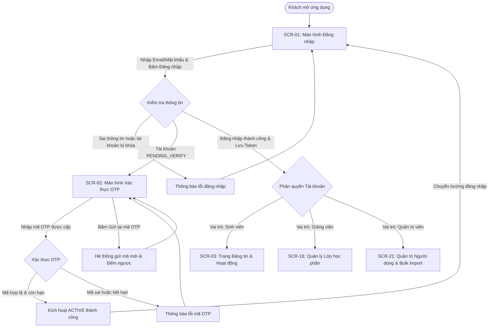
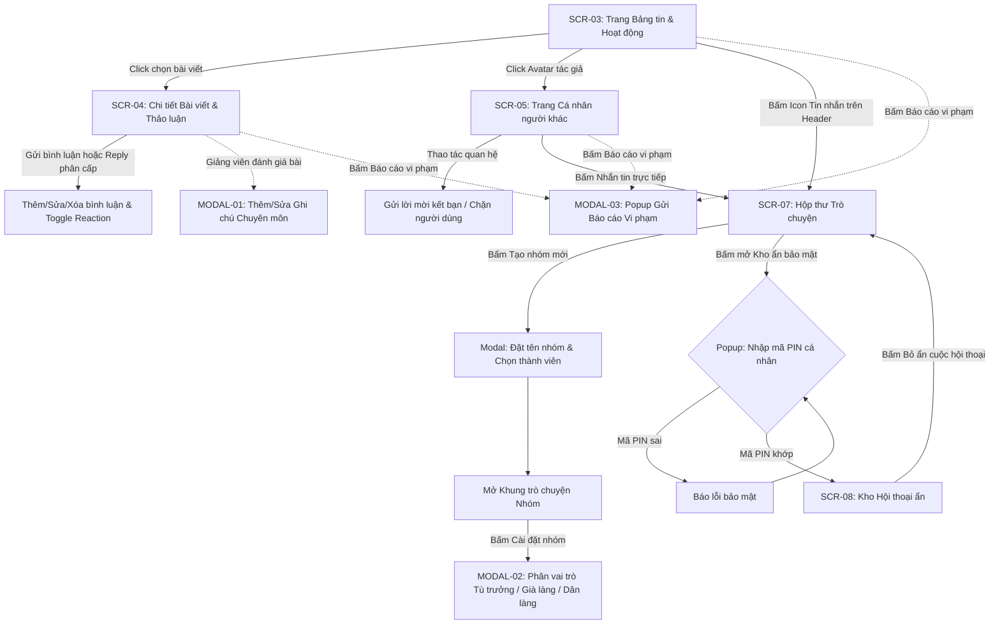
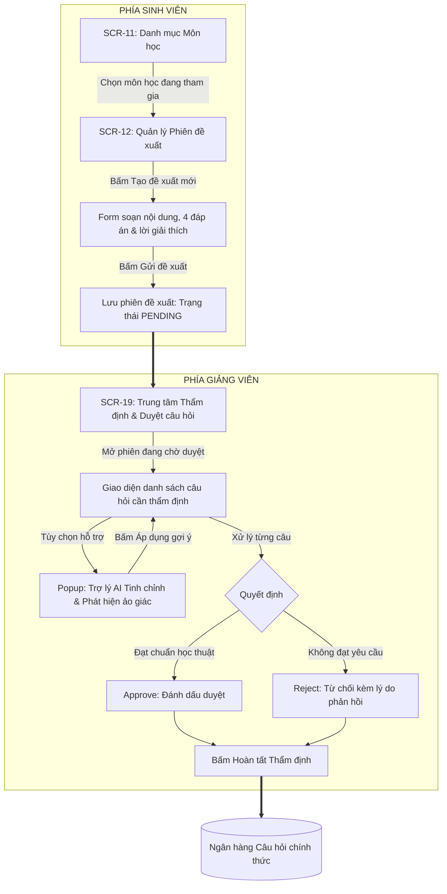
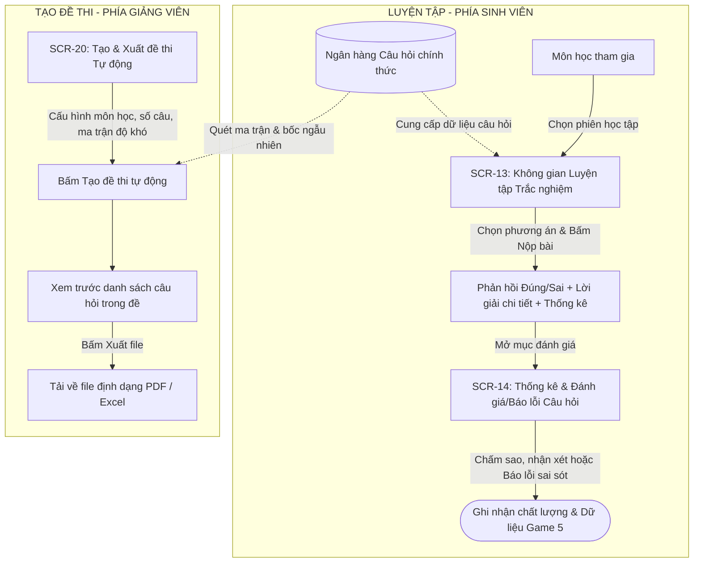
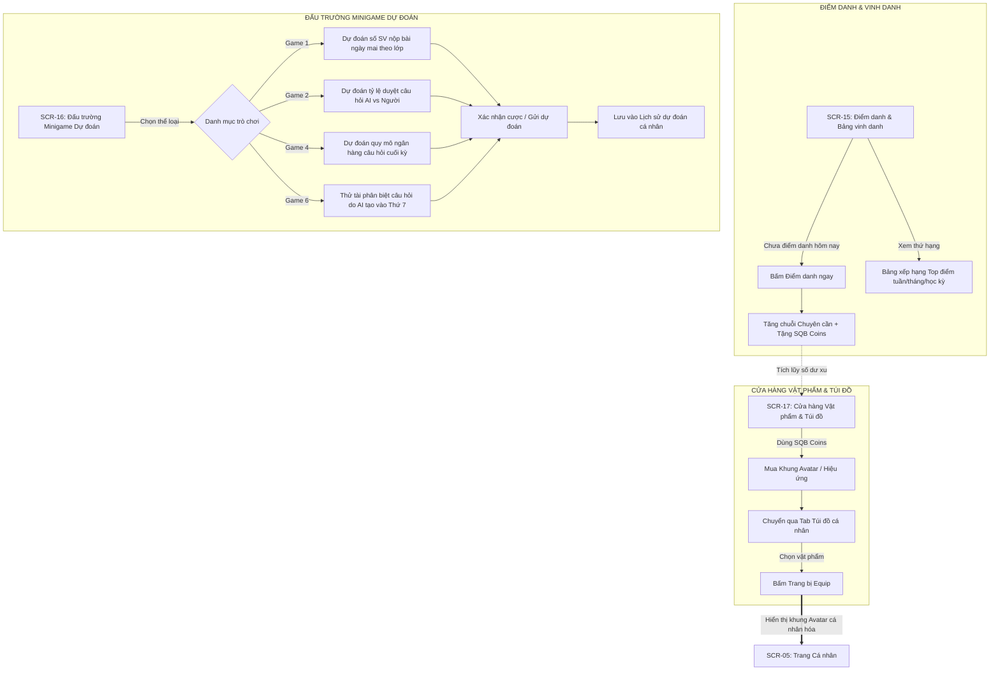

# TÀI LIỆU TOÀN DIỆN: KIẾN TRÚC MÀN HÌNH & SƠ ĐỒ LUỒNG ĐIỀU HƯỚNG (SCREEN FLOW DIAGRAMS)

Tài liệu này được biên soạn chuẩn xác 100% dựa trên tài liệu đặc tả 33 Use Case và tài liệu tổng quan màn hình. Nội dung bao gồm danh mục 24 màn hình chính, 4 modal chức năng và các sơ đồ luồng Mermaid chi tiết phục vụ thiết kế giao diện (UI/UX) và lập trình Frontend.

---

## PHẦN I: TỔNG QUAN HỆ THỐNG & PHÂN HỆ TÁC NHÂN (ACTORS)

* **Guest (Khách vãng lai / Chưa đăng nhập):** Đăng nhập vào hệ thống, kích hoạt tài khoản được cấp thông qua xác thực mã OTP.
* **Student (Sinh viên):** Tham gia mạng xã hội học tập, bảng tin, bình luận tương tác, trò chuyện cá nhân & nhóm, đề xuất bộ câu hỏi trắc nghiệm, luyện tập trắc nghiệm, đánh giá/báo lỗi câu hỏi, tham gia minigame dự đoán học thuật, điểm danh nhận coin và mua sắm vật phẩm cá nhân hóa.
* **Lecturer (Giảng viên):** Toàn quyền như Sinh viên + Quản lý các lớp học phần phụ trách, thẩm định & duyệt các phiên câu hỏi sinh viên đề xuất, sử dụng AI tinh chỉnh câu hỏi và phát hiện ảo giác (hallucination), cấu hình sinh đề thi tự động theo ma trận, xuất đề thi PDF/Excel, thẩm định báo lỗi câu hỏi từ sinh viên (Game 5), thêm ghi chú chuyên môn học thuật trên bài viết.
* **Admin (Quản trị viên):** Cấp tài khoản đơn lẻ, kích hoạt OTP, nhập danh sách tài khoản hàng loạt (Bulk Import), quản trị vòng đời học kỳ, quản lý danh mục môn học, phân công lớp học phần qua Excel, quản lý & trao tặng huy hiệu, cấu hình và tính toán lại bảng xếp hạng (Redis Cache Rebuild), tiếp nhận và xử lý báo cáo vi phạm, tương tác với bảng điều khiển Trợ lý AI.

---

## PHẦN II: SƠ ĐỒ CÂY DANH MỤC MÀN HÌNH (SITE MAP)

```text
HỆ THỐNG GIAO DIỆN (24 SCREENS + 04 MODALS)
├── [ZONE 1: AUTHENTICATION] (Công khai / Khách)
│   ├── SCR-01: Màn hình Đăng nhập (Login Screen)
│   └── SCR-02: Màn hình Xác thực OTP (OTP Verification)
│
├── [ZONE 2: CORE PORTAL - SOCIAL & COMMS] (Mọi User đã đăng nhập)
│   ├── SCR-03: Trang Bảng tin & Hoạt động (Feed & Activity Stream)
│   ├── SCR-04: Chi tiết Bài viết & Thảo luận (Post Detail & Comments)
│   │   └── MODAL-01: Popup Ghi chú Chuyên môn Giảng viên (Lecturer Notes Modal)
│   ├── SCR-05: Trang Cá nhân & Huy hiệu (User Profile & Badges)
│   ├── SCR-06: Trung tâm Bạn bè & Khối kết nối (Friends & Relations)
│   ├── SCR-07: Hộp thư Trò chuyện (Messenger / Conversations)
│   │   └── MODAL-02: Drawer/Modal Quản trị Nhóm chat (Group Chat Settings)
│   ├── SCR-08: Kho Hội thoại ẩn (Secret/Hidden Vault Chat)
│   ├── SCR-09: Tìm kiếm Toàn cục (Global Search)
│   ├── SCR-10: Cài đặt Cá nhân & Bảo mật (Settings & Devices)
│   └── MODAL-03: Popup Gửi Báo cáo Vi phạm (Report Modal)
│
├── [ZONE 3: HỌC TẬP & NGÂN HÀNG CÂU HỎI] (Sinh viên & Giảng viên)
│   ├── SCR-11: Danh mục Môn học & Tra cứu (Subjects Directory)
│   ├── SCR-12: Quản lý Phiên đề xuất Câu hỏi (Question Proposal Sessions)
│   ├── SCR-13: Không gian Luyện tập Trắc nghiệm (Practice & Quiz Mode)
│   └── SCR-14: Thống kê & Đánh giá Câu hỏi (Question Review & Ratings)
│
├── [ZONE 4: GAMIFICATION & PHẦN THƯỞNG] (Sinh viên & Giảng viên)
│   ├── SCR-15: Điểm danh & Bảng vinh danh (Daily Check-in & Leaderboard)
│   ├── SCR-16: Đấu trường Minigame Dự đoán (Academic Prediction Games)
│   └── SCR-17: Cửa hàng Vật phẩm & Túi đồ (Cosmetics Shop & Inventory)
│
├── [ZONE 5: CỔNG GIẢNG VIÊN (LECTURER PORTAL)]
│   ├── SCR-18: Quản lý Lớp học phần (Course Class Management)
│   ├── SCR-19: Trung tâm Thẩm định & Duyệt câu hỏi (Question Review Hub)
│   └── SCR-20: Tạo & Xuất đề thi tự động (Exam Generator & Export)
│
└── [ZONE 6: QUẢN TRỊ HỆ THỐNG (ADMIN PORTAL)]
    ├── SCR-21: Quản lý Người dùng & Bulk Import (User Management)
    ├── SCR-22: Quản trị Đào tạo (Học kỳ & Môn học) (Academic Management)
    ├── SCR-23: Quản lý Danh hiệu & Huy hiệu (Badges Config & Grant)
    └── SCR-24: Trợ lý Quản trị AI (Admin AI Assistant Chat)
```

---

## PHẦN III: SƠ ĐỒ ĐIỀU HƯỚNG TỔNG THỂ (GLOBAL SCREEN NAVIGATION)

Khung điều hướng trung tâm (Header & Navigation Sidebar) kết nối toàn bộ các khu vực chức năng:

```mermaid
flowchart TD
    %% Khởi tạo & Xác thực
    START([Bắt đầu / Khách truy cập]) --> SCR01[SCR-01: Màn hình Đăng nhập]
    SCR01 -- "Tài khoản PENDING_VERIFY" --> SCR02[SCR-02: Màn hình Xác thực OTP]
    SCR02 -- "Xác thực OTP thành công" --> SCR01

    %% Khung điều hướng Shell
    SCR01 -- "Đăng nhập thành công" --> SHELL{{KHUNG ĐIỀU HƯỚNG CHUNG<br/>Header & Sidebar Navigation}}

    %% Rẽ nhánh vai trò trực tiếp sau Login
    SHELL ==>|Vai trò: Sinh viên| SCR03[SCR-03: Trang Bảng tin & Hoạt động]
    SHELL ==>|Vai trò: Giảng viên| SCR18[SCR-18: Quản lý Lớp học phần]
    SHELL ==>|Vai trò: Quản trị viên| SCR21[SCR-21: Quản trị Người dùng & Bulk Import]

    %% Zone 2: Tiện ích & Mạng xã hội
    SHELL --> SCR06[SCR-06: Trung tâm Bạn bè]
    SHELL --> SCR07[SCR-07: Hộp thư Trò chuyện]
    SHELL --> SCR09[SCR-09: Tìm kiếm Toàn cục]
    SHELL --> SCR10[SCR-10: Cài đặt & Bảo mật]

    %% Zone 3: Học tập
    SHELL --> SCR11[SCR-11: Danh mục Môn học]

    %% Zone 4: Gamification
    SHELL --> SCR15[SCR-15: Điểm danh & BXH]
    SHELL --> SCR16[SCR-16: Đấu trường Minigame]
    SHELL --> SCR17[SCR-17: Cửa hàng & Túi đồ]

    %% Zone 5: Giảng viên mở rộng
    SHELL -.-> SCR19[SCR-19: Trung tâm Thẩm định & Duyệt câu hỏi]
    SHELL -.-> SCR20[SCR-20: Tạo & Xuất đề thi tự động]

    %% Zone 6: Admin mở rộng
    SHELL -.-> SCR22[SCR-22: Quản trị Đào tạo Học kỳ & Môn]
    SHELL -.-> SCR23[SCR-23: Quản lý Huy hiệu & Leaderboard]
    SHELL -.-> SCR24[SCR-24: Trợ lý Quản trị AI]

    %% Các mối liên kết chéo cốt lõi (Cross-links)
    SCR03 --> SCR04[SCR-04: Chi tiết Bài viết & Bình luận]
    SCR04 -. "Role Giảng viên" .-> MODAL01[MODAL-01: Ghi chú chuyên môn]
    SCR03 & SCR04 --> SCR05[SCR-05: Trang Cá nhân]
    SCR06 --> SCR05
    SCR05 -- "Bấm Nhắn tin" --> SCR07
    SCR07 --> MODAL02[MODAL-02: Quản trị Nhóm chat]
    SCR07 -- "Nhập mã PIN" --> SCR08[SCR-08: Kho Hội thoại ẩn]
    SCR03 & SCR04 & SCR05 -. "Gửi vi phạm" .-> MODAL03[MODAL-03: Gửi Báo cáo vi phạm]

    SCR11 --> SCR12[SCR-12: Quản lý Phiên đề xuất Câu hỏi]
    SCR12 ==>|Duyệt hoàn tất| DB[(Ngân hàng Câu hỏi chính thức)]
    DB ==> SCR13[SCR-13: Luyện tập Trắc nghiệm]
    DB ==> SCR20
    SCR13 --> SCR14[SCR-14: Đánh giá & Báo lỗi Câu hỏi]
    SCR17 -- "Trang bị Avatar" --> SCR05

    %% Phân màu Styling
    classDef auth fill:#eceff1,stroke:#607d8b,stroke-width:2px;
    classDef user fill:#e3f2fd,stroke:#1976d2,stroke-width:2px;
    classDef academic fill:#e8f5e9,stroke:#388e3c,stroke-width:2px;
    classDef game fill:#fff3e0,stroke:#f57c00,stroke-width:2px;
    classDef lecturer fill:#fbe9e7,stroke:#d84315,stroke-width:2px;
    classDef admin fill:#f3e5f5,stroke:#7b1fa2,stroke-width:2px;
    classDef modal fill:#fff9c4,stroke:#fbc02d,stroke-width:1px,stroke-dasharray: 5 5;
    classDef store fill:#efebe9,stroke:#4e342e,stroke-width:2px;

    class SCR01,SCR02 auth;
    class SCR03,SCR04,SCR05,SCR06,SCR07,SCR08,SCR09,SCR10 user;
    class SCR11,SCR12,SCR13,SCR14 academic;
    class SCR15,SCR16,SCR17 game;
    class SCR18,SCR19,SCR20 lecturer;
    class SCR21,SCR22,SCR23,SCR24 admin;
    class MODAL01,MODAL02,MODAL03 modal;
    class DB store;
```



---

## PHẦN IV: SƠ ĐỒ CHI TIẾT 05 LUỒNG HOẠT ĐỘNG CHÍNH

### Luồng 1: Khởi tạo, Đăng nhập & Điều hướng Phân quyền



---

### Luồng 2: Mạng xã hội, Tương tác & Trò chuyện



---

### Luồng 3: Quy trình Đề xuất & Thẩm định Câu hỏi (Học thuật)



---

### Luồng 4: Luyện tập, Đánh giá & Thi trắc nghiệm



---

### Luồng 5: Gamification, Minigame & Cửa hàng (Phần thưởng)



---

## PHẦN V: BẢNG TRA CỨU ROUTING MÀN HÌNH & ÁNH XẠ USE CASE

| Mã Màn Hình | Tên Màn Hình / Giao Diện | Đường Dẫn Tuyến (Route Path) | Tác Nhân (Actor) | Use Case Trực Tiếp |
| :--- | :--- | :--- | :--- | :--- |
| **SCR-01** | Đăng nhập hệ thống | `/login` | Public / Guest | UC01 |
| **SCR-02** | Xác thực OTP & Kích hoạt | `/verify-otp` | Public / Pending | UC01, UC02 |
| **SCR-03** | Bảng tin & Dòng hoạt động | `/feed` | All Users | UC05, UC15 |
| **SCR-04** | Chi tiết bài viết & Bình luận | `/posts/:id` | All Users | UC07, UC08 |
| **MODAL-01** | Ghi chú chuyên môn giảng viên | *(Modal / Drawer)* | Lecturer | UC06 |
| **SCR-05** | Trang cá nhân & Huy hiệu | `/profile/:userId` | All Users | UC04, UC27 |
| **SCR-06** | Trung tâm Bạn bè & Khối kết nối | `/friends` | All Users | UC09, UC10 |
| **SCR-07** | Hộp thư Trò chuyện | `/messages` | All Users | UC11 |
| **MODAL-02** | Quản trị nhóm trò chuyện | *(Drawer / Modal)* | Group Admin | UC12 |
| **SCR-08** | Kho hội thoại ẩn (Bảo mật PIN) | `/messages/hidden-vault` | All Users | UC13 |
| **SCR-09** | Tìm kiếm toàn cục | `/search` | All Users | UC30 |
| **SCR-10** | Cài đặt cá nhân & Phiên thiết bị | `/settings` | All Users | UC14, UC33 |
| **MODAL-03** | Báo cáo vi phạm nội dung / User | *(Modal)* | All Users | UC31 |
| **SCR-11** | Danh mục Môn học & Tra cứu | `/subjects` | All Users | UC17 |
| **SCR-12** | Quản lý Phiên đề xuất câu hỏi | `/proposals` | Student, Lecturer | UC19 |
| **SCR-13** | Không gian Luyện tập trắc nghiệm | `/practice/:sessionId` | Student, Lecturer | UC21 |
| **SCR-14** | Thống kê & Đánh giá/Báo lỗi câu hỏi | *(Modal / View)* | Student, Lecturer | UC21, UC22, UC26 |
| **SCR-15** | Điểm danh & Bảng vinh danh | `/gamification/leaderboard` | Student, Admin | UC25 |
| **SCR-16** | Đấu trường Minigame dự đoán | `/gamification/minigames` | Student, Lecturer | UC26 |
| **SCR-17** | Cửa hàng vật phẩm & Túi đồ | `/shop` | All Users | UC28 |
| **SCR-18** | Quản lý Lớp học phần | `/lecturer/classes` | Lecturer, Admin | UC18 |
| **SCR-19** | Trung tâm Thẩm định & Duyệt câu hỏi | `/lecturer/reviews` | Lecturer, Admin | UC20, UC29 |
| **SCR-20** | Tạo & Xuất đề thi tự động | `/lecturer/exams` | Lecturer | UC23, UC24 |
| **SCR-21** | Quản lý Người dùng & Bulk Import | `/admin/users` | Admin | UC02, UC03 |
| **SCR-22** | Quản trị Đào tạo (Học kỳ, Môn học) | `/admin/academic` | Admin | UC16, UC17, UC18 |
| **SCR-23** | Quản lý Huy hiệu & Rebuild Cache | `/admin/badges` | Admin | UC25, UC27 |
| **SCR-24** | Trợ lý Quản trị AI | `/admin/ai-assistant` | Admin | UC29 |
