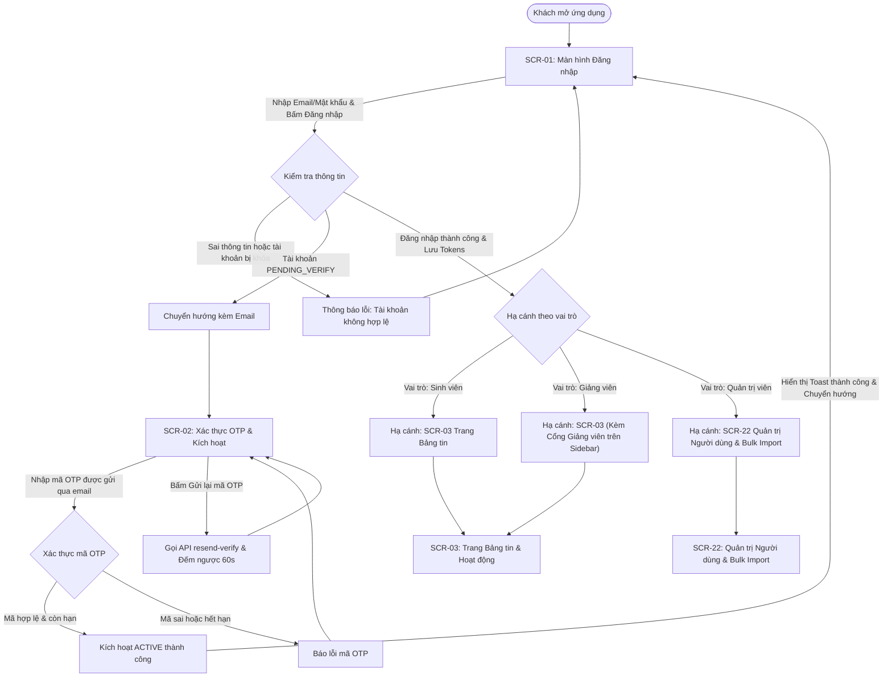
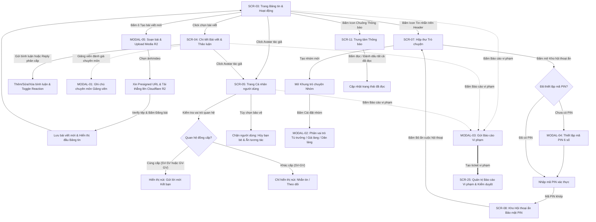
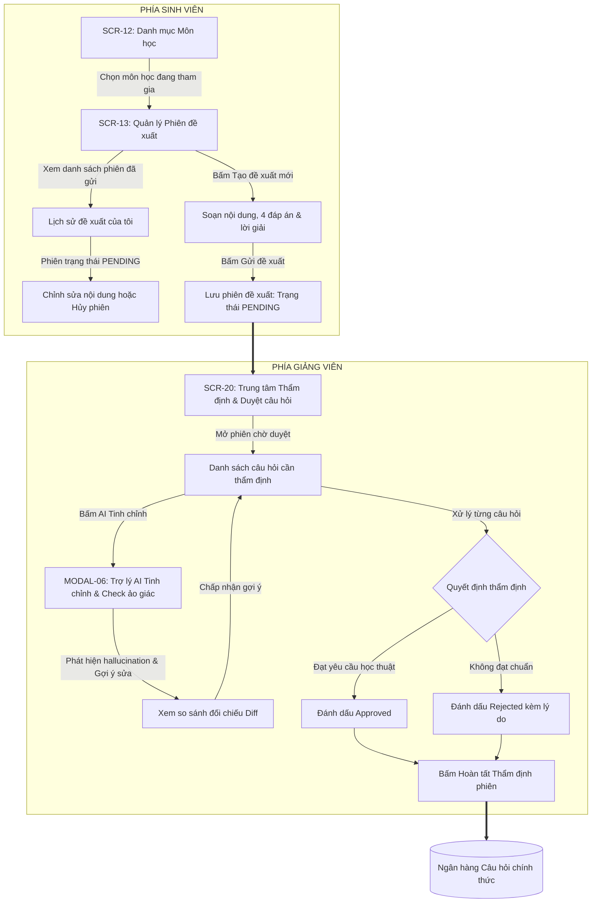
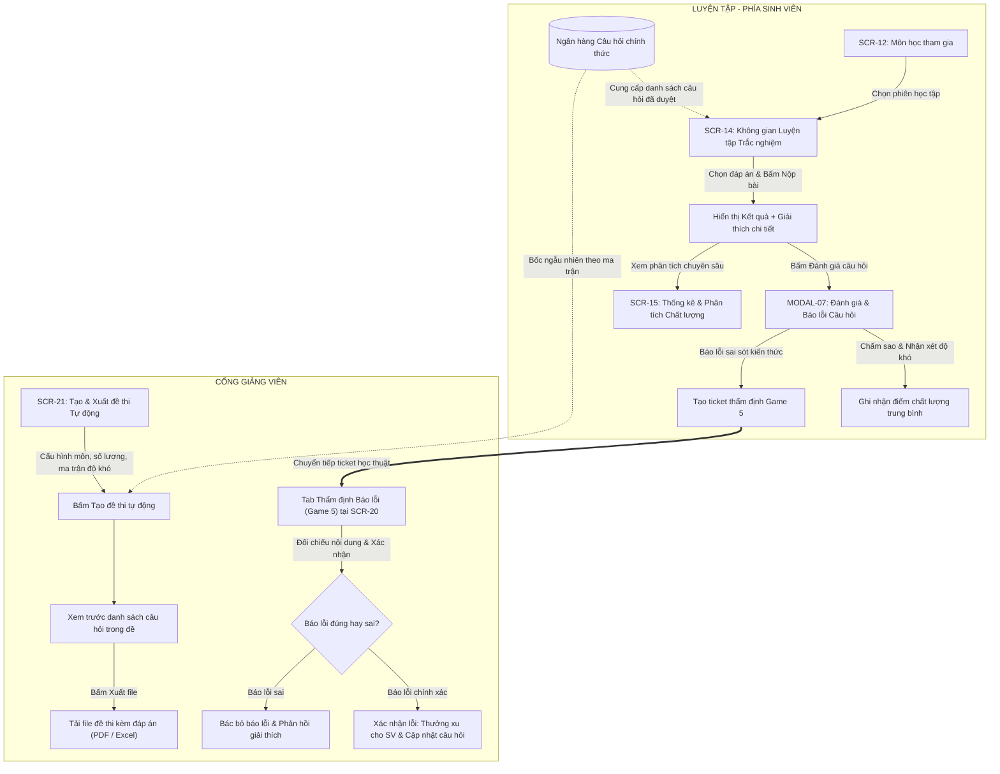
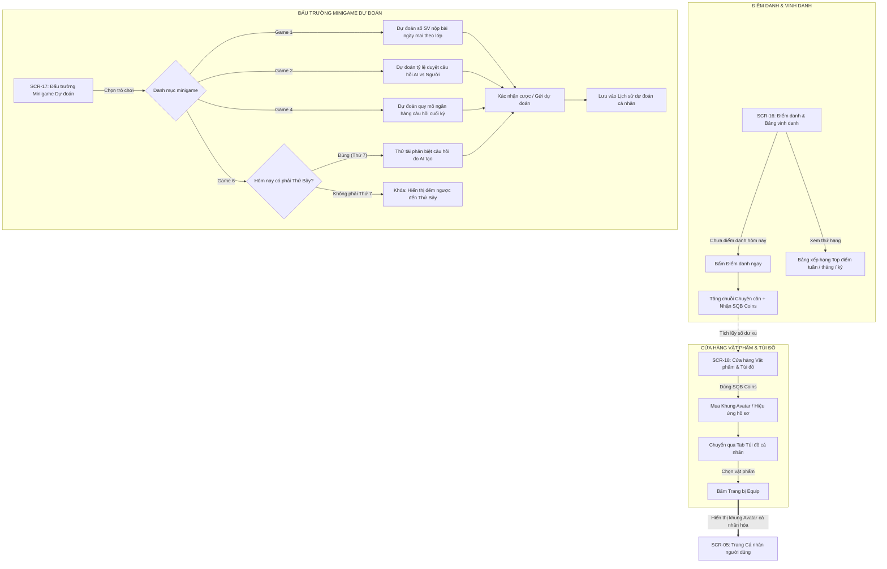

# TÀI LIỆU TOÀN DIỆN: KIẾN TRÚC MÀN HÌNH & SƠ ĐỒ LUỒNG ĐIỀU HƯỚNG (SCREEN FLOW DIAGRAMS)

Tài liệu này được biên soạn chuẩn xác 100% dựa trên tài liệu đặc tả 33 Use Case ([`requirements.md`](requirements.md)) và tài liệu quy chuẩn phát triển ([`FRONTEND_CONVENTIONS.md`](FRONTEND_CONVENTIONS.md), [`AGENTS.md`](AGENTS.md)). Nội dung bao gồm danh mục chuẩn hóa 26 màn hình chính (Screens), 07 hộp thoại chức năng (Modals/Drawers) và các sơ đồ luồng Mermaid chi tiết phục vụ thiết kế giao diện (UI/UX) và lập trình Frontend.

---

## PHẦN I: TỔNG QUAN HỆ THỐNG & PHÂN HỆ TÁC NHÂN (ACTORS)

* **Guest (Khách vãng lai / Chưa đăng nhập):** Đăng nhập vào hệ thống ([`UC01`](requirements.md#uc01-dang-nhap-he-thong)), kích hoạt tài khoản được cấp thông qua xác thực mã OTP ([`UC02`](requirements.md#uc02-quan-tri-vien-tao-tai-khoan--kich-hoat-qua-otp)).
* **Student (Sinh viên):** Tham gia mạng xã hội học tập, bảng tin & dòng hoạt động ([`UC05`](requirements.md#uc05-dang-bai-viet-moi), [`UC15`](requirements.md#uc15-xem-dong-hoat-dong-activity-feed)), đăng bài viết kèm đa phương tiện tải lên Cloudflare R2 ([`UC05`](requirements.md#uc05-dang-bai-viet-moi), [`UC32`](requirements.md#uc32-tai-len-tep-va-hinh-anh-cloudflare-r2-media)), bình luận tương tác phân cấp ([`UC07`](requirements.md#uc07-binh-luan-tren-bai-viet)), thả cảm xúc đa hình ([`UC08`](requirements.md#uc08-tha--bo-cam-xuc-reactions)), kết bạn với người dùng đồng cấp Sinh viên - Sinh viên ([`UC09`](requirements.md#uc09-quan-ly-moi-quan-he-ban-be-friendships)), chặn người dùng ([`UC10`](requirements.md#uc10-chan-nguoi-dung-blocks)), trò chuyện cá nhân & nhóm ([`UC11`](requirements.md#uc11-tro-chuyen-truc-tiep--nhom-chat)), quản trị nhóm chat ([`UC12`](requirements.md#uc12-quan-tri-nhom-chat)), bảo vệ tin nhắn riêng tư bằng kho hội thoại ẩn mã PIN ([`UC13`](requirements.md#uc13-quan-ly-kho-hoi-thoai-an-bang-ma-pin)), nhận & quản lý thông báo ([`UC14`](requirements.md#uc14-quan-ly-thong-bao)), tra cứu danh mục môn học ([`UC17`](requirements.md#uc17-quan-tri-danh-muc-mon-hoc-subjects)), đề xuất câu hỏi trắc nghiệm và quản lý phiên gửi ([`UC19`](requirements.md#uc19-quan-ly-phien-de-xuat-cau-hoi-trac-nghiem-sessions)), luyện tập trắc nghiệm theo phiên học tập ([`UC21`](requirements.md#uc21-luyen-tap-va-nop-cau-tra-loi)), đánh giá & báo lỗi câu hỏi tham gia Game 5 ([`UC22`](requirements.md#uc22-danh-gia-chat-luong-cau-hoi), [`UC26`](requirements.md#uc26-tham-gia-minigame-du-doan-hoc-thuat)), điểm danh nhận xu SQB Coins và theo dõi BXH ([`UC25`](requirements.md#uc25-diem-danh-chuyen-can-va-bang-xep-hang)), tham gia các minigame dự đoán học thuật Game 1, 2, 4, 6 ([`UC26`](requirements.md#uc26-tham-gia-minigame-du-doan-hoc-thuat)), mua sắm & trang bị vật phẩm cá nhân hóa ([`UC28`](requirements.md#uc28-cua-hang-va-trang-bi-vat-pham-ca-nhan-hoa)), tìm kiếm toàn cục đa thực thể ([`UC30`](requirements.md#uc30-tim-kiem-toan-van-full-text-search)), gửi báo cáo vi phạm nội dung/người dùng ([`UC31`](requirements.md#uc31-gui-bao-cao-vi-pham-reports)), quản lý thiết bị và phiên đăng nhập ([`UC33`](requirements.md#uc33-quan-ly-thiet-bi-dang-nhap-va-phien-lam-viec-devices)).
* **Lecturer (Giảng viên):** Toàn quyền như Sinh viên (trong phạm vi kết bạn đồng cấp Giảng viên - Giảng viên) + Quản lý các lớp học phần phụ trách và danh sách sinh viên ([`UC18`](requirements.md#uc18-quan-ly-lop-hoc-phan-course-classes)), thêm ghi chú chuyên môn học thuật trên bài viết ([`UC06`](requirements.md#uc06-giang-vien-cap-nhat-ghi-chu-chuyen-mon)), thẩm định & phê duyệt các phiên đề xuất câu hỏi từ sinh viên ([`UC20`](requirements.md#uc20-tham-dinh-va-duyet-cau-hoi-question-review)), thẩm định báo lỗi câu hỏi từ sinh viên trong minigame học thuật Game 5 ([`UC20`](requirements.md#uc20-tham-dinh-va-duyet-cau-hoi-question-review), [`UC26`](requirements.md#uc26-tham-gia-minigame-du-doan-hoc-thuat)), sử dụng Trợ lý AI tinh chỉnh câu hỏi và phát hiện ảo giác (hallucination) ([`UC29`](requirements.md#uc29-tro-ly-ai-va-tinh-chinh-cau-hoi-hoc-thuat)), cấu hình sinh đề thi tự động theo ma trận độ khó ([`UC23`](requirements.md#uc23-quan-ly-va-tao-de-thi-tu-dong)), xuất đề thi và ngân hàng câu hỏi ra file PDF/Excel ([`UC24`](requirements.md#uc24-xuat-de-thi-va-ngan-hang-cau-hoi)).
* **Admin (Quản trị viên):** Cấp tài khoản người dùng đơn lẻ và kích hoạt OTP ([`UC02`](requirements.md#uc02-quan-tri-vien-tao-tai-khoan--kich-hoat-qua-otp)), nhập danh sách tài khoản hàng loạt qua Excel/CSV (Bulk Import) ([`UC03`](requirements.md#uc03-nhap-tai-khoan-hang-loat-bulk-import)), quản lý hồ sơ và vai trò người dùng ([`UC04`](requirements.md#uc04-quan-ly-ho-so-ca-nhan)), quản trị vòng đời học kỳ toàn trường ([`UC16`](requirements.md#uc16-quan-ly-hoc-ky-semesters)), quản trị danh mục môn học ([`UC17`](requirements.md#uc17-quan-tri-danh-muc-mon-hoc-subjects)), phân công lớp học phần và gán sinh viên hàng loạt qua Excel ([`UC18`](requirements.md#uc18-quan-ly-lop-hoc-phan-course-classes)), thẩm định câu hỏi cấp cao ([`UC20`](requirements.md#uc20-tham-dinh-va-duyet-cau-hoi-question-review)), kích hoạt tính toán lại bảng xếp hạng (Redis Cache Rebuild) và chốt học kỳ ([`UC25`](requirements.md#uc25-diem-danh-chuyen-can-va-bang-xep-hang)), cấu hình danh hiệu và trao tặng huy hiệu thủ công ([`UC27`](requirements.md#uc27-quan-ly-va-cap-phat-huy-hieu-danh-hieu)), tiếp nhận và xử lý các ticket báo cáo vi phạm nội dung/người dùng ([`UC31`](requirements.md#uc31-gui-bao-cao-vi-pham-reports)), tương tác với bảng điều khiển Trợ lý AI Quản trị ([`UC29`](requirements.md#uc29-tro-ly-ai-va-tinh-chinh-cau-hoi-hoc-thuat)).

---

## PHẦN II: SƠ ĐỒ CÂY DANH MỤC MÀN HÌNH (SITE MAP)

```text
HỆ THỐNG GIAO DIỆN CHUẨN HÓA (26 SCREENS + 07 MODALS)
├── [ZONE 1: AUTHENTICATION] (Công khai / Khách)
│   ├── SCR-01: Màn hình Đăng nhập (Login Screen - /login)
│   └── SCR-02: Màn hình Xác thực OTP & Kích hoạt (OTP Verification - /verify-otp)
│
├── [ZONE 2: CORE PORTAL - SOCIAL & COMMS] (Mọi User đã đăng nhập)
│   ├── SCR-03: Trang Bảng tin & Hoạt động (Feed & Activity Stream - /feed)
│   │   └── MODAL-05: Popup Soạn bài viết & Đính kèm Media R2 (Create Post Modal)
│   ├── SCR-04: Chi tiết Bài viết & Thảo luận (Post Detail & Comments - /posts/:id)
│   │   └── MODAL-01: Popup Ghi chú Chuyên môn Giảng viên (Lecturer Notes Modal)
│   ├── SCR-05: Trang Cá nhân & Bộ sưu tập Huy hiệu (User Profile & Badges - /profile/:userId)
│   ├── SCR-06: Trung tâm Bạn bè & Khối kết nối (Friends & Relations - /friends)
│   ├── SCR-07: Hộp thư Trò chuyện (Messenger / Conversations - /messages)
│   │   ├── MODAL-02: Drawer/Modal Quản trị Nhóm chat (Group Chat Settings)
│   │   └── MODAL-04: Popup Mã PIN Kho ẩn (Thiết lập / Mở khóa Kho bí mật)
│   ├── SCR-08: Kho Hội thoại ẩn Bảo mật PIN (Secret Vault Chat - /messages/hidden-vault)
│   ├── SCR-09: Tìm kiếm Toàn cục Đa thực thể (Global Search - /search)
│   ├── SCR-10: Cài đặt Cá nhân & Phiên thiết bị (Settings & Devices - /settings)
│   ├── SCR-11: Trung tâm Thông báo (Notifications Center - /notifications)
│   └── MODAL-03: Popup Gửi Báo cáo Vi phạm Nội dung / Người dùng (Report Modal)
│
├── [ZONE 3: HỌC TẬP & NGÂN HÀNG CÂU HỎI] (Sinh viên & Giảng viên)
│   ├── SCR-12: Danh mục Môn học & Tra cứu (Subjects Directory - /subjects)
│   ├── SCR-13: Quản lý Phiên đề xuất Câu hỏi (Proposal Sessions - /proposals)
│   ├── SCR-14: Không gian Luyện tập Trắc nghiệm (Practice & Quiz Mode - /practice/:sessionId)
│   │   └── MODAL-07: Popup Đánh giá Chất lượng & Báo lỗi Câu hỏi (Game 5 Report)
│   └── SCR-15: Thống kê & Phân tích Chất lượng Câu hỏi (Question Analytics - /questions/:id/analytics)
│
├── [ZONE 4: GAMIFICATION & PHẦN THƯỞNG] (Sinh viên & Giảng viên)
│   ├── SCR-16: Điểm danh & Bảng vinh danh (Daily Check-in & Leaderboard - /gamification/leaderboard)
│   ├── SCR-17: Đấu trường Minigame Dự đoán (Academic Prediction Games - /gamification/minigames)
│   └── SCR-18: Cửa hàng Vật phẩm & Túi đồ (Cosmetics Shop & Inventory - /shop)
│
├── [ZONE 5: CỔNG GIẢNG VIÊN (LECTURER PORTAL)]
│   ├── SCR-19: Quản lý Lớp học phần (Course Class Management - /lecturer/classes)
│   ├── SCR-20: Trung tâm Thẩm định Câu hỏi & Duyệt báo lỗi Game 5 (Review Hub - /lecturer/reviews)
│   │   └── MODAL-06: Popup Trợ lý AI Tinh chỉnh & Phát hiện Ảo giác (AI Refine Modal)
│   └── SCR-21: Tạo & Xuất đề thi tự động (Exam Generator & Export - /lecturer/exams)
│
└── [ZONE 6: QUẢN TRỊ HỆ THỐNG (ADMIN PORTAL)]
    ├── SCR-22: Quản trị Người dùng & Bulk Import (User Management - /admin/users)
    ├── SCR-23: Quản trị Đào tạo (Học kỳ & Môn học) (Academic Management - /admin/academic)
    ├── SCR-24: Quản lý Danh hiệu & Rebuild Cache (Badges & Cache Rebuild - /admin/badges)
    ├── SCR-25: Quản trị Báo cáo Vi phạm & Kiểm duyệt (Content Moderation - /admin/reports)
    └── SCR-26: Trợ lý Quản trị AI (Admin AI Assistant Chat - /admin/ai-assistant)
```

---

## PHẦN III: SƠ ĐỒ ĐIỀU HƯỚNG TỔNG THỂ (GLOBAL SCREEN NAVIGATION)

Khung điều hướng trung tâm (Header & Sidebar Navigation Shell) kết nối toàn diện 26 màn hình và 07 hộp thoại ngữ cảnh:

```mermaid
flowchart TD
    %% Khởi tạo & Xác thực
    START(["Bắt đầu / Khách truy cập"]) --> SCR01["SCR-01: Màn hình Đăng nhập"]
    SCR01 -- "Tài khoản PENDING_VERIFY" --> SCR02["SCR-02: Xác thực OTP & Kích hoạt"]
    SCR02 -- "Kích hoạt OTP thành công" --> SCR01

    %% Khung điều hướng chung Shell
    SCR01 -- "Đăng nhập thành công" --> SHELL{{"KHUNG ĐIỀU HƯỚNG CHUNG<br/>Header & Sidebar Navigation Shell"}}

    %% Phân luồng hạ cánh thông minh sau Login
    SHELL ==>|"Sinh viên & Giảng viên (Mặc định)"| SCR03["SCR-03: Trang Bảng tin & Hoạt động"]
    SHELL ==>|"Quản trị viên (Mặc định)"| SCR22["SCR-22: Quản trị Người dùng & Bulk Import"]

    %% Zone 2: Tiện ích & Mạng xã hội
    SHELL --> SCR06["SCR-06: Trung tâm Bạn bè & Khối kết nối"]
    SHELL --> SCR07["SCR-07: Hộp thư Trò chuyện"]
    SHELL --> SCR09["SCR-09: Tìm kiếm Toàn cục Đa thực thể"]
    SHELL --> SCR10["SCR-10: Cài đặt Cá nhân & Phiên thiết bị"]
    SHELL --> SCR11["SCR-11: Trung tâm Thông báo"]

    %% Zone 3: Học tập & Ngân hàng câu hỏi
    SHELL --> SCR12["SCR-12: Danh mục Môn học & Tra cứu"]
    SHELL --> SCR13["SCR-13: Quản lý Phiên đề xuất Câu hỏi"]

    %% Zone 4: Gamification & Phần thưởng
    SHELL --> SCR16["SCR-16: Điểm danh & Bảng vinh danh"]
    SHELL --> SCR17["SCR-17: Đấu trường Minigame Dự đoán"]
    SHELL --> SCR18["SCR-18: Cửa hàng Vật phẩm & Túi đồ"]

    %% Zone 5: Cổng Giảng viên mở rộng
    SHELL -.->|"Cổng Giảng viên"| SCR19["SCR-19: Quản lý Lớp học phần"]
    SHELL -.->|"Cổng Giảng viên"| SCR20["SCR-20: Trung tâm Thẩm định & Duyệt báo lỗi"]
    SHELL -.->|"Cổng Giảng viên"| SCR21["SCR-21: Tạo & Xuất đề thi tự động"]

    %% Zone 6: Cổng Admin mở rộng
    SHELL -.->|"Cổng Quản trị"| SCR23["SCR-23: Quản trị Đào tạo Học kỳ & Môn"]
    SHELL -.->|"Cổng Quản trị"| SCR24["SCR-24: Quản lý Huy hiệu & Rebuild Cache"]
    SHELL -.->|"Cổng Quản trị"| SCR25["SCR-25: Quản trị Báo cáo Vi phạm & Kiểm duyệt"]
    SHELL -.->|"Cổng Quản trị"| SCR26["SCR-26: Trợ lý Quản trị AI"]

    %% Liên kết chéo cốt lõi (Cross-links) & Modals
    SCR03 -. "Soạn bài viết" .-> MODAL05["MODAL-05: Soạn bài & Upload Media R2"]
    SCR03 --> SCR04["SCR-04: Chi tiết Bài viết & Thảo luận"]
    SCR04 -. "Giảng viên đánh giá" .-> MODAL01["MODAL-01: Ghi chú chuyên môn Giảng viên"]
    SCR03 & SCR04 --> SCR05["SCR-05: Trang Cá nhân & Huy hiệu"]
    SCR06 --> SCR05
    SCR05 -- "Nhắn tin" --> SCR07
    SCR07 -. "Cài đặt nhóm" .-> MODAL02["MODAL-02: Quản trị Nhóm chat"]
    SCR07 -. "Mở kho bảo mật" .-> MODAL04["MODAL-04: Xác thực/Thiết lập mã PIN"]
    MODAL04 -- "PIN chính xác" --> SCR08["SCR-08: Kho Hội thoại ẩn"]
    SCR03 & SCR04 & SCR05 -. "Báo cáo vi phạm" .-> MODAL03["MODAL-03: Gửi Báo cáo Vi phạm"]
    MODAL03 ==>|"Chuyển tiếp ticket xử lý"| SCR25

    SCR12 --> SCR13
    SCR12 -- "Chọn phiên luyện tập" --> SCR14["SCR-14: Không gian Luyện tập Trắc nghiệm"]
    SCR14 -. "Nộp bài & Đánh giá" .-> MODAL07["MODAL-07: Đánh giá & Báo lỗi Câu hỏi"]
    MODAL07 ==>|"Dữ liệu ticket Game 5"| SCR20
    SCR14 --> SCR15["SCR-15: Thống kê & Phân tích Chất lượng"]
    SCR13 ==>|"Duyệt hoàn tất"| BANK[("Ngân hàng Câu hỏi chính thức")]
    BANK ==> SCR14
    BANK ==> SCR21
    SCR20 -. "AI hỗ trợ tinh chỉnh" .-> MODAL06["MODAL-06: Trợ lý AI Tinh chỉnh & Check ảo giác"]
    SCR18 -- "Trang bị Avatar/Hiệu ứng" --> SCR05

    %% Phân màu Styling (Tuân thủ triệt để HEX chuẩn 6-digit & 8-digit)
    classDef auth fill:#eceff1,stroke:#607d8b,stroke-width:2px;
    classDef user fill:#e3f2fd,stroke:#1976d2,stroke-width:2px;
    classDef academic fill:#e8f5e9,stroke:#388e3c,stroke-width:2px;
    classDef game fill:#fff3e0,stroke:#f57c00,stroke-width:2px;
    classDef lecturer fill:#fbe9e7,stroke:#d84315,stroke-width:2px;
    classDef admin fill:#f3e5f5,stroke:#7b1fa2,stroke-width:2px;
    classDef modal fill:#fff9c4,stroke:#fbc02d,stroke-width:1px,stroke-dasharray: 5 5;
    classDef store fill:#efebe9,stroke:#4e342e,stroke-width:2px;

    class SCR01,SCR02 auth;
    class SCR03,SCR04,SCR05,SCR06,SCR07,SCR08,SCR09,SCR10,SCR11 user;
    class SCR12,SCR13,SCR14,SCR15 academic;
    class SCR16,SCR17,SCR18 game;
    class SCR19,SCR20,SCR21 lecturer;
    class SCR22,SCR23,SCR24,SCR25,SCR26 admin;
    class MODAL01,MODAL02,MODAL03,MODAL04,MODAL05,MODAL06,MODAL07 modal;
    class BANK store;
```



> **Chú giải kiểu mũi tên điều hướng:**
> - `==>` Mũi tên nét đôi: Luồng chính / Điều hướng trực tiếp sau đăng nhập hoặc chuyển dữ liệu tự động.
> - `-->` Mũi tên nét liền: Điều hướng chuyển trang từ Menu điều hướng hoặc sự kiện Click.
> - `-.->` Mũi tên nét đứt: Kích hoạt Hộp thoại ngữ cảnh (Modal/Drawer) hoặc phân quyền vai trò.

---

## PHẦN IV: SƠ ĐỒ CHI TIẾT 05 LUỒNG HOẠT ĐỘNG CHÍNH

### Luồng 1: Khởi tạo, Đăng nhập & Điều hướng Phân quyền

Quy trình xác thực người dùng, kích hoạt tài khoản bằng mã OTP và phân luồng hạ cánh thông minh:



---

### Luồng 2: Mạng xã hội, Tương tác & Trò chuyện

Quy trình đăng bài viết đa phương tiện qua Cloudflare R2, tương tác cộng đồng, quan hệ bạn bè đồng cấp, kho ẩn mã PIN và xử lý báo cáo vi phạm:



---

### Luồng 3: Quy trình Đề xuất & Thẩm định Câu hỏi (Học thuật)

Vòng đời khép kín từ lúc sinh viên soạn thảo phiên câu hỏi, theo dõi/chỉnh sửa, đến khi giảng viên thẩm định kèm hỗ trợ AI tinh chỉnh:



---

### Luồng 4: Luyện tập, Đánh giá, Thẩm định Báo lỗi Game 5 & Thi trắc nghiệm

Quy trình sinh viên luyện tập theo phiên học tập, đánh giá câu hỏi, gửi báo lỗi Game 5 và giảng viên thẩm định báo lỗi kết hợp xuất đề thi:



---

### Luồng 5: Gamification, Minigame & Cửa hàng (Phần thưởng)

Quy trình điểm danh nhận streak, tham gia các minigame dự đoán học thuật (Game 1, 2, 4, 5, 6), tích lũy xu và mua sắm trang bị ngoại trang:



---

## PHẦN V: BẢNG TRA CỨU ROUTING MÀN HÌNH & ÁNH XẠ USE CASE (100% 33 USE CASES)

Bảng đối chiếu toàn diện giữa 26 Màn hình chính, 07 Hộp thoại ngữ cảnh và đầy đủ 33 Use Cases trong hệ thống:

| Mã Giao Diện | Tên Màn Hình / Hộp Thoại Ngữ Cảnh | Đường Dẫn Tuyến (Route Path) | Tác Nhân (Actor) | Ánh Xạ Use Case Trực Tiếp |
| :--- | :--- | :--- | :--- | :--- |
| **SCR-01** | Màn hình Đăng nhập hệ thống | `/login` | Public / Guest | [`UC01`](requirements.md#uc01-dang-nhap-he-thong) |
| **SCR-02** | Màn hình Xác thực OTP & Kích hoạt | `/verify-otp` | Public / Pending User | [`UC01`](requirements.md#uc01-dang-nhap-he-thong), [`UC02`](requirements.md#uc02-quan-tri-vien-tao-tai-khoan--kich-hoat-qua-otp) |
| **SCR-03** | Trang Bảng tin & Hoạt động mạng xã hội | `/feed` | All Users | [`UC05`](requirements.md#uc05-dang-bai-viet-moi), [`UC15`](requirements.md#uc15-xem-dong-hoat-dong-activity-feed) |
| **MODAL-05** | Hộp thoại Soạn bài viết & Upload Media R2 | *(Contextual Modal)* | All Users | [`UC05`](requirements.md#uc05-dang-bai-viet-moi), [`UC32`](requirements.md#uc32-tai-len-tep-va-hinh-anh-cloudflare-r2-media) |
| **SCR-04** | Chi tiết Bài viết & Thảo luận phân cấp | `/posts/:id` | All Users | [`UC07`](requirements.md#uc07-binh-luan-tren-bai-viet), [`UC08`](requirements.md#uc08-tha--bo-cam-xuc-reactions) |
| **MODAL-01** | Hộp thoại Ghi chú chuyên môn Giảng viên | *(Contextual Modal)* | Lecturer | [`UC06`](requirements.md#uc06-giang-vien-cap-nhat-ghi-chu-chuyen-mon) |
| **SCR-05** | Trang Cá nhân & Bộ sưu tập Huy hiệu | `/profile/:userId` | All Users | [`UC04`](requirements.md#uc04-quan-ly-ho-so-ca-nhan), [`UC27`](requirements.md#uc27-quan-ly-va-cap-phat-huy-hieu-danh-hieu) |
| **SCR-06** | Trung tâm Bạn bè & Khối kết nối | `/friends` | All Users (Peer-only) | [`UC09`](requirements.md#uc09-quan-ly-moi-quan-he-ban-be-friendships), [`UC10`](requirements.md#uc10-chan-nguoi-dung-blocks) |
| **SCR-07** | Hộp thư Trò chuyện & Hội thoại | `/messages` | All Users | [`UC11`](requirements.md#uc11-tro-chuyen-truc-tiep--nhom-chat) |
| **MODAL-02** | Hộp thoại Quản trị nhóm chat | *(Drawer / Modal)* | Group Admin / Leaders | [`UC12`](requirements.md#uc12-quan-tri-nhom-chat) |
| **MODAL-04** | Hộp thoại Mã PIN Kho ẩn (Tạo mới / Mở khóa) | *(Contextual Modal)* | All Users | [`UC13`](requirements.md#uc13-quan-ly-kho-hoi-thoai-an-bang-ma-pin) |
| **SCR-08** | Kho Hội thoại ẩn Bảo mật mã PIN | `/messages/hidden-vault` | All Users | [`UC13`](requirements.md#uc13-quan-ly-kho-hoi-thoai-an-bang-ma-pin) |
| **SCR-09** | Tìm kiếm Toàn cục Đa thực thể | `/search` | All Users | [`UC30`](requirements.md#uc30-tim-kiem-toan-van-full-text-search) |
| **SCR-10** | Cài đặt Cá nhân & Phiên thiết bị | `/settings` | All Users | [`UC10`](requirements.md#uc10-chan-nguoi-dung-blocks), [`UC14`](requirements.md#uc14-quan-ly-thong-bao), [`UC33`](requirements.md#uc33-quan-ly-thiet-bi-dang-nhap-va-phien-lam-viec-devices) |
| **SCR-11** | Trung tâm Thông báo | `/notifications` | All Users | [`UC14`](requirements.md#uc14-quan-ly-thong-bao) |
| **MODAL-03** | Hộp thoại Gửi Báo cáo Vi phạm | *(Contextual Modal)* | All Users | [`UC31`](requirements.md#uc31-gui-bao-cao-vi-pham-reports) |
| **SCR-12** | Danh mục Môn học & Tra cứu | `/subjects` | All Users | [`UC17`](requirements.md#uc17-quan-tri-danh-muc-mon-hoc-subjects) |
| **SCR-13** | Quản lý Phiên đề xuất Câu hỏi | `/proposals` | Student, Lecturer | [`UC19`](requirements.md#uc19-quan-ly-phien-de-xuat-cau-hoi-trac-nghiem-sessions) |
| **SCR-14** | Không gian Luyện tập Trắc nghiệm | `/practice/:sessionId` | Student, Lecturer | [`UC21`](requirements.md#uc21-luyen-tap-va-nop-cau-tra-loi) |
| **MODAL-07** | Hộp thoại Đánh giá & Báo lỗi Câu hỏi (Game 5) | *(Contextual Modal)* | Student, Lecturer | [`UC22`](requirements.md#uc22-danh-gia-chat-luong-cau-hoi), [`UC26`](requirements.md#uc26-tham-gia-minigame-du-doan-hoc-thuat) |
| **SCR-15** | Thống kê & Phân tích Chất lượng Câu hỏi | `/questions/:id/analytics` | Student, Lecturer | [`UC21`](requirements.md#uc21-luyen-tap-va-nop-cau-tra-loi), [`UC22`](requirements.md#uc22-danh-gia-chat-luong-cau-hoi) |
| **SCR-16** | Điểm danh & Bảng vinh danh | `/gamification/leaderboard` | Student, Admin | [`UC25`](requirements.md#uc25-diem-danh-chuyen-can-va-bang-xep-hang) |
| **SCR-17** | Đấu trường Minigame Dự đoán | `/gamification/minigames` | Student, Lecturer | [`UC26`](requirements.md#uc26-tham-gia-minigame-du-doan-hoc-thuat) |
| **SCR-18** | Cửa hàng Vật phẩm & Túi đồ | `/shop` | All Users | [`UC28`](requirements.md#uc28-cua-hang-va-trang-bi-vat-pham-ca-nhan-hoa) |
| **SCR-19** | Quản lý Lớp học phần | `/lecturer/classes` | Lecturer, Admin | [`UC18`](requirements.md#uc18-quan-ly-lop-hoc-phan-course-classes) |
| **SCR-20** | Trung tâm Thẩm định & Duyệt báo lỗi Game 5 | `/lecturer/reviews` | Lecturer, Admin | [`UC20`](requirements.md#uc20-tham-dinh-va-duyet-cau-hoi-question-review), [`UC26`](requirements.md#uc26-tham-gia-minigame-du-doan-hoc-thuat), [`UC29`](requirements.md#uc29-tro-ly-ai-va-tinh-chinh-cau-hoi-hoc-thuat) |
| **MODAL-06** | Hộp thoại Trợ lý AI Tinh chỉnh & Check ảo giác | *(Contextual Modal)* | Lecturer, Admin | [`UC29`](requirements.md#uc29-tro-ly-ai-va-tinh-chinh-cau-hoi-hoc-thuat) |
| **SCR-21** | Tạo & Xuất đề thi tự động | `/lecturer/exams` | Lecturer | [`UC23`](requirements.md#uc23-quan-ly-va-tao-de-thi-tu-dong), [`UC24`](requirements.md#uc24-xuat-de-thi-va-ngan-hang-cau-hoi) |
| **SCR-22** | Quản trị Người dùng & Bulk Import | `/admin/users` | Admin | [`UC02`](requirements.md#uc02-quan-tri-vien-tao-tai-khoan--kich-hoat-qua-otp), [`UC03`](requirements.md#uc03-nhap-tai-khoan-hang-loat-bulk-import), [`UC04`](requirements.md#uc04-quan-ly-ho-so-ca-nhan) |
| **SCR-23** | Quản trị Đào tạo (Học kỳ & Môn học) | `/admin/academic` | Admin | [`UC16`](requirements.md#uc16-quan-ly-hoc-ky-semesters), [`UC17`](requirements.md#uc17-quan-tri-danh-muc-mon-hoc-subjects), [`UC18`](requirements.md#uc18-quan-ly-lop-hoc-phan-course-classes) |
| **SCR-24** | Quản lý Danh hiệu & Rebuild Cache | `/admin/badges` | Admin | [`UC25`](requirements.md#uc25-diem-danh-chuyen-can-va-bang-xep-hang), [`UC27`](requirements.md#uc27-quan-ly-va-cap-phat-huy-hieu-danh-hieu) |
| **SCR-25** | Quản trị Báo cáo Vi phạm & Kiểm duyệt | `/admin/reports` | Admin | [`UC31`](requirements.md#uc31-gui-bao-cao-vi-pham-reports) |
| **SCR-26** | Trợ lý Quản trị AI | `/admin/ai-assistant` | Admin | [`UC29`](requirements.md#uc29-tro-ly-ai-va-tinh-chinh-cau-hoi-hoc-thuat) |
